# Landmark audit (pre-rebuild)

Date: 2026-11-15. Scope: the eight sites listed below, as they are drawn by the current build
(dev server, quality "high"). This is an audit only; no model or data was changed.

## Method and limits

- **In-game captures:** `node tools/dev/shots.ts docs/screenshots/landmarks-v4/audit '<views>' --landmarks`.
  All screenshots referenced here are in `docs/screenshots/landmarks-v4/audit/`. Triangle counts
  are the values the tool printed (`userData.triangles` of the landmark meshes in the scene); they
  equal the figures already in `docs/LANDMARKS.md`.
- **References:** links only. Nothing was downloaded or copied into the repository.
- **Reference photos were not viewed.** The tools available for this audit return page text, not
  images. Every comparison below is therefore based on (a) the text of the linked pages, (b) file
  names / captions / descriptions on Wikimedia Commons, and (c) the auditor's general knowledge of
  the buildings. Statements from (c) are marked **[knowledge]**; where I am not sure, I say so.
  Because of this, **no site can be given a status better than "not reference-matched
  (approximation)" by this audit**. A person (or a tool that can see images) should open the
  linked photos before any rebuild starts.
- A geographically correct footprint is not treated as evidence that a model is accurate.
- Spawn point (from `public/data/kuching/manifest.json`): x=184.9, z=-170.5, on the waterfront
  about 75 m east of the Square Tower. Distances "from spawn" below are straight-line.

A rendering issue that affects several sites: walls intended as white (Fort Margherita, Astana,
Square Tower) are drawn as mid-grey on every face that is not in direct sun. In most of the
captures these buildings read as grey concrete, not whitewash. This is a property of the shared
vertex-colour landmark material and lighting, not of any one builder.

---

## 1. Sarawak State Legislative Assembly Building (DUN) - `dun`

**Current representation.** `src/world/landmarks/dun.ts`, procedural, 1,101 triangles, fitted to
OSM way 1357531465 (20-node star outline). Two podium tiers following the outline, a round glazed
drum with thin columns, a nine-ridge faceted gold roof and a spire; total height fixed at 114 m.
About 270 m from spawn, across the river.

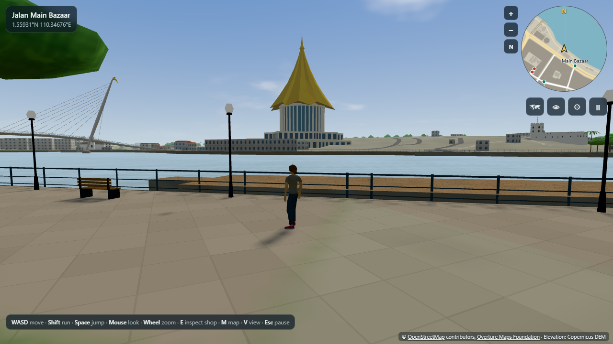
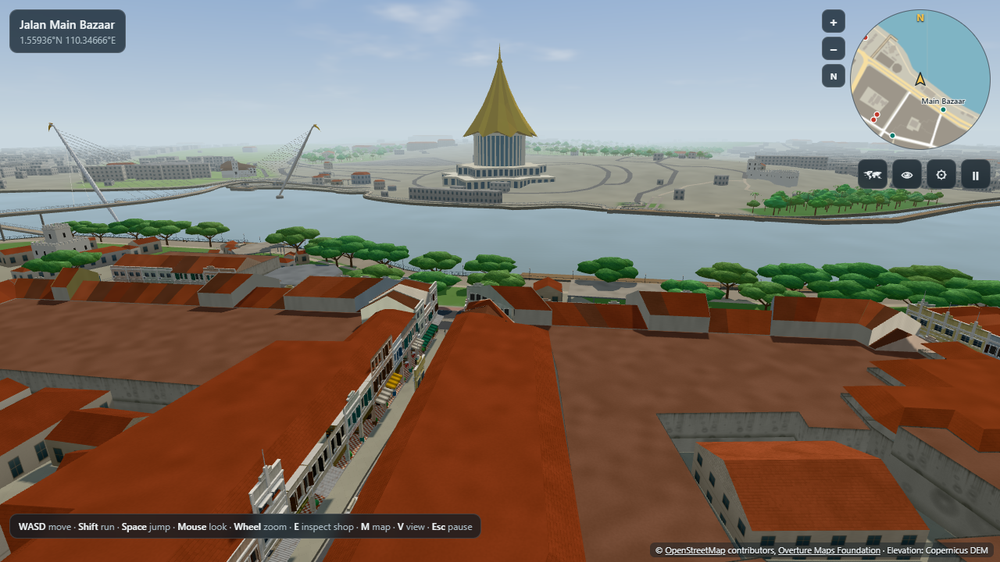
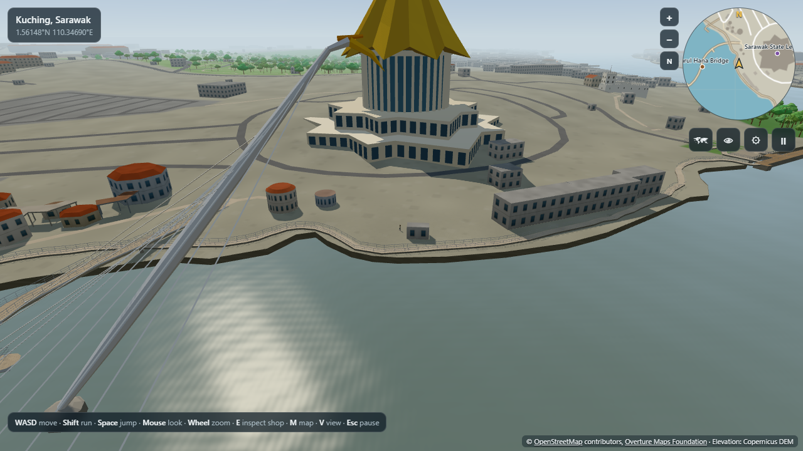

**References.**
- Wikipedia, "New Sarawak State Legislative Assembly Building": <https://en.wikipedia.org/wiki/New_Sarawak_State_Legislative_Assembly_Building>
  (9 floors; roof 114 m, tip 115 m; nine-pointed star cross-section; form modelled on a Bidayuh
  *baruk* round house; roof likened to the royal umbrella; musical fountain in front since 2018;
  99 m flagpole since 2023).
- Commons category: <https://commons.wikimedia.org/wiki/Category:New_Sarawak_State_Legislative_Assembly_Building>
- Commons file, general view (CC BY-SA 4.0): <https://commons.wikimedia.org/wiki/File:Kuching_Sarawak_Dewan-Undangan-Negeri-Sarawak-01.jpg>
- Commons file, view from the bridge (CC BY 2.0): <https://commons.wikimedia.org/wiki/File:New_Sarawak_State_Legislative_Assembly_Building_from_Darul_Hana_Bridge,_Kuching,_Sarawak_(44099618292).jpg>

**Comparison.**
- *Silhouette:* recognisable from the waterfront: a gold pointed roof over a pale drum on a
  stepped base. This is the strongest of the existing models at a distance.
- *Roof shape:* modelled as nine ridges with flat triangular facets between them and a simple
  concave profile. **[knowledge]** The real roof is a pleated umbrella: each of the nine bays is a
  curved, folded surface, the eave line scallops between nine projecting points, and the eaves
  flare outwards well beyond the drum. In game the pleats read as flat shards and the eave is a
  jagged edge. I am not certain of the real ratio of roof height to total height; in game the roof
  takes roughly half of the 114 m.
- *Facade proportions:* the drum is drawn as a narrow cylinder with dark glass strips between
  thin columns. **[knowledge]** The real tower is ringed by tall, closely spaced pale columns/fins
  over several storeys, and the building widens downwards in more than two steps. The two podium
  tiers in game are plain extrusions of the star with generic windows.
- *Height:* total height uses the published figure and looks plausible against the bridge masts.
  Tier heights and drum radius are guesses (stated in the file header).
- *Materials/colours:* gold roof and pale stone are right in kind. The roof is flat-shaded
  vertex colour with no metallic response; the real cladding is a matte gold metal **[knowledge]**.
- *Entrance:* none modelled. **[knowledge]** The real building has a ceremonial approach and
  steps on the river side.
- *Surroundings:* poor. The building stands on a bare beige plane. OSM outbuildings around it
  are generic grey boxes, one of them a long three-storey block directly between the DUN and the
  river that dominates the view from the waterfront (see `dun-street.png`).

**Incorrect or missing features.**
- Roof bays are flat facets, not curved pleats; no flared scalloped eave.
- No colonnade detail, no floor banding on the drum.
- No river-side forecourt, steps, landscaped mound, musical fountain or 99 m flagpole.
- Generic box buildings in the foreground hide the podium from the south bank.

**Verdict.** Dedicated model (registry + GLB) is warranted. The roof is a doubly curved pleated
surface and the colonnade is repetitive fine detail; both are awkward in the vertex-colour kit and
straightforward in a modelling tool. It needs a far LOD, since it is on the skyline from most of
the map. A cheaper interim step is procedural: subdivide each roof bay into a curved fold and
extend the eave.

**Verification status:** `not reference-matched (approximation)`.

---

## 2. Darul Hana Bridge - `darul-hana`

**Current representation.** `src/world/landmarks/darulHanaBridge.ts`, procedural, 4,382 triangles
across all chunks, fitted to the mapped deck ways (568501299 and four others). Deck, truss,
railings, two inclined masts with stylised hornbill heads, cable fans, pile caps. South landing is
about 100 m from spawn.

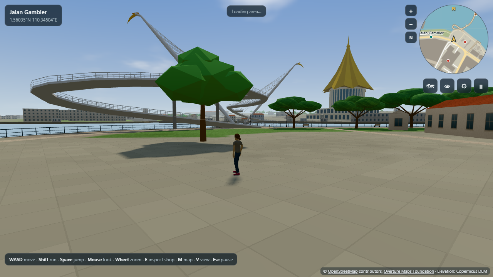
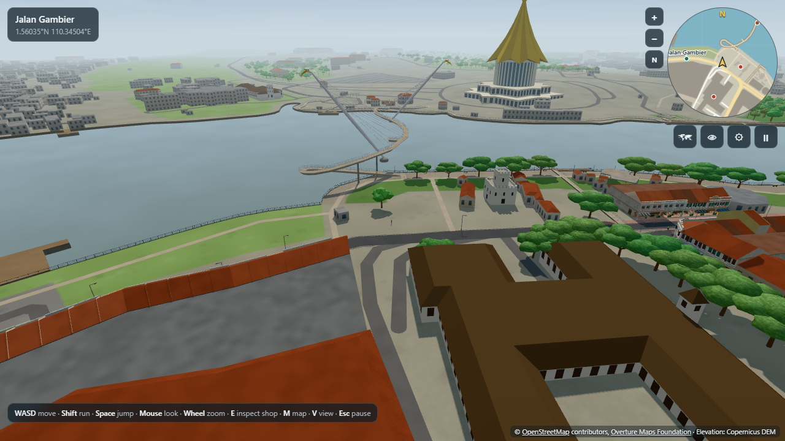

**References.**
- schlaich bergermann partner project page: <https://www.sbp.de/en/project/darul-hana-bridge/>
  (337 m with ramps, 267 m main bridge, 133 m main span, 64 m masts inclined outwards in opposite
  directions, deck 3.25 m, one-side-supported steel tube truss 1.62 m deep, precast slab walkway,
  fully locked cables).
- Wikipedia, "Darul Hana Bridge": <https://en.wikipedia.org/wiki/Darul_Hana_Bridge> (S-shaped
  deck, two viewing decks, hornbill / Bidayuh bamboo bridge references, 48 degree inclination).
  Note the infobox width "32.5 m" contradicts the engineer's 3.25 m.
- Commons category: <https://commons.wikimedia.org/wiki/Category:Darul_Hana_Bridge>
- Commons file, daylight view from the waterfront (CC BY 2.0): <https://commons.wikimedia.org/wiki/File:Darul_Hana_Bridge,_Kuching,_Sarawak.jpg>

**Comparison.**
- *Silhouette:* correct in kind: S-curved deck high over the river, two masts leaning away from
  each other, cable fans on one side of the deck. The plan curve and the spiral south ramp come
  from mapped ways.
- *Masts:* length and lean follow published numbers, with the stated ambiguity about what the
  48 degrees is measured from. The mast-head shape is the builder's own invention; I cannot say
  from text how close it is to the real finial.
- *Deck:* width matches the published 3.25 m. In the captures the deck reads as a thick grey
  slab; the real deck is a slender tube truss with the walkway on top and cables on one edge.
- *Colours:* drawn grey with a yellow-brown mast head. **[knowledge, uncertain]** I recall the
  steelwork as white or light-coloured; the engineer's page gives no colour, only the nickname
  "Golden Bridge" (the night lighting). This needs a photo check before any colour change.
- *Height:* deck about 12 m above bank level, consistent with published descriptions; the ramp
  profile is generated.
- *Surroundings:* south landing meets the promenade correctly; the north landing arrives on the
  bare plane in front of the DUN.

**Incorrect or missing features.**
- Steel colour unverified and probably too dark.
- Mast heads are stylised guesses.
- Cable count, anchor spacing and mast foot positions are estimates (feet are not mapped).
- No lighting fixtures; truss barely readable from the bank.

**Verdict.** Procedural improvements are sufficient, and are the better fit. The model is tied
to the mapped deck geometry and is split across chunks; a GLB would have to duplicate that curve
and elevation exactly to meet the walkable deck. Worth doing: colour check, a slimmer deck edge,
a mast head shaped from photos.

**Verification status:** `not reference-matched (approximation)` (dimensions are taken from
published figures; appearance has not been compared with photos).

---

## 3. Fort Margherita - `fort-margherita`

**Current representation.** `src/world/landmarks/fortMargherita.ts`, procedural, 1,216 triangles,
fitted to OSM relation 12489078 (outer wall and courtyard ring). A crenellated wall ring 6.6 m
high with window slits, and a three-storey crenellated tower placed at the point of the mapped
solid area farthest from the walls. About 370 m from spawn, across the river.

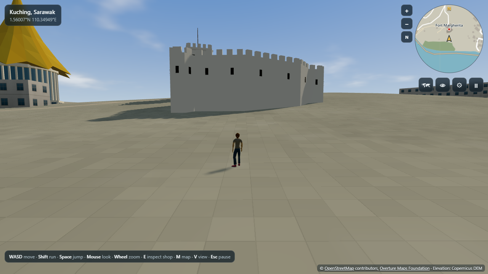
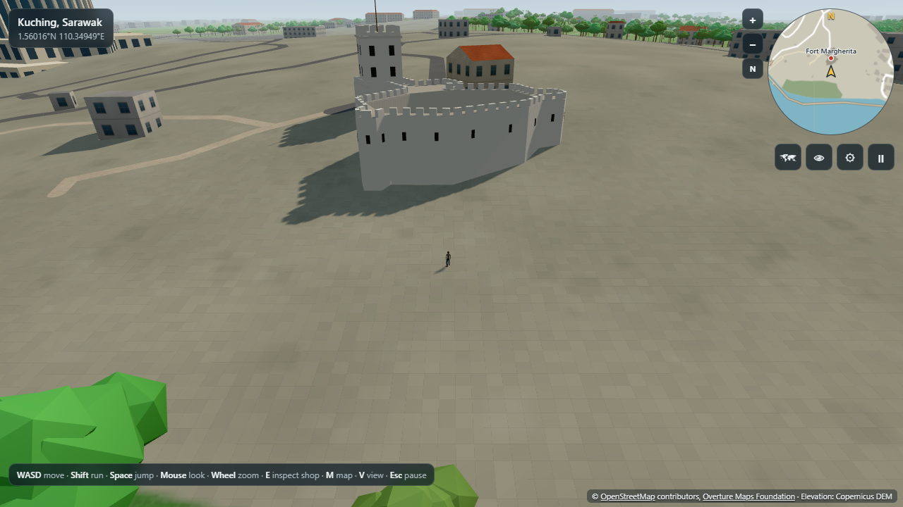

**References.**
- Wikipedia, "Fort Margherita": <https://en.wikipedia.org/wiki/Fort_Margherita> (1879, English
  castle style, three-storey tower block, courtyard enclosed by a high wall, wooden windows used
  as gun ports, on a hill overlooking the river).
- Commons category: <https://commons.wikimedia.org/wiki/Category:Fort_Margherita>
- Commons file, "The main tower of Fort Margherita" (CC BY-SA 4.0): <https://commons.wikimedia.org/wiki/File:Fort_Margherita_-_Kuching.jpg>

**Comparison.**
- *Silhouette:* a low battlemented enclosure with one taller tower is right in kind.
- *Tower:* in game it is a slim square turret standing at the north-west corner, outside the
  line of the wall. **[knowledge]** The real tower block is the main mass of the fort: a broad
  rectangular three-storey keep on the river side, with the walled courtyard behind it. The game
  has the emphasis reversed (large wall ring, small tower). The file header already says the
  tower position is a guess.
- *Walls:* in game the perimeter wall is as tall as a two-storey building, with window slits all
  round. **[knowledge, uncertain]** The courtyard wall is lower than the tower block and mostly
  blank; the shuttered openings are in the tower block.
- *Colour:* intended white, renders mid-grey. **[knowledge]** The real fort is whitewashed.
- *Entrance:* none modelled.
- *Surroundings:* wrong. Wikipedia places the fort on a hill; in game it stands on a flat bare
  plane with no lawn or trees. An unrelated OSM building is drawn as a generic house with an
  orange roof touching the fort.

**Incorrect or missing features.**
- Tower block too small and in the wrong place relative to the courtyard.
- Wall too tall and too uniform; windows on the wrong element.
- No gate, no wooden shutters, no hill, no lawn.
- Reads grey, not white.

**Verdict.** A dedicated model is the more reliable route. The key relationship (tower block
against courtyard) is not in the mapped data, so the builder cannot derive it; it has to be set
from references, which is what the registry/anchor system is for. The building is small and
simple, so the asset is cheap. The missing hill is a terrain/data issue that a model will not fix.

**Verification status:** `not reference-matched (approximation)`.

---

## 4. The Astana - `astana`

**Current representation.** `src/world/landmarks/astana.ts`, procedural, 660 triangles, fitted to
OSM way 353344429. The outline is sliced into rectangular wings with dark hipped roofs on a
plinth; a crenellated tower is placed at the short south end. About 410 m from spawn, across the
river. The grounds are not open to the public, so the real building is only seen from a distance.

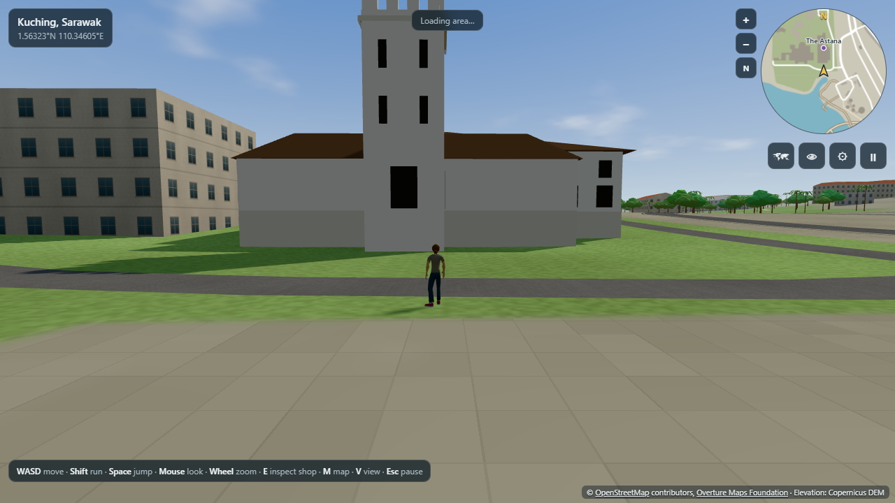
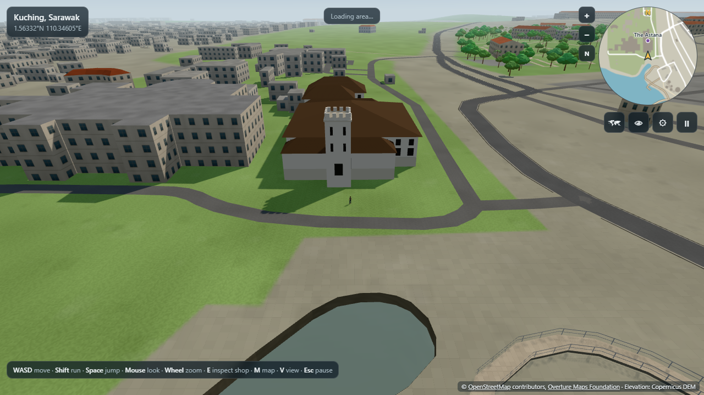

**References.**
- Wikipedia, "The Astana, Sarawak": <https://en.wikipedia.org/wiki/The_Astana,_Sarawak> (three
  separate buildings linked by short narrow passages; north bank opposite the waterfront).
- Commons category: <https://commons.wikimedia.org/wiki/Category:The_Astana,_Sarawak>
- Commons file, "Front view of the building from the Kuching Waterfront" (CC BY-SA 3.0): <https://commons.wikimedia.org/wiki/File:Astana_Sarawak.JPG>
- Commons file, 1896 view, titled "a partly castellated building" (Wellcome Collection): <https://commons.wikimedia.org/wiki/File:Kuching,_Sarawak;_the_Astana,_a_partly_castellated_building._Wellcome_V0037394.jpg>

**Comparison.**
- *Silhouette:* in game, a blank block with a tall plain tower stuck on its narrow end.
  **[knowledge]** From the waterfront the real Astana is a long, low, white frontage of linked
  bungalows with a crenellated entrance tower in the middle of that frontage. The game shows the
  narrow end to the river, so the view from the waterfront is the wrong elevation. The file header
  and `docs/LANDMARKS.md` already call the tower position the weakest part.
- I could not determine from text whether the mapped way covers the whole palace or only one
  block; the minimap shows more mapped shapes to the west that the builder does not use.
- *Roof:* dark brown hipped roofs are right in kind **[knowledge]**; exact colour unverified.
- *Facade:* walls are completely blank apart from two black rectangles; no verandah, arches,
  windows or columns. **[knowledge]** The real ground floor is arcaded/verandahed.
- *Height:* the tower is drawn about twice the eaves height; plausibility unverified.
- *Colour:* intended white, renders grey.
- *Surroundings:* wrong. Neighbouring mapped buildings in the compound are drawn as generic
  four-storey grey blocks that are larger than the palace and dominate it; the real setting is
  lawns and gardens sloping to the river with low ancillary buildings **[knowledge]**.

**Incorrect or missing features.**
- Tower on the wrong facade; frontage orientation as seen from the river is wrong.
- No verandahs, arches, windows or passages between blocks.
- Three-bungalow composition not legible.
- Neighbouring generic blocks out of scale; no gardens.

**Verdict.** Dedicated model necessary if the Astana is to be recognisable. The composition
cannot be derived from one outline. Because it is only seen from across the river, a modest
model with a good far LOD is enough; interior-side detail is wasted effort. The out-of-scale
neighbours need a data-side fix (height overrides) regardless.

**Verification status:** `not reference-matched (approximation)`.

---

## 5. Tua Pek Kong Temple - `tua-pek-kong`

**Current representation.** `src/world/landmarks/tuaPekKong.ts`, procedural, 642 triangles,
fitted to OSM way 269781302, which is the temple *plot*, not a building outline. Stone terrace
with front steps, red rear hall, open front pavilion with red columns and a two-tier roof, orange
tiled roofs with green ridges and gold finials. About 450 m from spawn.

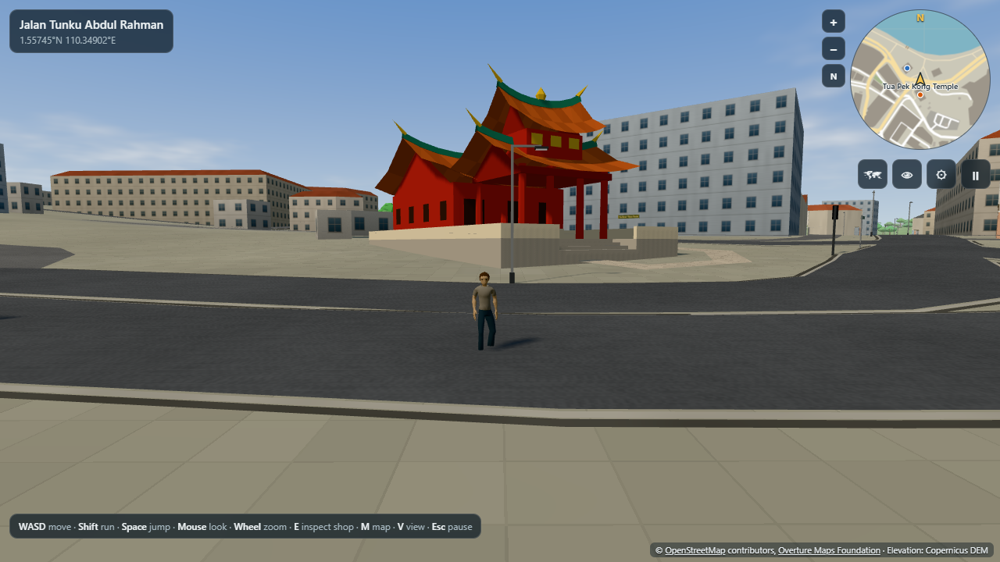
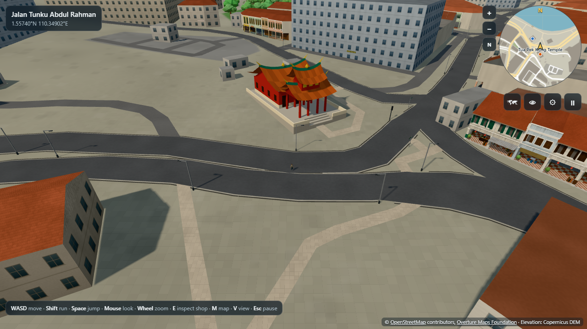

**References.**
- Wikipedia, "Tua Pek Kong Temple, Kuching": <https://en.wikipedia.org/wiki/Tua_Pek_Kong_Temple,_Kuching>
  (near the waterfront, opposite the Chinese History Museum; no architectural description).
- Commons category: <https://commons.wikimedia.org/wiki/Category:Tua_Pek_Kong_Temple,_Kuching>
- Commons file (CC BY-SA 3.0): <https://commons.wikimedia.org/wiki/File:Tua_Pek_Kong,_Kuching.jpg>
- Commons file, street view from Jalan Tunku Abdul Rahman, 2015 (CC BY-SA 2.0): <https://commons.wikimedia.org/wiki/File:Tua_Pek_Kong_Temple_(Kuching)_(40369107880).jpg>

**Comparison.**
- *Silhouette:* a small red temple with curved tiled roofs on a raised terrace reads correctly
  as "the Tua Pek Kong" from the road. Of the eight, this is the closest in general impression.
- *Roof:* two-tier front roof and upswept ridge ends are right in kind. **[knowledge]** The real
  ridges carry dense decoration (dragons, pearl, ceramic figures); in game there are four plain
  finials. Tile colour is unverified.
- *Facade:* red columns and red hall are right in kind **[knowledge]**. No signboards, door
  panels, lanterns or painted detail.
- *Terrace:* **[knowledge]** the real temple sits on a raised knoll behind a retaining wall, with
  a flight of steps up from the road junction and a forecourt with an incense burner. The game
  has a plain cream plinth about 1.5 m high with one short stair.
- *Entrance position:* front placed on the short end facing the river; consistent with
  **[knowledge]** but not checked.
- *Footprint:* the model fills the whole plot, so the hall is probably larger than the real one
  and the forecourt is missing.
- *Surroundings:* bare paving; road layout around the knoll is from OSM and looks right.

**Incorrect or missing features.**
- Ridge decoration, signboards, lanterns, incense burner, forecourt.
- Retaining wall and main stair of the knoll.
- Building size derived from the plot, not from a building outline.

**Verdict.** Procedural improvements could reach an acceptable standard, but a dedicated model
is recommended for consistency: the Hiang Thian Siang Ti temple 400 m away already has a GLB, and
parts of that kit (roof, ridge ornaments, columns) should be reusable. The terrace needs its own
collision either way.

**Verification status:** `not reference-matched (approximation)`.

---

## 6. Borneo Cultures Museum - `borneo-cultures-museum`

**Current representation.** `src/world/landmarks/borneoCulturesMuseum.ts`, procedural, 1,171
triangles, fitted to OSM way 835977956. The outline is extruded to 26 m (5 x 5.2 m), with a dark
glazed ground floor, large pyramid-shaped studs in two golds and near-black, and a shallow
striped vaulted roof. About 660 m from spawn; not visible from the waterfront.

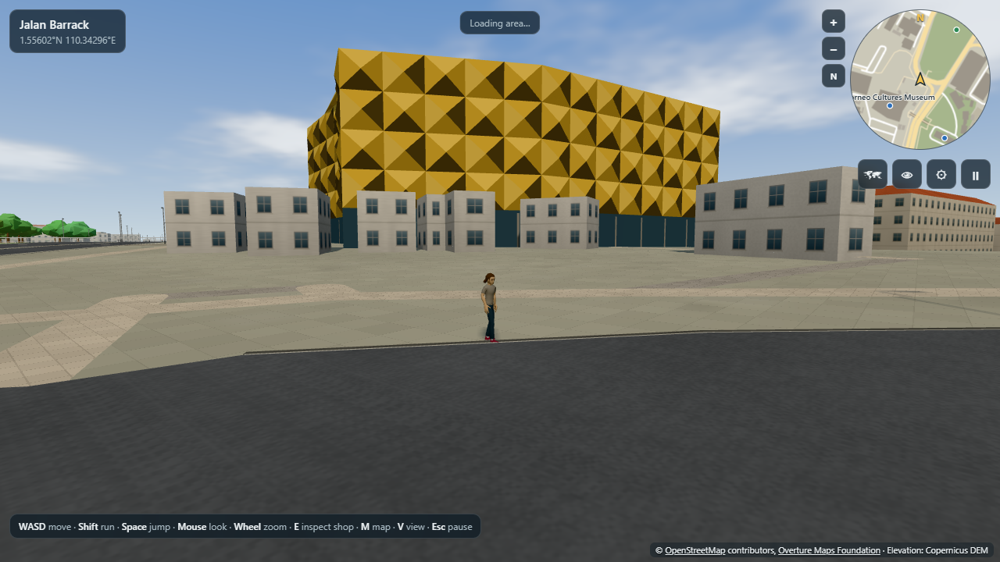
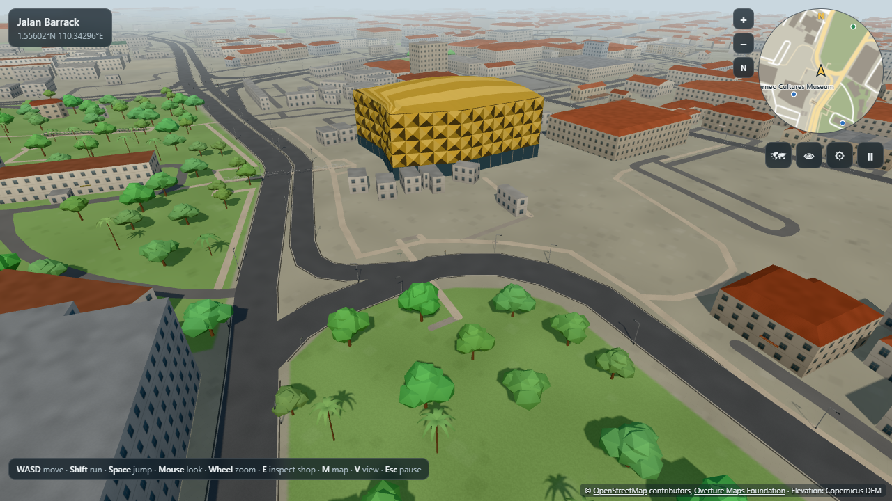

**References.**
- Wikipedia, "Borneo Cultures Museum": <https://en.wikipedia.org/wiki/Borneo_Cultures_Museum>
  (design inspired by Sarawak craft motifs and by the DUN; exhibitions on the upper four floors).
- Commons category: <https://commons.wikimedia.org/wiki/Category:Borneo_Cultures_Museum>
- Commons file, "view from the backyard garden" (CC BY-SA 4.0): <https://commons.wikimedia.org/wiki/File:Borneo_Cultures_Museum_view_from_the_backyard_garden.jpg>
- Operator: Sarawak Museum Department, <https://museum.sarawak.gov.my/>

**Comparison.**
- *Silhouette:* a large gold box with a low curved roof. **[knowledge]** The real building is a
  large gold-clad block with a curved roofline, so the mass is right in kind. I am not confident
  about the real roof form or about how the facades are articulated (recesses, glazed slots,
  entrance canopy), and the text sources do not say.
- *Facade:* the studs are about one storey tall and strongly three-dimensional, giving a quilted
  or studded look. **[knowledge]** The real cladding is a much finer pattern of metal panels that
  reads as a woven surface, not as pyramids. This is the main visible error.
- *Height:* 26 m to the eave is an estimate from five levels; unverified.
- *Colours:* gold and bronze are right in kind; the near-black triangle faces are darker than
  anything I recall on the building.
- *Entrance:* none modelled; the whole ground floor is a uniform dark band.
- *Surroundings:* several small mapped structures at the base are drawn as generic two-storey
  grey boxes pressed against the facade. Whatever they are in reality (canopies, plant, annexes),
  they are not free-standing houses.

**Incorrect or missing features.**
- Cladding pattern far too coarse and too deep.
- No entrance, no facade articulation.
- Roof form unverified.
- Stray generic boxes around the base.

**Verdict.** Probably procedural: the building is essentially a box whose identity is in its
surface, so a proper cladding texture/normal pattern on the existing extrusion plus an entrance
would fix most of what is visibly wrong. Confirm the roof and facade articulation from photos
first; if the massing turns out to be more complex than a box, switch to a dedicated model.

**Verification status:** `not reference-matched (approximation)`.

---

## 7. Kuching Waterfront structures - `waterfront` (promenade) and `square-tower`

**Current representation.**
- *Promenade:* no landmark builder. It is produced by the generic generators: paving and grass
  areas, the shoreline railing, lamp posts, benches, trees, timber jetty decks, one open shelter
  (`building=roof`: flat slab on thin posts) and small mapped kiosks/buildings drawn as generic
  boxes with gable roofs. The `waterfront` landmark entry is a label point at the west end, near
  the floating mosque.
- *Square Tower:* `src/world/landmarks/squareTower.ts`, procedural, 530 triangles, fitted to OSM
  way 817868530: crenellated two-storey square body, taller central tower, slit openings. 75 m
  from spawn.

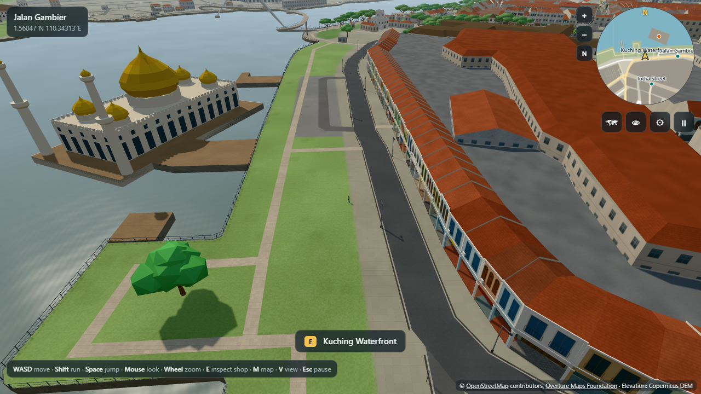
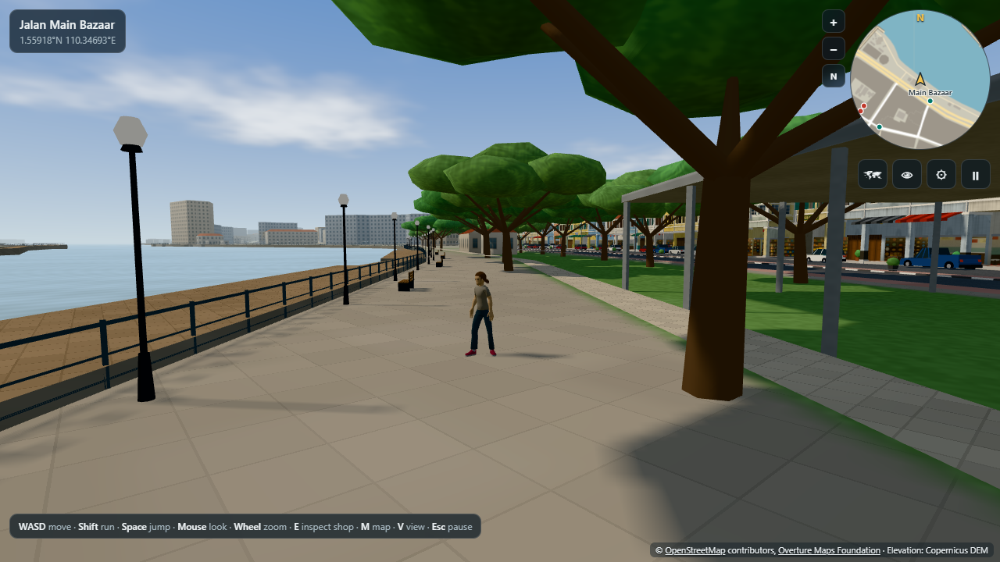
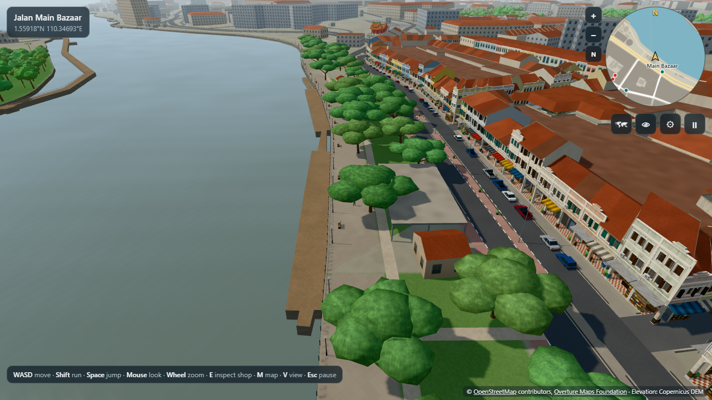
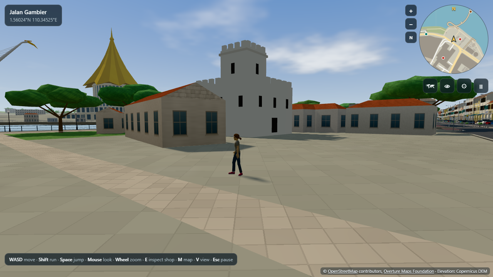
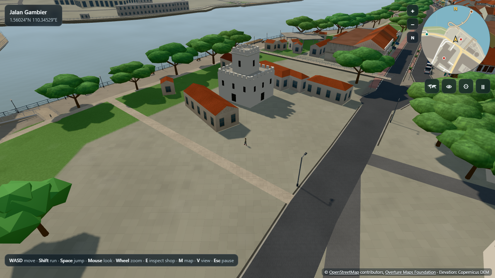

**References.**
- Wikipedia, "Kuching Waterfront": <https://en.wikipedia.org/wiki/Kuching_Waterfront> (south
  bank promenade; covered pedestrian areas, LED lighting and new landscaping added 2017-2019).
- Sarawak Tourism Board, "Kuching Waterfront": <https://sarawaktourism.com/attraction/kuching-waterfront/>
  (per a search summary: restored Chinese pavilion, musical fountains, modern sculptures). The
  page returned 404 to an automated request, so I have not read it directly.
- Commons category, waterfront: <https://commons.wikimedia.org/wiki/Category:Kuching_Waterfront>
- Commons category, Square Tower: <https://commons.wikimedia.org/wiki/Category:Square_Tower,_Kuching>
- Commons file, Square Tower (CC BY-SA 4.0): <https://commons.wikimedia.org/wiki/File:Square_Tower,_Kuching.jpg>
- Asia for Visitors, Square Tower: <https://asiaforvisitors.com/malaysia/sarawak/kuching/square-tower>

**Comparison - promenade.**
- *Right:* the line of the bank, the continuous railing, regular lamp posts, shade trees, timber
  jetties and the relationship to the Main Bazaar shophouses all come from mapped data and give a
  correct general layout.
- *Wrong or missing:* everything that makes the promenade specific. Sources name a Chinese
  pavilion, musical fountains, sculptures and covered walkways; none of these exists in game.
  **[knowledge]** There are also food kiosks of a consistent design, an open-air stage/amphitheatre
  area, patterned paving and tambang (ferry) landings. In game the kiosks are generic boxes with
  windows and tiled gable roofs, and the paving is one uniform tile.
- The shelter at the spawn is a flat slab on posts; its real form is unverified.

**Comparison - Square Tower.**
- *Silhouette:* a small crenellated square block with a higher central tower is right in kind
  **[knowledge]**. This is a reasonable stand-in.
- *Facade:* openings are black slits and one black door. **[knowledge]** The real tower has an
  arched entrance and regular window openings; details unverified.
- *Colour:* intended white, renders grey in most views.
- *Surroundings:* the tower is hemmed in by generic gable-roofed sheds (mapped neighbours) that
  are the same height as its lower storey and hide it from the promenade side.

**Incorrect or missing features.**
- Chinese pavilion, musical fountain, sculptures, covered walkways, stage area.
- Kiosk design, paving pattern, ferry landings.
- Square Tower entrance arch and window detail; neighbouring sheds out of character.

**Verdict.** Mixed. The promenade itself should stay procedural (it is long, data-driven and
mostly street furniture); what it needs is a small set of placed props/pavilions, which could be
GLBs placed through the registry. The Square Tower is small and close to the spawn; a dedicated
model is cheap and is the first building a new player sees, but the present builder is not
badly wrong and a procedural tidy-up (white that reads white, arched door, windows) would also do.

**Verification status:** promenade `not reference-matched (approximation)`; Square Tower
`not reference-matched (approximation)`.

---

## 8. Carpenter Street Harmony Arch - not a registered landmark

**Current representation.** OSM way 1388134059 (`man_made=ceremonial_gate`, `building=yes`) is in
chunk `0_-1` as an ordinary building: footprint about 4.7 m x 11.3 m, height 6.5 m, 2 storeys,
kind 0. `src/world/BuildingBuilder.ts` draws it as a closed grey two-storey box with rows of
windows and a tiled roof edge. It stands across the west end of Jalan Carpenter. No triangle
count is reported because it is not a landmark mesh. About 185 m from spawn and at the entrance
to the rebuilt Carpenter Street district.

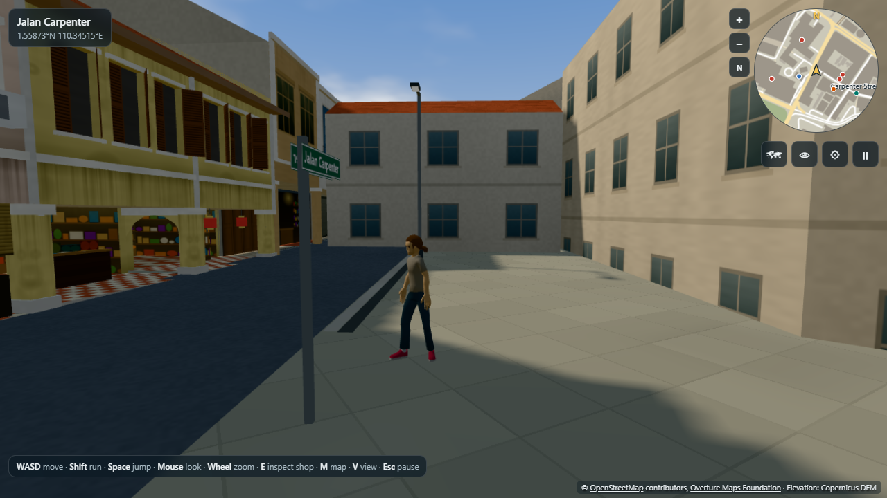
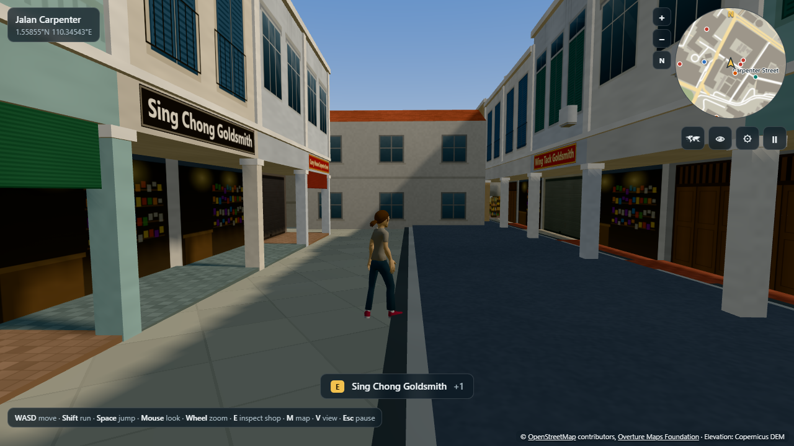
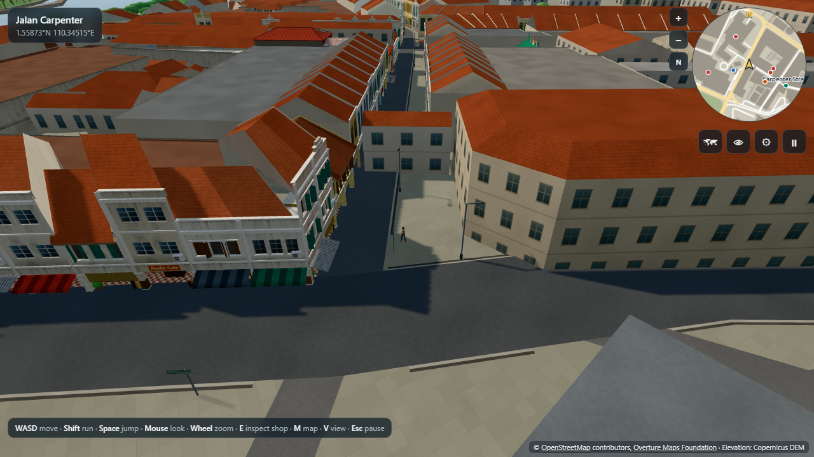

**Confirmed in game:** the gate is a solid box with windows that closes the end of the street
(visible at the end of the street in `harmony-arch-east.png`, and as the grey block between the
shophouse rows in the aerial). Buildings collide by footprint, so it very likely blocks walking
into Carpenter Street from the west; I did not test collision by walking into it.

**References.**
- The Star, 28 Sep 2017, "Harmony Arch signboard reinstalled at Carpenter Street": <https://www.thestar.com.my/metro/metro-news/2017/09/28/harmony-arch-signboard-reinstalled-at-carpenter-street>
  (signboard, 10th anniversary; no physical description).
- Commons category, Carpenter Street: <https://commons.wikimedia.org/wiki/Category:Carpenter_Street,_Kuching>
  (no dedicated Harmony Arch category was found; photos of the arch, if any, will be here).
- Asia for Visitors, Carpenter Street: <https://asiaforvisitors.com/malaysia/sarawak/kuching/carpenter-street>
- Search summaries (not read directly) describe it as an ornate Chinese-style red archway marking
  the entrance to Chinatown, launched in March 2007.

**Comparison.**
- *Silhouette:* wrong in every respect. **[knowledge]** The real structure is an open Chinese
  gateway (paifang) spanning the carriageway: columns either side, a tiled multi-tier roof with
  upturned ends, a name board (亲善门) in the middle. Traffic and pedestrians pass under it.
  Colours beyond "red" are unverified.
- *Height and proportions:* the mapped footprint (about 11 m across the street, under 5 m deep)
  is plausible for the span and depth of a gate; 6.5 m is a generic default.
- *Entrance/relationship to surroundings:* the game turns the district's entrance into a dead end.

**Incorrect or missing features.**
- It is drawn as a building, not a gate: no opening, windows where there are none.
- No columns, roof tiers, name board or colour.
- Collision should be two column bases, not the whole footprint.

**Verdict.** Dedicated model with a registry entry is necessary. The generic generator cannot
produce an open gate, and the site needs its own collision. The asset is small and sits beside
the two sites already rebuilt with the registry system. As an immediate stop-gap the data
pipeline could exclude `man_made=ceremonial_gate` from building generation.

**Verification status:** `not reference-matched (approximation)` (strictly: not modelled).

---

## Other sites noticed

Not part of the eight; one capture each, same caveats.

- **Old Courthouse** (`oldCourthouse.ts`, 508 triangles, 165 m from spawn).
  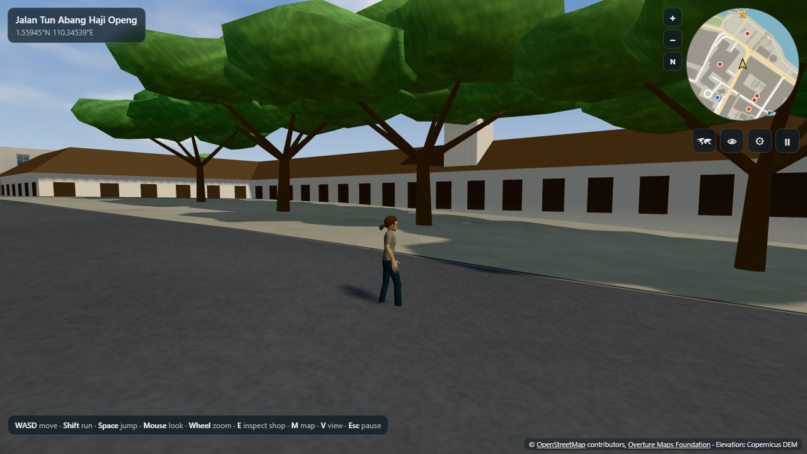
  Long white single-storey ranges with dark roofs and regular dark openings read correctly in
  kind. Roofs are truncated hips with flat tops (the header says so; real roofs have ridges).
  The clock tower is a plain cream box at the middle of the longest wall; its real position and
  form are unverified, and **[knowledge]** the real one stands over a colonnaded front portico.
  No columns are modelled, only rectangular holes. References:
  <https://en.wikipedia.org/wiki/Kuching_Old_Courthouse>,
  <https://commons.wikimedia.org/wiki/Category:Old_Court_House,_Kuching>.
  Status: `not reference-matched (approximation)`.
- **Masjid India / floating mosque** (`floatingMosque.ts`, 2,376 triangles, 310 m from spawn).
  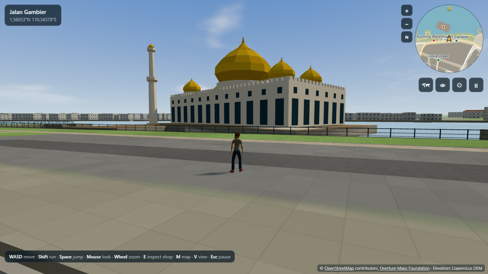
  Cream crenellated box with tall dark openings, one large and four small gold onion domes, two
  minarets, on a platform at the river edge. Plausible in kind; `docs/LANDMARKS.md` records that
  no dimensional source was found, and I found no Commons category for it. Dome count, minaret
  count and facade are unverified. Status: `not reference-matched (approximation)`.
- **Generic neighbours.** At the DUN, Astana, Fort Margherita, Square Tower and the museum, the
  worst visual damage is done by adjacent mapped structures drawn as generic grey boxes. Fixing
  heights/kinds for a handful of OSM ids would improve five sites without any new model.
- **White renders grey.** See the note under "Method and limits".

---

## Proposed priority sequence

Ranked by visibility from the waterfront spawn, how wrong the current model is, and effort.

1. **Harmony Arch** - not visible from spawn, but it is functionally wrong (a box that closes the
   entrance to the rebuilt Carpenter Street district) and is the smallest asset on the list.
2. **DUN** - the dominant object in the spawn view; recognisable but coarse (faceted roof, no
   colonnade, bare setting); dedicated model with far LOD, medium to high effort.
3. **Generic-neighbour and white-material fixes** - data and material changes only; improves the
   DUN, Astana, fort, Square Tower and museum views at low effort before any modelling.
4. **Waterfront promenade props and Square Tower** - where the player starts; the tower is
   acceptable in kind, the promenade lacks every named feature; low effort per item.
5. **Darul Hana Bridge** - very visible and already the best match in kind; procedural colour
   and mast-head corrections after a photo check, low effort.
6. **Old Courthouse** - large, 165 m from spawn, on the way to Carpenter Street; flat-topped
   roofs and a placeholder clock tower; medium effort, could remain procedural with real ridges.
7. **Fort Margherita** - visible across the river but small on screen; tower/courtyard
   relationship is wrong; small dedicated model, low to medium effort.
8. **The Astana** - visible across the river at 400 m; wrong elevation faces the river and the
   walls are blank; dedicated model needed, medium effort, far-LOD quality is enough.
9. **Tua Pek Kong Temple** - not visible from spawn; the best general impression of the eight;
   dedicated model for consistency with the other temple, medium effort, kit reuse likely.
10. **Borneo Cultures Museum** - farthest from spawn and not on the river; main error is surface
    pattern scale; texture work on the existing box, low to medium effort.
11. **Floating mosque** - plausible in kind, no reliable reference found yet; defer until
    references exist.

## Summary table

| Site | Drawn by | Triangles | Recommended route | Status |
| --- | --- | --- | --- | --- |
| DUN | `dun.ts` | 1,101 | dedicated model | not reference-matched (approximation) |
| Darul Hana Bridge | `darulHanaBridge.ts` | 4,382 | procedural improvements | not reference-matched (approximation) |
| Fort Margherita | `fortMargherita.ts` | 1,216 | dedicated model (small) | not reference-matched (approximation) |
| The Astana | `astana.ts` | 660 | dedicated model | not reference-matched (approximation) |
| Tua Pek Kong Temple | `tuaPekKong.ts` | 642 | dedicated model (procedural possible) | not reference-matched (approximation) |
| Borneo Cultures Museum | `borneoCulturesMuseum.ts` | 1,171 | procedural / texture, pending photo check | not reference-matched (approximation) |
| Waterfront promenade | generic generators | n/a | procedural plus placed props | not reference-matched (approximation) |
| Square Tower | `squareTower.ts` | 530 | either; small dedicated model | not reference-matched (approximation) |
| Harmony Arch | `BuildingBuilder.ts` (generic box) | n/a | dedicated model + registry entry | not reference-matched (approximation) |
