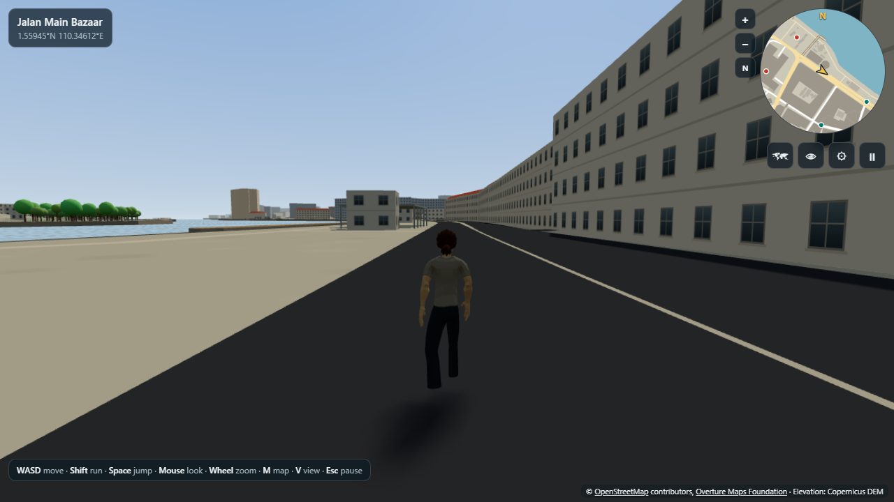
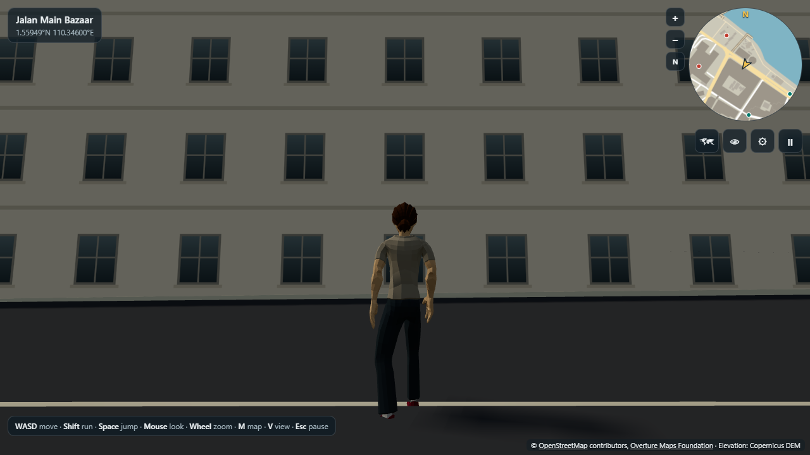
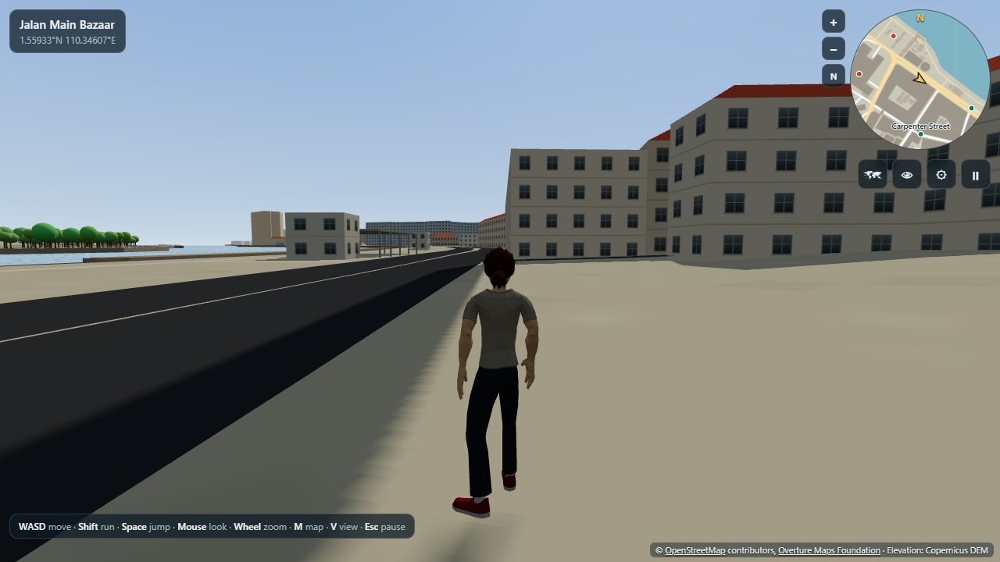
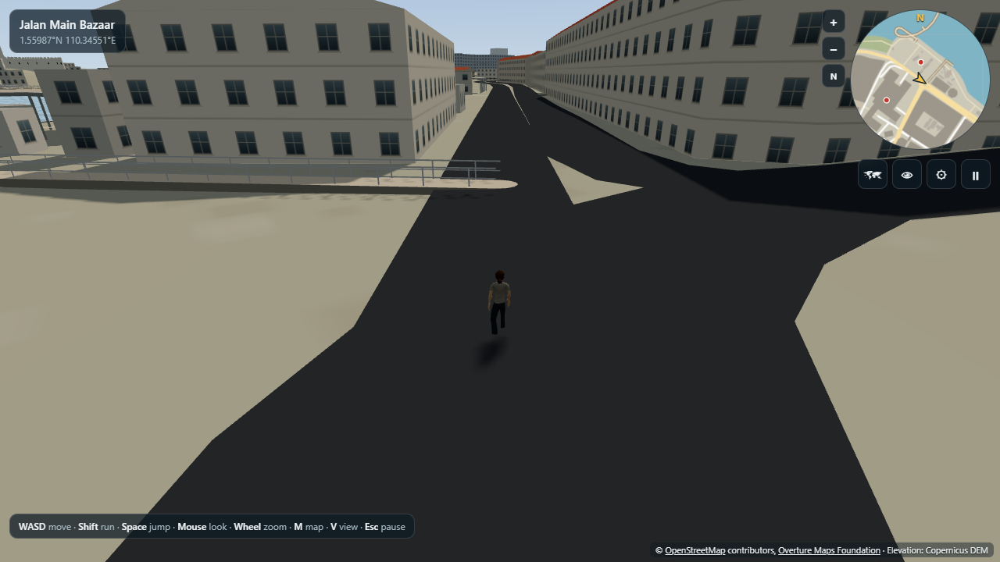
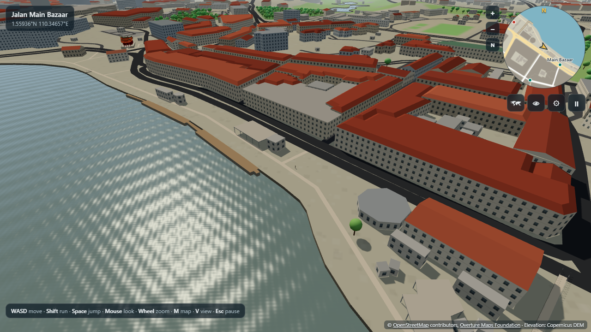

# Kuching 3D V2: visual realism, shop identity, gameplay feel

Scope of this phase: one vertical slice, the Kuching Waterfront and Jalan Main Bazaar, raised to a
higher standard, with the systems built so the rest of the old town inherits them. Nothing was
rewritten: the renderer (Three.js r170, WebGL2), the chunk format, the coordinate system and every
mapped outline are unchanged. Geographic validation still passes 11 of 11 checks.

Committed on branch `v2-visual-realism` at the owner's request; not pushed, not deployed. Driving is not implemented.

## 1. Audit of V1: why it looked generic

Screenshots of V1 at six fixed viewpoints are in `docs/screenshots/v2/before/`.

Caused by **source-data gaps** (OpenStreetMap for this area):

| # | Finding | Evidence |
|---|---|---|
| D1 | Old-town blocks are mapped as one outline per block, with no levels, type or lot lines | 51 of 3,603 OSM buildings have `building:levels`, 3 have `height`; Main Bazaar rows are `building=yes` |
| D2 | No shop data was being fetched at all | V1's Overpass query took only tourism / historic / place-of-worship nodes; OSM actually holds 1,403 named places here |
| D3 | No sidewalks, street lamps, crossings or trees worth the name | 0 km mapped sidewalk, 1 street lamp, 19 trees, 21 crossings |
| D4 | Road widths are class defaults | 6 of 7,310 ways carry a width |

Caused by **rendering, geometry and gameplay**:

| # | Finding |
|---|---|
| R1 | Unknown-height blocks defaulted to 10 to 12 m and were textured with a 3.3 m storey grid, so two-storey shophouse rows rendered as four-storey office slabs |
| R2 | One window texture, one beige palette, no ground-floor treatment: no five-foot way, columns, shopfronts, signs |
| R3 | Flat single-colour ground, near-black roads, no kerbs; all materials untextured Lambert |
| R4 | Roofs: one terracotta cap over a whole block |
| R5 | ACES tone mapping greyed colours; linear fog; plain gradient sky; sun direction left the river-facing fronts in shade; water moire in the distance |
| R6 | Character snapped to full speed (14 m/s^2), turned at one rate, camera rigidly locked to the character with instant boom pops; no audio |

## 2. What was studied from Abyssal Garden

The repository's `prompt.txt`, `README.md`, `quality.js` and `dev.js` were read in full and the
shaders skimmed (the Reddit thread blocked automated access and was not read). It is a hand-written
WebGPU renderer; porting to it would mean rewriting a working streaming city renderer for no
geographic gain, so the Three.js renderer was kept and its **discipline** was borrowed instead:

| Technique there | Adopted here |
|---|---|
| Six fixed camera poses and a blind critic that sees only renders | `tools/dev/v2-views.json`, `docs/screenshots/v2/`, independent reviewer (section 6) |
| Scripted 60 s fly-through reporting average / p99 / max with resolution locked | `tools/dev/traverse.ts` (section 5) |
| Exponential fog with distance fade instead of a hard cut | exponential-squared haze matched to the horizon colour |
| Per-vertex ambient occlusion and hemispheric ambient | darker wall feet, shaded arcade ceilings and shopfronts, hemisphere light |
| One procedural detail texture, no downloads | world-space procedural detail in every material, canvas-painted facade atlas |
| Instance / batch everything, cull per cell | one merged mesh per layer per chunk (unchanged principle), signs in one atlas per chunk |

Not adopted: the baked 3D AO volume, ray-marched light shafts, a one-time shadow bake (chunks
stream), HDR post chain with bloom (cost without street-level benefit on mid-range phones).

## 3. What changed

Details and the mapped-versus-inferred breakdown are in `STREETSCAPE.md` and `SHOP_IDENTITY.md`.

**Architecture.** 122 old-town blocks are now shophouse rows generated on their real outlines:
street-facing walls are detected from the mapped streets, split into about 5 m lots, and each lot
gets a deterministic colour, upper-storey style and shopfront. Every row has a walkable five-foot
way (the collision outline is recessed by the same function that draws it), columns, fascia,
cornices, pilasters, blinds and air-conditioner units, and a ridge roof parallel to the street.
Heights dropped from 10 to 12 m to an estimated 8.2 m.

**Shop identity.** New data pipeline (OSM named POIs, optional Overture Places, owner overrides)
with stable ids, source, source date and verification state. 3,929 places, 743 facade signs,
association by geometric evidence only. Press **E** near a shop to inspect it and open it in Google
Maps. `?admin=1` turns the panel into a correction editor that exports an overrides file.

**Light and materials.** Neutral tone mapping, mid-morning sun that lights the river-facing fronts,
texel-snapped soft shadows, exponential haze, analytic sky with drifting clouds, Day / Evening
setting, procedural asphalt, paving, plaster, clay tile and turf, kerbs and roadside drains,
distance-faded water ripples.

**Street level.** 109 mapped traffic signals, 1,600 street-name plates at mapped junctions, mapped
benches and bollards, procedurally spaced lamp posts, 5 km of promenade railing along the mapped
river bank, broad-canopy trees and palms.

**Gameplay.** Eased acceleration and stopping, speed-dependent turning, walk 1.6 m/s and run
5.2 m/s (was 2.0 and 6.0), spring-damped follow camera with look-ahead, over-the-shoulder framing,
speed-dependent field of view, auto-centring after 1.4 s without look input, three-ray boom
collision that eases instead of popping and centres the camera in narrow five-foot ways, synthesised footstep and landing audio (paving / timber
deck). The existing distance-driven walk / run animation blending was already sound and was kept.

**Future driving.** `CameraTarget` interface, speed-scaled chunk look-ahead and build budget, and a
written integration plan (`VEHICLES.md`).

## 4. Before / after

Same camera, same build pipeline, production builds of both versions (`docs/screenshots/v2/`).

| View | Before | After |
|---|---|---|
| 1 Waterfront |  |  |
| 2 Main Bazaar |  |  |
| 3 Shophouse facade |  |  |
| 4 Five-foot way |  |  |
| 5 Junction |  |  |
| 6 Overview |  |  |

Also: `after/08-place-panel.png` (inspect), `after/09-evening-main-bazaar.png`,
`after/10-admin-editor.png`, `after/11-admin-sign-updated.png`.

In view 4 the "before" camera is inside the building: V1 had no five-foot way, so the same
coordinates are solid wall there.

The signs in view 3 (Little Borneo, Winnie's Cafe, Kuching Waterfront Lodge) are OSM records on
Jalan Main Bazaar; "Little Borneo" carries the mapped address 12 Jalan Main Bazaar.

## 5. Performance (measured)

Method: `tools/dev/traverse.ts`, a scripted 60 s run along Jalan Main Bazaar, Lebuh Wayang and
Jalan Ewe Hai, on production builds of both versions served locally, adaptive resolution off.
Machine: 13th Gen Intel(R) Core(TM) i5-13420H, Intel(R) UHD Graphics (0x0000A7A8) Direct3D11 vs_5_0 ps_5_0 (integrated), 16 GB, system Edge
with GPU acceleration (ANGLE / Direct3D 11). GPU time comes from `EXT_disjoint_timer_query_webgl2`
around each render call; CPU time is the whole animation-frame callback. Raw data:
`docs/perf-v2.json`. All cells are **before -> after**.

**Limits of this measurement.** One machine with an integrated GPU. The "mobile" row is a phone-sized
viewport emulated on that desktop GPU: no physical phone was tested, so phone performance is
**not validated**. No discrete-GPU desktop was tested either.

### Frame pacing, vsync on (what a player sees; capped at 60)

| Session | Avg fps | 1 % low fps | p99 frame ms | Max frame ms | Frames > 33 ms | Frames > 50 ms |
|---|---|---|---|---|---|---|
| Desktop 1080p High | 59.8 -> 51.7 | 33.7 -> 25.8 | 24.7 -> 30.3 | 43.9 -> 77.8 | 9 -> 20 | 0 -> 3 |
| Desktop 1080p Medium | 59.9 -> 59.5 | 37.5 -> 33.3 | 22.1 -> 23.7 | 64 -> 137.1 | 2 -> 3 | 1 -> 1 |
| Mobile viewport 390x844 @3x, Low | 59.9 -> 59.9 | 37.8 -> 42.2 | 21.3 -> 18.8 | 81.2 -> 87.8 | 4 -> 4 | 1 -> 1 |

### Cost per frame, vsync on

| Session | CPU ms avg | CPU ms p99 | GPU ms avg | GPU ms p99 | Draw calls avg / max | Triangles avg | JS heap peak MB |
|---|---|---|---|---|---|---|---|
| Desktop 1080p High | 6.64 -> 7.2 | 13.2 -> 14.4 | 7.05 -> 14.09 | 9.46 -> 21.05 | 206 / 236 -> 261 / 300 | 95148 -> 157093 | 47.8 -> 70.2 |
| Desktop 1080p Medium | 4.39 -> 4.71 | 9 -> 9.3 | 6.06 -> 9.98 | 8.68 -> 17.21 | 100 / 123 -> 125 / 154 | 40364 -> 79243 | 37.3 -> 45.4 |
| Mobile viewport 390x844 @3x, Low | 2.55 -> 2.81 | 6.2 -> 5.1 | 1.42 -> 2.98 | 1.69 -> 3.3 | 53 / 67 -> 69 / 82 | 20627 -> 53621 | 24.6 -> 33.1 |

### Throughput, vsync off (uncapped)

| Session | Avg fps | Avg frame ms | CPU ms avg | GPU ms avg |
|---|---|---|---|---|
| Desktop 1080p High | 81.8 -> 74.4 | 12.22 -> 13.44 | 9.87 -> 11.45 | 7.87 -> 11.33 |
| Desktop 1080p Medium | 120.6 -> 89.6 | 8.29 -> 11.16 | 6.18 -> 9.08 | 5.75 -> 9.57 |
| Mobile viewport 390x844 @3x, Low | 304.4 -> 270 | 3.29 -> 3.7 | 2.14 -> 2.61 | 1.06 -> 1.67 |

Uncapped percentiles are not reported as results: on this GPU both versions stall for 200 to
500 ms inside `renderer.render` every half second or so when the frame rate is uncapped
(`tools/dev/hitch-diag.ts`: 53 slow frames in 15 s before, 52 after, none coinciding with a chunk
build). That is a property of the uncapped test mode here, not of either build.

### Loading and streaming (vsync-on runs)

| Session | Time to playable s | Initial requests | Initial download MB (uncompressed) | Transferred MB (local server, no compression) | Max chunk build ms | Frames blocked on an unloaded chunk |
|---|---|---|---|---|---|---|
| Desktop 1080p High | 3.3 -> 6.6 | 106 -> 187 | 2.60 -> 3.09 | 1.31 -> 1.50 | 32.3 -> 87.3 | 0 -> 0 |
| Desktop 1080p Medium | 1.0 -> 4.5 | 46 -> 78 | 1.89 -> 2.17 | 1.06 -> 1.16 | 29.9 -> 72.2 | 0 -> 0 |
| Mobile viewport 390x844 @3x, Low | 1.0 -> 3.3 | 30 -> 49 | 1.69 -> 1.90 | 0.98 -> 1.06 | 28.2 -> 76.9 | 0 -> 0 |

No frame in any run was blocked waiting for a chunk, and no chunk pop-in at the player's position
was recorded. Visible streaming artifact that remains: a high-detail chunk now appears in two
steps one frame apart (geometry, then trees / furniture / signs), which is how the per-frame build
cost was kept down.

Distance covered in 60 s fell from 358 m to 310 m because the run speed was deliberately lowered
(6.0 to 5.2 m/s).

### Size (gzip, computed from the build output)

| | Before | After |
|---|---|---|
| Core application (HTML + CSS + JS, excluding data and the character model) | 207 KB | 224 KB |
| All map data | 2.27 MB | 2.71 MB |
| of which chunk files (513) | 1.84 MB | 1.93 MB |
| of which place files (370) | none | 348 KB |

Targets: core under 1 MB compressed: **met** (224 KB gzip). Initial playable download under
10 MB: **met** (see table; about 2 to 3 MB uncompressed depending on quality). No facade or
street texture is downloaded; all of them are generated in the browser.

### Reading the result

- **Medium (the default) and Low are at parity** with V1 in frame pacing.
- **High is slower on this integrated GPU**: about 52 fps average instead of 60, with GPU time
  roughly doubled. The cost is fragment work at 1080p (shadowed, procedurally detailed surfaces)
  plus more geometry. With adaptive resolution on (the default) the renderer lowers the internal
  resolution to hold frame rate; that behaviour was not benchmarked.
- Changes made after the first measurement, because it showed a regression: tree canopies cut from
  400 to 100 triangles, chunk decoration moved to a second frame, level-of-detail hysteresis,
  shadow map refreshed every other frame, cheaper ground and asphalt shaders. Before those, High
  was 49.6 fps with 169 frames over 33 ms, and Medium 57 fps with 100.
- CPU cost per frame is up slightly; JS heap peak is higher (place data, sign canvases, facade
  atlas).

## 6. Independent visual review

A separate reviewer agent was given only the twelve screenshots and asked to compare them with
freely licensed photographs on Wikimedia Commons (it reached Commons and viewed a five-foot-way
photo at full size plus about 30 waterfront thumbnails; it noted Commons has no good modern
street-wide Main Bazaar facade photo). It had no access to code, docs or reasoning.

First-pass verdict: every viewpoint better than V1 (view 3 "much better"), overall **"partly"**
recognisable: "the nearest facades read as a generic Straits shophouse row, but not specifically
Main Bazaar".

| Reviewer defect | Severity | Outcome |
|---|---|---|
| Beige grid-window block left on Main Bazaar among the shophouses | critical | **Fixed.** It was a three-storey row OSM names "328 Gallery Sdn. Bhd."; business-named rows are now classified and tagged levels are honoured |
| Camera clips into door and column in the five-foot way | critical | **Reduced.** The shoulder offset now yields to nearby walls; columns still do not block the camera |
| Evening: building side near-black | major | **Fixed** (ambient raised). Lamp heads still do not cast light |
| Two signs stacked on one bay | major | **Fixed**: one sign per lot |
| Roofs one long strip, no per-lot form | major | **Improved**: party walls at every lot boundary; air wells still absent (not mapped) |
| Lamp posts highway scale; columns and ground storey heavy | major | **Fixed**: lamps 6.2 m, columns 0.36 m, beam 3.0 m |
| Lane / kerb line across the carriageway | major | **Fixed**: kerbs are clipped wherever another carriageway lies under them |
| Storefronts repeat two textures | major | **Improved**: per-lot shutter / door paint; still only three shopfront types |
| Ceiling flat dark green; AC boxes intersect cornice | minor | **Fixed** |
| Waterfront sterile: no trees, kiosks, sculptures, ornate railing | major | **Open.** None of these are mapped; they need a hand-authored waterfront pass |
| No vehicles, vendors, merchandise, awnings, Chinese-character signs | major | **Open.** Not in the data; signs show whatever script the source name uses |
| Far bank bare; landmarks not in frame | major | View 1 now faces the mapped Darul Hana Bridge; far-bank kampung detail is **open** |
| Facades too clean and uniform in height | major | **Open** (no per-building height or condition data) |
| River flat, jetty reads as a plank | minor | **Open** |

Remaining honest assessment: the slice now reads as a Kuching-style shophouse street with real
shop names in the right places, on the correct street geometry. It is not yet a photographic
match for Main Bazaar; the gap is mostly un-mapped street life and per-building individuality.

## 7. Tests

| Suite | Result |
|---|---|
| Unit (`npm test`) | 26 passed, 0 failed (9 new: frontage geometry, deterministic styling, association rules, invariants over the generated rows and place files) |
| End-to-end (`npm run test:e2e`, system Edge with GPU; desktop 1920, laptop 1366, mobile 390 and 360) | 16 passed, 0 failed |
| Geographic validation (`npm run data:validate`) | 11 of 11 checks passed after the streetscape pass (road, building and water vertices within 7.1 mm of source) |
| Type check (`npm run typecheck`) | clean |
| Production build (`npm run build`) | succeeds |
| Interaction script (`tools/dev/v2-extra.ts`) | inspect prompt, panel, Google Maps link, Escape closes without pausing, admin correction rebuilds the sign |

Test changes: walking / running speed expectations in `gameplay.spec.ts` and `touch.spec.ts` follow
the new pacing, and the 1.7 km streaming run has a longer time budget for the slower run speed.

Environment note: on this machine another process holds port 3000, and the Vite dev server points
its hot-reload socket there, which makes every e2e test that asserts a clean console fail. Run
the suite with `PUBLIC_PORT=5174 npm run test:e2e` in that situation (this is how the result above
was obtained). It is unrelated to V2.

Not tested: a physical phone, a discrete-GPU desktop, Safari / Firefox, slow networks.


## 8. Files

New: `src/world/arch/{frontage,Shophouse,FacadeAtlas}.ts`, `src/world/StreetFurniture.ts`,
`src/world/places/{types,associate,Labels,PlaceIndex}.ts`, `src/ui/PlacePanel.ts`,
`src/player/Footsteps.ts`, `tools/extract-map-data/fetch-pois.ts`,
`tools/generate-world/{build-streetscape,build-places}.ts`, `tools/dev/{traverse,v2-extra,build-profile,hitch-diag,gpu-probe}.ts`,
`tools/dev/v2-views.json`, `tests/unit/streetscape.test.ts`, `data/places-overrides.json`,
`docs/{V2_REPORT,STREETSCAPE,SHOP_IDENTITY,VEHICLES}.md`, `docs/perf-v2.json`,
`docs/screenshots/v2/`, `public/data/kuching/places/`, `public/data/kuching/streetscape-report.json`.

Changed: `src/main.ts`, `src/world/{WorldManager,Materials,ChunkManager,BuildingBuilder,RoadBuilder,TerrainBuilder,VegetationBuilder,CollisionWorld,types}.ts`,
`src/player/{PlayerController,ThirdPersonCamera,Input}.ts`, `src/ui/GameMenu.ts`,
`src/styles/main.css`, `index.html`, `package.json`, `tests/e2e/{gameplay,touch}.spec.ts` (speed
expectations follow the new pacing), `README.md`, `docs/{ARCHITECTURE,GEOGRAPHIC_SOURCES,LIMITATIONS}.md`,
and all 513 chunk files (annotations added; mapped coordinates unchanged, verified by
`npm run data:validate`).

## 9. Build and run

```bash
npm install
npm run dev            # development, http://localhost:3000
npm run build          # production bundle in dist/ (static; wrangler.jsonc serves it on Cloudflare Workers)
npm run preview        # serve dist/ locally
npm run data:build     # regenerate chunks + streetscape + graph + places from the cached sources
npm run data:places    # after editing data/places-overrides.json
npm test               # unit tests
npm run test:e2e       # browser tests (system Edge, GPU)
node tools/dev/traverse.ts <label> --url=http://localhost:4173/    # 60 s benchmark
```

Nothing was pushed or deployed.
