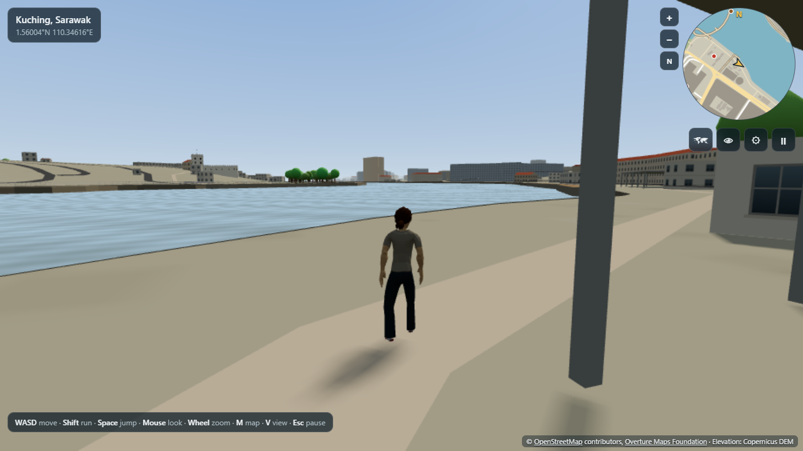
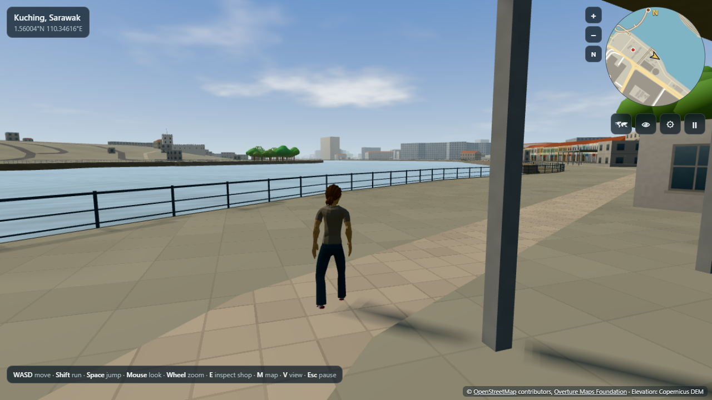
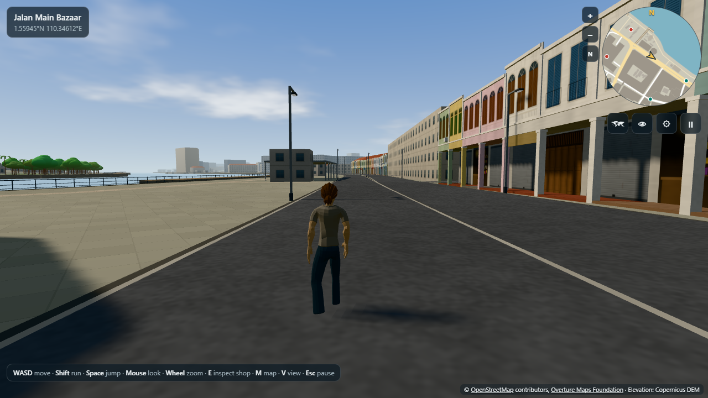
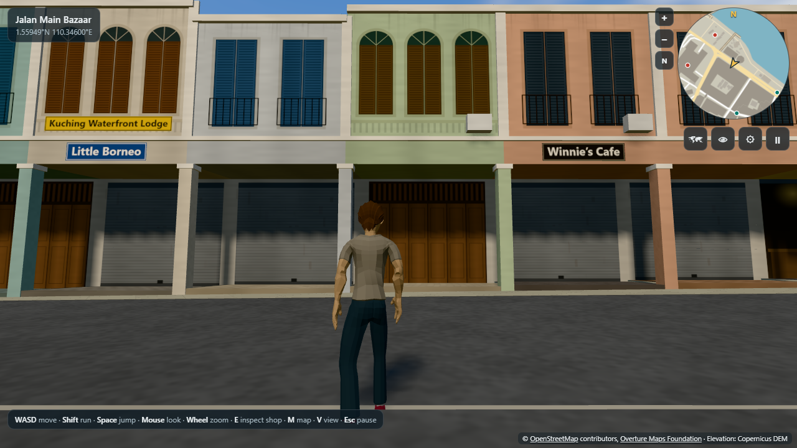
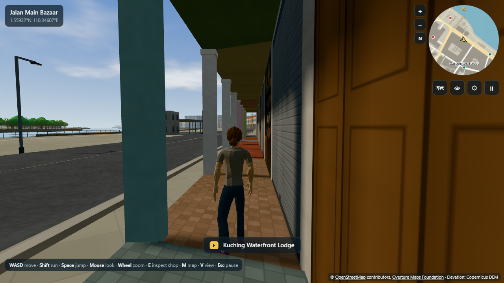
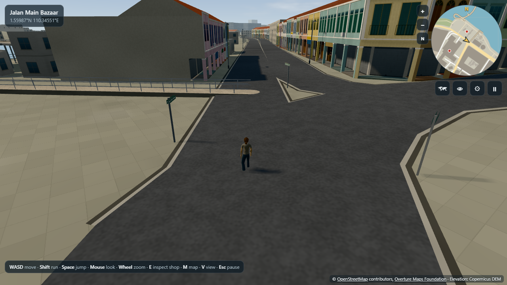
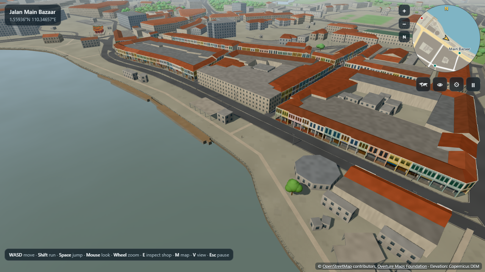

# Kuching 3D V2: visual realism, shop identity, gameplay feel

Scope of this phase: one vertical slice, the Kuching Waterfront and Jalan Main Bazaar, raised to a
higher standard, with the systems built so the rest of the old town inherits them. Nothing was
rewritten: the renderer (Three.js r170, WebGL2), the chunk format, the coordinate system and every
mapped outline are unchanged. Geographic validation still passes 11 of 11 checks.

Not done in this phase: nothing was committed or deployed; driving is not implemented.

## 1. Audit of V1: why it looked generic

Screenshots of V1 at six fixed viewpoints are in `docs/screenshots/v2/before/`.

Caused by **source-data gaps** (OpenStreetMap for this area):

| # | Finding | Evidence |
|---|---|---|
| D1 | Old-town blocks are mapped as one outline per block, with no levels, type or lot lines | 51 of 3,603 OSM buildings have `building:levels`, 3 have `height`; Main Bazaar rows are `building=yes` |
| D2 | No shop data was being fetched at all | V1's Overpass query took only tourism / historic / place-of-worship nodes; OSM actually holds 1,403 named places here |
| D3 | No sidewalks, street lamps, crossings or trees worth the name | 0 km mapped sidewalk, 1 street lamp, 19 trees, 21 crossings |
| D4 | Road widths are class defaults | 6 of 7,310 ways carry a width |

Caused by **rendering, geometry and gameplay**:

| # | Finding |
|---|---|
| R1 | Unknown-height blocks defaulted to 10 to 12 m and were textured with a 3.3 m storey grid, so two-storey shophouse rows rendered as four-storey office slabs |
| R2 | One window texture, one beige palette, no ground-floor treatment: no five-foot way, columns, shopfronts, signs |
| R3 | Flat single-colour ground, near-black roads, no kerbs; all materials untextured Lambert |
| R4 | Roofs: one terracotta cap over a whole block |
| R5 | ACES tone mapping greyed colours; linear fog; plain gradient sky; sun direction left the river-facing fronts in shade; water moire in the distance |
| R6 | Character snapped to full speed (14 m/s^2), turned at one rate, camera rigidly locked to the character with instant boom pops; no audio |

## 2. What was studied from Abyssal Garden

The repository's `prompt.txt`, `README.md`, `quality.js` and `dev.js` were read in full and the
shaders skimmed (the Reddit thread blocked automated access and was not read). It is a hand-written
WebGPU renderer; porting to it would mean rewriting a working streaming city renderer for no
geographic gain, so the Three.js renderer was kept and its **discipline** was borrowed instead:

| Technique there | Adopted here |
|---|---|
| Six fixed camera poses and a blind critic that sees only renders | `tools/dev/v2-views.json`, `docs/screenshots/v2/`, independent reviewer (section 6) |
| Scripted 60 s fly-through reporting average / p99 / max with resolution locked | `tools/dev/traverse.ts` (section 5) |
| Exponential fog with distance fade instead of a hard cut | exponential-squared haze matched to the horizon colour |
| Per-vertex ambient occlusion and hemispheric ambient | darker wall feet, shaded arcade ceilings and shopfronts, hemisphere light |
| One procedural detail texture, no downloads | world-space procedural detail in every material, canvas-painted facade atlas |
| Instance / batch everything, cull per cell | one merged mesh per layer per chunk (unchanged principle), signs in one atlas per chunk |

Not adopted: the baked 3D AO volume, ray-marched light shafts, a one-time shadow bake (chunks
stream), HDR post chain with bloom (cost without street-level benefit on mid-range phones).

## 3. What changed

Details and the mapped-versus-inferred breakdown are in `STREETSCAPE.md` and `SHOP_IDENTITY.md`.

**Architecture.** 120 old-town blocks are now shophouse rows generated on their real outlines:
street-facing walls are detected from the mapped streets, split into about 5 m lots, and each lot
gets a deterministic colour, upper-storey style and shopfront. Every row has a walkable five-foot
way (the collision outline is recessed by the same function that draws it), columns, fascia,
cornices, pilasters, blinds and air-conditioner units, and a ridge roof parallel to the street.
Heights dropped from 10 to 12 m to an estimated 8.2 m.

**Shop identity.** New data pipeline (OSM named POIs, optional Overture Places, owner overrides)
with stable ids, source, source date and verification state. 3,929 places, 752 facade signs,
association by geometric evidence only. Press **E** near a shop to inspect it and open it in Google
Maps. `?admin=1` turns the panel into a correction editor that exports an overrides file.

**Light and materials.** Neutral tone mapping, mid-morning sun that lights the river-facing fronts,
texel-snapped soft shadows, exponential haze, analytic sky with drifting clouds, Day / Evening
setting, procedural asphalt, paving, plaster, clay tile and turf, kerbs and roadside drains,
distance-faded water ripples.

**Street level.** 109 mapped traffic signals, 1,600 street-name plates at mapped junctions, mapped
benches and bollards, procedurally spaced lamp posts, 5 km of promenade railing along the mapped
river bank, broad-canopy trees and palms.

**Gameplay.** Eased acceleration and stopping, speed-dependent turning, walk 1.6 m/s and run
5.2 m/s (was 2.0 and 6.0), spring-damped follow camera with look-ahead, over-the-shoulder framing,
speed-dependent field of view, auto-centring after 1.4 s without look input, three-ray boom
collision that eases instead of popping, synthesised footstep and landing audio (paving / timber
deck). The existing distance-driven walk / run animation blending was already sound and was kept.

**Future driving.** `CameraTarget` interface, speed-scaled chunk look-ahead and build budget, and a
written integration plan (`VEHICLES.md`).

## 4. Before / after

Same camera, same build pipeline, production builds of both versions (`docs/screenshots/v2/`).

| View | Before | After |
|---|---|---|
| 1 Waterfront |  |  |
| 2 Main Bazaar |  |  |
| 3 Shophouse facade |  |  |
| 4 Five-foot way |  |  |
| 5 Junction |  |  |
| 6 Overview |  |  |

Also: `after/08-place-panel.png` (inspect), `after/09-evening-main-bazaar.png`,
`after/10-admin-editor.png`, `after/11-admin-sign-updated.png`.

In view 4 the "before" camera is inside the building: V1 had no five-foot way, so the same
coordinates are solid wall there.

The signs in view 3 (Little Borneo, Winnie's Cafe, Kuching Waterfront Lodge) are OSM records on
Jalan Main Bazaar; "Little Borneo" carries the mapped address 12 Jalan Main Bazaar.

<!-- PERF -->

<!-- REVIEW -->

<!-- TESTS -->

## 8. Files

New: `src/world/arch/{frontage,Shophouse,FacadeAtlas}.ts`, `src/world/StreetFurniture.ts`,
`src/world/places/{types,associate,Labels,PlaceIndex}.ts`, `src/ui/PlacePanel.ts`,
`src/player/Footsteps.ts`, `tools/extract-map-data/fetch-pois.ts`,
`tools/generate-world/{build-streetscape,build-places}.ts`, `tools/dev/{traverse,v2-extra}.ts`,
`tools/dev/v2-views.json`, `tests/unit/streetscape.test.ts`, `data/places-overrides.json`,
`docs/{V2_REPORT,STREETSCAPE,SHOP_IDENTITY,VEHICLES}.md`, `docs/perf-v2.json`,
`docs/screenshots/v2/`, `public/data/kuching/places/`, `public/data/kuching/streetscape-report.json`.

Changed: `src/main.ts`, `src/world/{WorldManager,Materials,ChunkManager,BuildingBuilder,RoadBuilder,TerrainBuilder,VegetationBuilder,CollisionWorld,types}.ts`,
`src/player/{PlayerController,ThirdPersonCamera,Input}.ts`, `src/ui/GameMenu.ts`,
`src/styles/main.css`, `index.html`, `package.json`, `tests/e2e/{gameplay,touch}.spec.ts` (speed
expectations follow the new pacing), `README.md`, `docs/{ARCHITECTURE,GEOGRAPHIC_SOURCES,LIMITATIONS}.md`,
and all 513 chunk files (annotations added; mapped coordinates unchanged, verified by
`npm run data:validate`).

## 9. Build and run

```bash
npm install
npm run dev            # development, http://localhost:3000
npm run build          # production bundle in dist/ (static; wrangler.jsonc serves it on Cloudflare Workers)
npm run preview        # serve dist/ locally
npm run data:build     # regenerate chunks + streetscape + graph + places from the cached sources
npm run data:places    # after editing data/places-overrides.json
npm test               # unit tests
npm run test:e2e       # browser tests (system Edge, GPU)
node tools/dev/traverse.ts <label> --url=http://localhost:4173/    # 60 s benchmark
```

Nothing in this phase was committed or deployed.
