# Kuching 3D V3: one high-fidelity test area (Main Bazaar and the Waterfront)

Scope: the whole of Jalan Main Bazaar (about 390 m, Old Courthouse junction to Lebuh Wayang) and
the Waterfront strip beside it. Nothing outside this district was restyled. The renderer, chunk
format, coordinate system and every mapped outline are unchanged; geographic validation still
passes 11 of 11 checks. Nothing was committed, pushed or deployed.

## 1. Diagnosis of the previous build (V2)

Method: read the code, ran the app, captured eight fixed street-level views
(`docs/screenshots/v3/before/`), listed the raw data for the area.

**Confirmed observations**

| # | Finding | Evidence |
|---|---|---|
| 1 | Facades were flat painted textures: no window recess, no shutter leaves, no interior behind a shopfront | `arch/Shophouse.ts` drew one textured quad per storey; before/03 |
| 2 | Every lot was two storeys, the same width, with a candy-coloured palette | 14-colour pastel table; `lv: 2` on every row; before/01, 02 |
| 3 | The street was empty: no vehicles, median, planting, goods, people | before/01, 06; chunk `0_-1` holds 16 trees and 23 furniture points in 6.5 ha |
| 4 | The two Main Bazaar carriageways were drawn 7.2 m wide each although their centre lines are 7.1 m apart, so the median that exists in reality had zero width | way widths are class defaults (`f` flag 4 = inferred) |
| 5 | Everything between the street and the river was one beige surface | terrain texture has a single base colour; before/04 |
| 6 | Blocks are mapped as one outline each (3,893 m2 for the main block), with no lot lines, levels or facade data | OSM ways 233690737, 236495303, 236495776: `building=yes` |
| 7 | Shop signs: 5 on the whole street, 2 of them stacked on wrong lots | place files; Overture records were never allowed a sign |
| 8 | Piers, lamp posts and trees did not collide; the raised walkway was not a walkable surface | `CollisionWorld` had only building outlines |
| 9 | Character mesh was flat-shaded (every facet visible) | `GlbCharacter.ts` kept the model's faceted normals |

**Assumptions (not proven)**

- That the dominant reason it "did not feel like Kuching" is missing street life and per-lot
  individuality rather than lighting. The reviewer's scores below support this but it is a judgement.
- Player and world scale were checked and are correct (character 1.72 m, lots 4.75 m, walkway
  2.3 m); scale was not a cause.

Root causes by category: incomplete geographic data (4, 6, and no mapped street furniture);
repetitive facades and missing local architecture (1, 2); missing environmental detail (3, 5);
materials (1, 5); gameplay (8, 9). Lighting and world scale were not significant causes.

## 2. Google Photorealistic 3D Tiles: feasibility

Researched from Google's own documentation and Google Earth Web. No key was created, no billing
enabled, no tile downloaded.

| Question | Finding | Source |
|---|---|---|
| Is Kuching covered? | Coverage is published per country only. Malaysia is listed; no city list exists; Kuching is not named | developers.google.com/maps/coverage |
| Is there a building mesh at Main Bazaar? | **Most likely not.** Google Earth Web at 1.5585 N, 110.3455 E, tilted 65 degrees, showed flat satellite imagery (dated 27 Apr 2024) draped on terrain, no vertical facades. Weakness: the loader had not finished, and a Kuala Lumpur control view did not load, so this is not a clean positive/negative pair | direct observation, 15 Nov 2026 |
| Price | Per root-tileset request (one per session, valid up to 3 h): 1,000 free per month, then USD 6.00 per 1,000 | developers.google.com/maps/billing-and-pricing/pricing |
| Quota | 10,000 root requests per day | Map Tiles usage and billing page |
| Caching / offline | Pre-fetching, storing and offline use are prohibited | Map Tiles API policies |
| Collision | "Geodata extraction" and deriving objects from the tiles are prohibited, so a baked collision mesh is not allowed; only ray tests against currently streamed tiles would be defensible (my reading, not legal advice) | same |
| Renderer | Any renderer is allowed; Three.js works through NASA-AMMOS 3DTilesRendererJS | Google FAQ blog, GitHub |
| Street-level quality | Google states the mesh is "less precise ... at the pedestrian-scale" | same blog |

Not verified: the Maps Platform Service Specific Terms could not be read in full, so any clause
about games is unchecked.

**Comparison**

| Criterion | A. Current Three.js + OSM/Overture + authored facades | B. Google Photorealistic 3D Tiles |
|---|---|---|
| Visual realism | Stylised, improving with authoring | Photographic from the air where a mesh exists; here apparently none |
| Geographic accuracy | Mapped outlines, validated to millimetres against source | Excellent where covered |
| Street-level quality | Controllable; clean geometry | Melted facades, no five-foot ways, baked-in cars |
| Third-person player | Works today | Possible (ray-cast ground), no walkable interiors or arcades |
| Collision | Exact, from the same geometry | Runtime ray tests only; nothing may be stored |
| Performance | 60 fps on an integrated GPU (section 9) | Heavy: tens to hundreds of MB per session, weak on phones |
| Download size | About 3 MB to playable | Streamed, uncached |
| Operating cost | Zero (static files) | USD 6 per 1,000 sessions after the free tier |
| API restrictions | None (ODbL / CDLA attribution) | No caching, no offline, no derived data, logo and attribution rules |
| Vehicles later | Road graph already exists | No road graph; would still need OSM underneath |

**Verdict: approach A is the viable one.** B fails first on coverage (very probably no mesh in
Kuching) and would fail on street-level quality, collision rules and cost even with coverage. The
renderer was not replaced. To settle coverage definitively, a key holder can request
`https://tile.googleapis.com/v1/3dtiles/root.json?key=...` once (inside the free tier) and check
whether tiles over 1.5595 N, 110.346 E refine to vertical facades.

Worth an enquiry instead: Sarawak Land and Survey's Savi3D lists "Kuching 3D Buildings"
(licence unknown).

## 3. What was built

New code lives in `src/world/district/` and `src/world/arch/Heritage*.ts`. It is switched on only
for blocks within 85 m of Main Bazaar.

**Geography corrected or added**

- Lot counts fitted to house numbers (section 6): 71 lots on seven frontages, 4.6 to 4.9 m wide.
- Carriageways narrowed from the 7.2 m class default to an estimated 5.4 m, which opens the
  1.7 m median that the mapped centre lines imply.
- Mapped trees inside the district are kept at their mapped positions.

**Shophouses** (`HeritageRow.ts`): every lot is modelled rather than textured.

- Masonry piers 0.46 m, raised tiled five-foot way, floor beam and a shallow arch at each party wall.
- Open shopfronts with a lit interior 3.4 m deep (three trades), half-lowered shutters, timber
  doors or closed roller shutters.
- Upper floors with recessed openings, hinged louvre leaves at varied angles, glazed casements,
  sills and hoods. Following the photo survey there are no arched upper windows.
- Four facade families (tiled-eave vernacular, parapet with mouldings, 1930s-50s concrete, modernised)
  in two and three storeys, built in groups of one to three lots.
- Paint: white, cream and pale yellow at the west end, brighter units toward Lebuh Wayang.
- One pitched roof per lot at that lot's height, oversailing tiled eaves, party walls, zinc rear roofs.
- Awnings, chick blinds, air-conditioner units, downpipes, lanterns, potted plants, goods tables,
  jars, racks, kopitiam tables.

**Street and waterfront** (`props.ts`, `Dressing.ts`, `TerrainBuilder.ts`)

- Raised brick median with striped kerbs, planter pots and twin-arm lamp columns.
- Kerbside parked cars (hatchback, saloon, pickup) on the shophouse side.
- Red-brick footpath and rain trees on the river side; promenade paving and a planted verge.
- Globe lamps and benches behind the railing; tambang boats at the mapped jetties.
- Small waterfront footprints drawn as cream kiosks with tiled roofs instead of grey boxes.

**Verified versus approximate**

| Element | Status |
|---|---|
| Block outlines, street centre lines, river bank, jetties, mapped trees | Real (OpenStreetMap) |
| Number of lots per frontage, house numbers | Fitted to open-data addresses, exact to about one lot |
| Street layout: two carriageways, median, kerbside parking, brick path, rain trees, globe lamps | Seen in photographs; dimensions estimated |
| Each lot's style, storeys, colour, awning, open/closed state | **Approximation**, statistically matched to the photo survey. No lot is a verified reconstruction |
| Position of each car, planter, lamp, bench, boat, non-mapped tree | **Approximation** |
| Kiosk appearance, lawn extent, promenade width | **Approximation** |

## 4. Before and after

Same camera, production builds of both versions, High quality, 1600 x 900.

| View | Before | After |
|---|---|---|
| 1 Main Bazaar, street level | 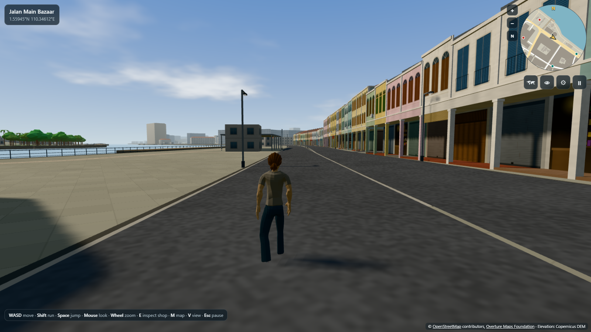 | 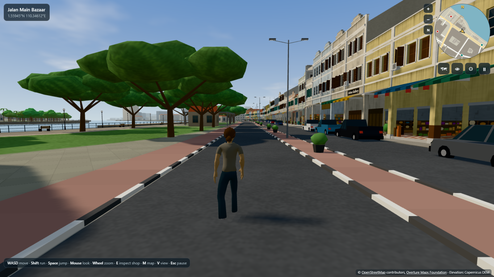 |
| 2 Shophouse row | 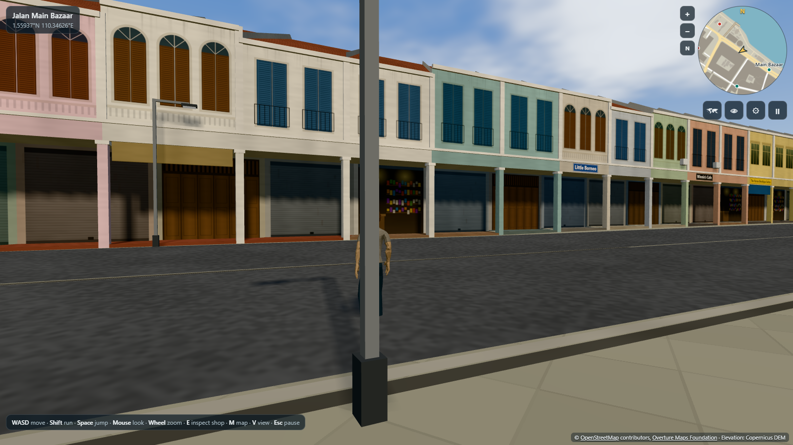 | 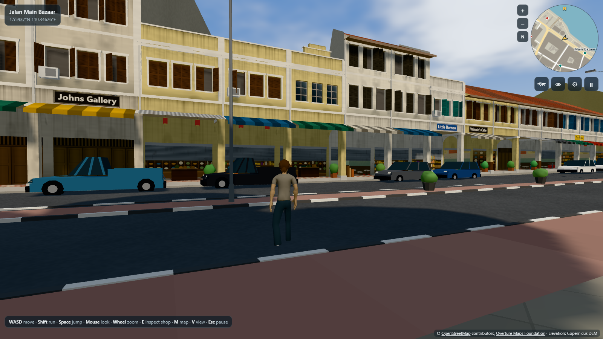 |
| 3 Shopfront close-up | 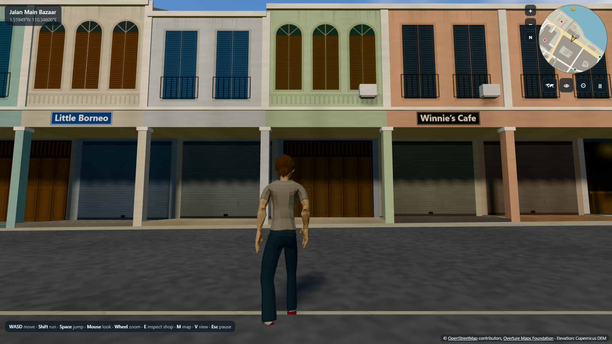 | 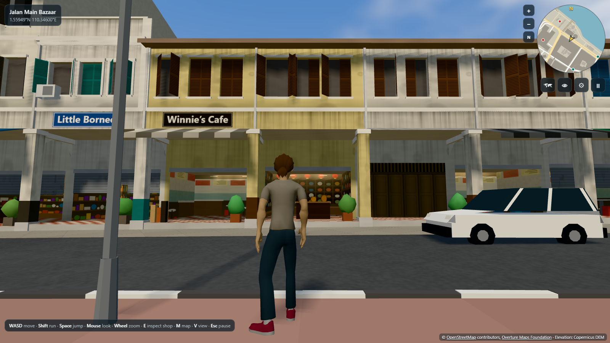 |
| 4 Waterfront and river | 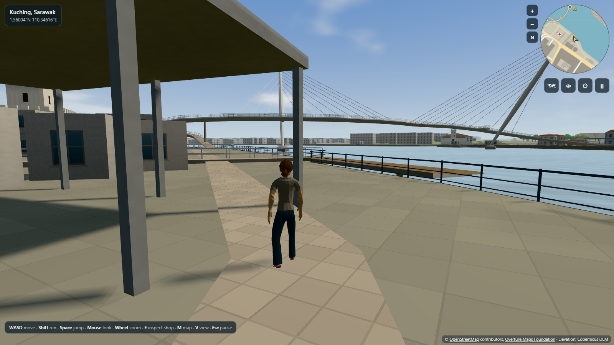 | 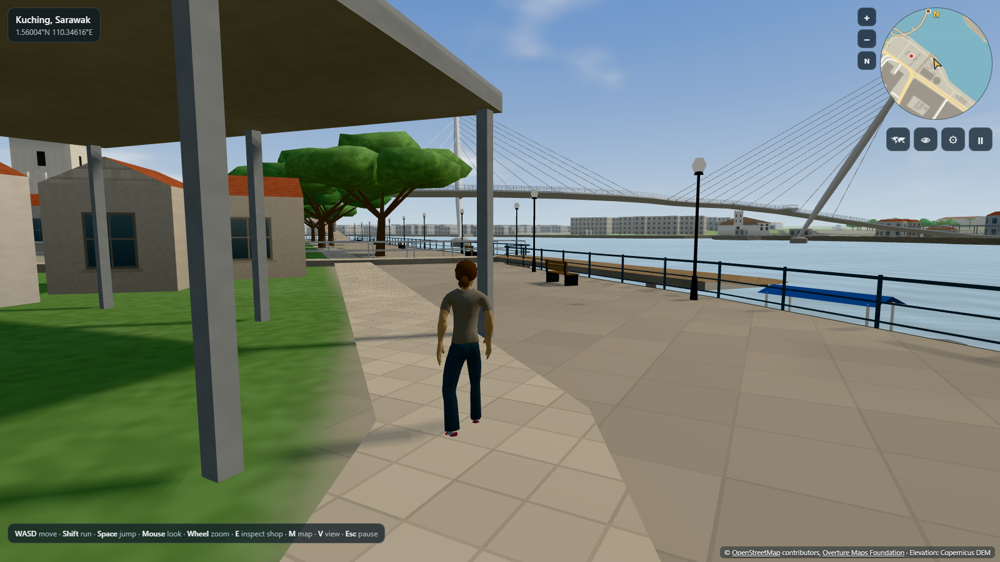 |
| 5 Character in the five-foot way | 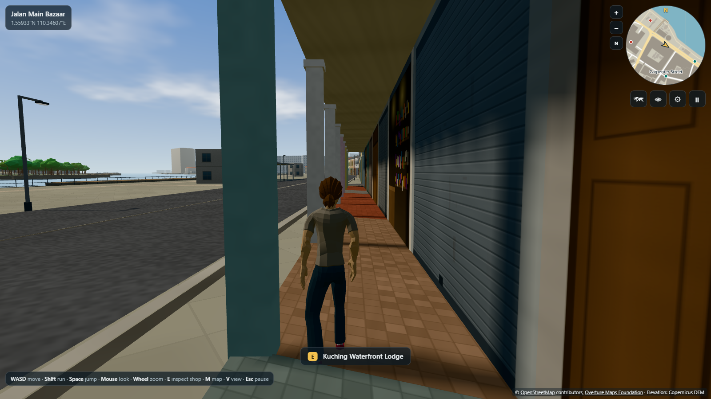 | 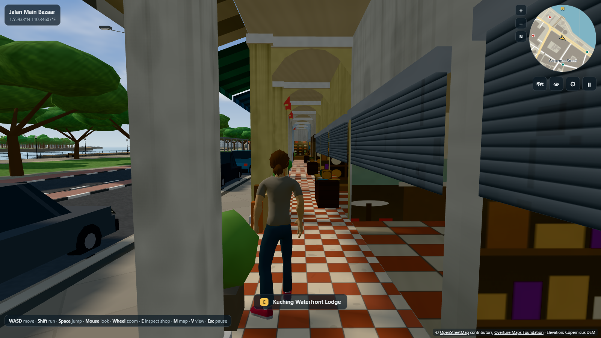 |
| 6 Junction | 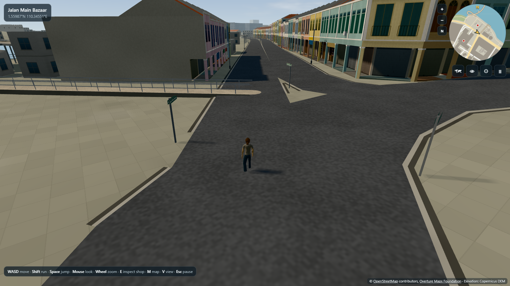 | 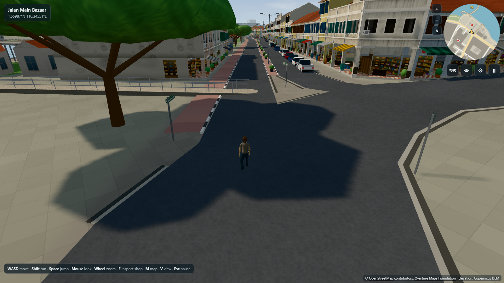 |
| 7 East end | 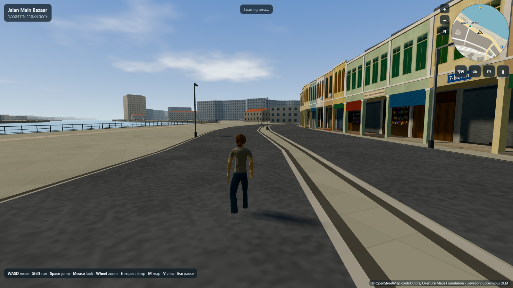 | 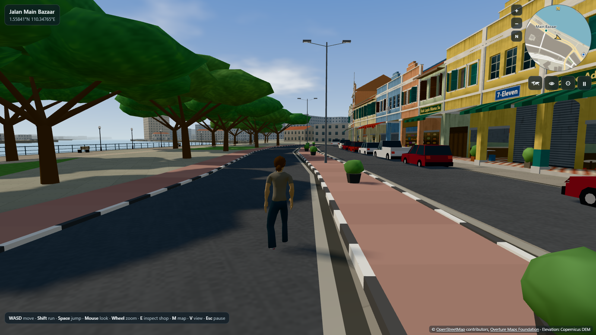 |
| 8 Overview | 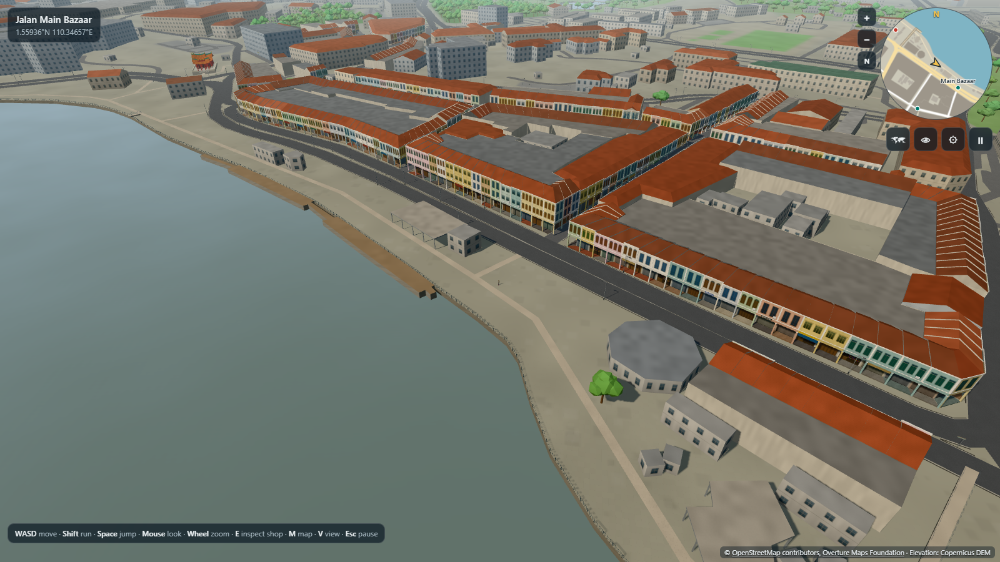 | 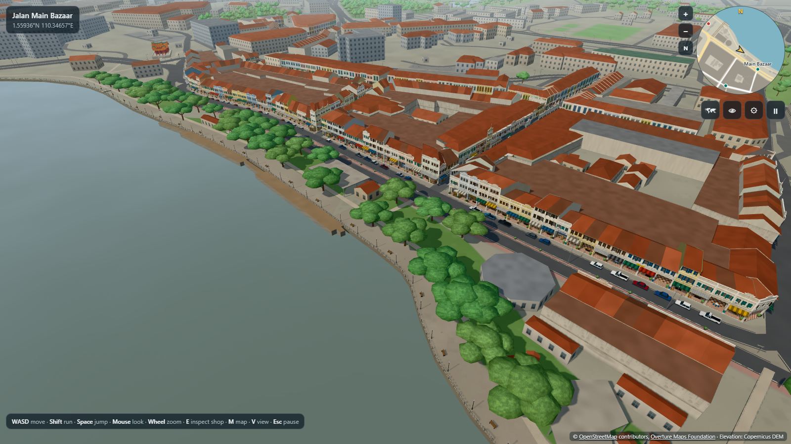 |
| 9 River view to the DUN | 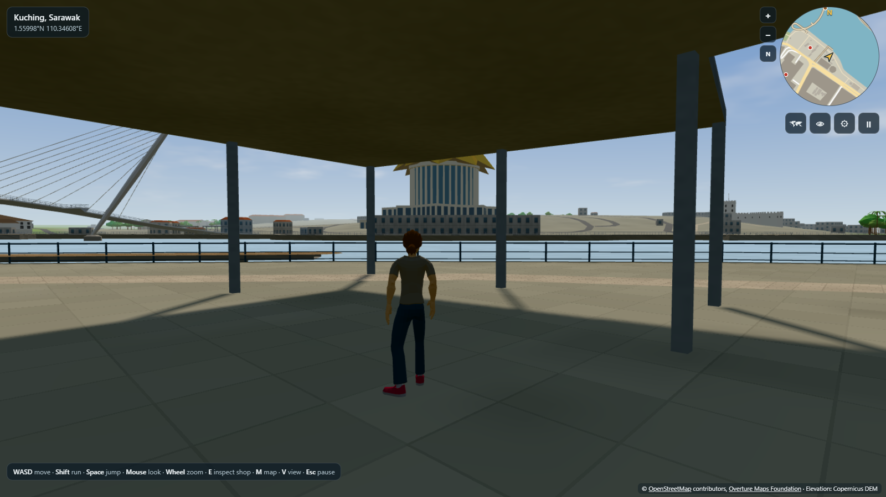 | 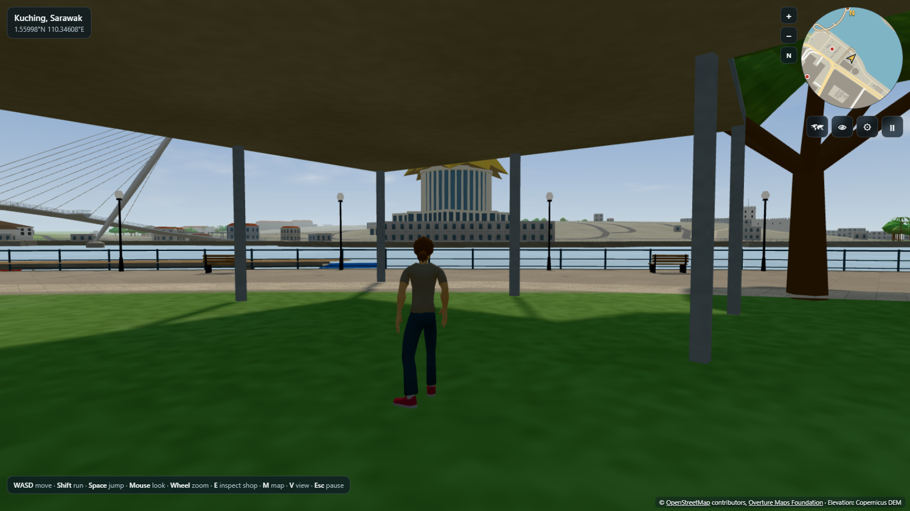 |

Views are defined in `tools/dev/v3-views.json`; regenerate with
`node tools/dev/shots.ts <dir> "$(cat tools/dev/v3-views.json)" --url=http://localhost:4174/ --size=1600x900`.

## 5. Reference comparison and independent review

**References used.** Wikimedia Commons: *A five foot way in Kuching, Sarawak* (CC BY-SA 2.0),
*010984 Kuching (Borneo)* (CC BY-SA 4.0), *The Waterfront, Kuching, Sarawak* (CC BY 2.0),
*Kuching Waterfront (17586892988)* (CC BY-SA 2.0), *Kuching Waterfront - Flickr - Dustin Iskandar*
(CC BY 2.0), *Sarawak Steamship Company Building 01*, *Chinese History Museum - Kuching*,
*Kuching Main Bazaar shophouses* (public domain, 1900-30). Google Street View (September 2024) was
looked at for layout only by the research agent; two panoramas loaded sharp, the rest blurred.
No Google imagery was copied or used as a texture. Commons has no modern street-wide photograph of
the Main Bazaar facades, which is the main limit on facade accuracy.

**Independent reviewer** (separate agent; saw only the screenshots and the Commons photos, no code):

- Every viewpoint judged better than before except the junction ("about the same").
- Street-level score **3 / 10 before, 5 / 10 after**.
- Recognisable as Kuching: **partly**. "Believable as a Southeast Asian shophouse street, but not yet Kuching."

| Reviewer defect | Outcome |
|---|---|
| Rust-red verge smeared across paving | **Fixed**: the brick path is now hard-edged geometry |
| Lamp columns too thick, planters person-sized | **Fixed**: columns 0.14 m, planters reduced |
| Grey roof wedges behind parapets, grey slab roofs | **Improved**: party walls take the lot colour, rear roofs weathered zinc-red |
| No arches across the five-foot way | **Fixed**: arch at each party wall |
| Signs tiny | **Improved**: boards enlarged to bay width where the name allows |
| Uniform grime | **Reduced** by about half |
| Tree shadows black | **Softened** (ambient raised) |
| Opposite bank generic; DUN not in frame | View 9 added facing the DUN, which was already modelled. Kampung houses still generic: **open** |
| Promenade paving and railing nothing like the real ones | **Open** |
| Steamship building and Chinese History Museum anonymous | **Open** |
| No Chinese or bilingual signage, few hanging goods | **Open**: names are never invented; only source text is shown |
| Low-poly cars and faceted canopies | Wheels rounded; otherwise **open** |
| Doubt that the median exists | Kept: the research agent saw it in Street View panoramas at 1.55949 N 110.34610 E and 1.55927 N 110.34640 E |

The screenshots in section 4 were captured after these fixes. They were not re-scored by the reviewer.

## 6. Shop identity coverage

Tested: 45 OpenStreetMap and Overture records within 45 m of the street.

**Method.** Main Bazaar has buildings on one side only, numbered consecutively from the west.
Eleven records state a Main Bazaar house number. Projected onto the frontage, eight of them fit
`number = 1 + distance / 4.8 m` within one lot, and the block breaks fall on the mapped gaps
(Jalan China after No. 22, the Bishopsgate lane after No. 39). That fit fixes the lot count and
lets a business be pinned to a numbered lot instead of a rough point.

| No. | Business | Source | Evidence |
|---|---|---|---|
| 6-7 | The Ranee Boutique Suites | OSM | number and position agree |
| 11 | Winnie's Cafe | OSM (2018) | number only; mapped point is 2 lots west |
| 12 | Little Borneo | OSM | number and position agree; sign also seen in Street View |
| 18 | Johns Gallery | Overture | number and position agree |
| 32 | Kelvin Gallery | Overture | number and position agree |
| 39 | 328 Gallery | Overture, OSM building name | number and position agree |
| 41 | Guan Ho Leong Optical | Overture | number and position agree |
| 42 | J.D Massage Centre | Overture and OSM | number and position agree |
| 55 | Borneo Adventure | Overture | number only; mapped point lies in the road |
| 58 | Kek Lapis Sarawak Mama Su | Overture | number and position agree (within one lot) |
| 66 | Little Borneo (UD Siburan Jaya) | Overture | number only; mapped point is 2 lots west |

Eleven businesses are pinned, eight of them with two independent pieces of evidence. Each shows a
sign on its lot and can be inspected with **E**; the panel states the lot number and evidence class.
None has been checked on the ground, and Overture records can be out of date.

**Not pinned**

- H-Mart 24: address says No. 6, position says No. 15. Contradictory.
- Kuching Waterfront Lodge, 7-Eleven, Upspot Hostel: mapped position only, no number. They keep
  their OSM-position sign where the lot is free.
- Asma Cake House (No. 91), Star Company (No. 30), Artrageously Ramsay Ong (No. 94): numbered in a
  source, but either outside the fitted range or with no open-data position to cross-check.
- Loft Waterfront ("Lot 4, 2nd floor"), SarLoca (Steamship building): ambiguous unit.
- Seen on signs in Street View but absent from open data: Qiasixco Cafe, Wo Jia Lodge, Joo Foong.
- About 55 of the 71 lots have no business name in any open source.

Google Maps is used only as an outbound link from the panel.

## 7. Gameplay

| Area | Change |
|---|---|
| Collision | Piers, goods, parked cars, tree trunks, planters, lamp posts and benches now block the character and the camera boom |
| Ground | The raised five-foot way (+0.14 m), the median (+0.16 m) and the brick path are real walkable levels; the character steps up instead of sinking into them |
| Character | Normals smoothed across edges under 70 degrees, so limbs read as rounded instead of faceted |
| Scale | Verified, unchanged: character 1.72 m, pier spacing 4.75 m, walkway clear height 3.05 m |
| Unchanged from V2 | Eased acceleration (9 m/s2) and braking, walk 1.6 / run 5.2 m/s, stride-matched walk-run blend, spring camera with look-ahead and boom collision. These were re-tested, not rewritten |
| Vehicles | Parked cars are static props with colliders. The road graph, `CameraTarget` interface and speed-scaled streaming from V2 are untouched |

Not improved: the character model itself (still the CC0 low-poly model; a better one needs a new
licensed asset), and bridge navigation (unchanged, still passes its existing tests).

## 8. Browser test results

| Suite | Result |
|---|---|
| Unit (`npm test`) | 31 passed, 0 failed (5 new: consecutive house numbers, pins resolve to lots, deterministic lot plans, a 0.9 m corridor always remains between goods, median geometry) |
| Browser, system Edge with GPU (`PUBLIC_PORT=5174 npm run test:e2e`), desktop 1920, laptop 1366, mobile 390 and 360 | 20 passed. One layout test failed in the full run with aborted place-file requests because a file was saved during the run and the dev server reloaded the page; re-run on its own it passed |
| New district tests (`tests/e2e/district.spec.ts`) | 4 passed: runs the whole street (300 m) grounded and never inside a building; walks both long five-foot ways end to end between piers and goods; piers, parked cars and shopfronts are solid; 10+ pinned businesses have signs, Little Borneo on lot 12 |
| Geographic validation (`npm run data:validate`) | 11 of 11 checks passed (no data file changed) |
| Type check, production build | clean, succeeds |

Not tested: a physical phone, a discrete-GPU desktop, Firefox, Safari, slow networks. Pointer-lock
mouse look is not automatable. The Cloudflare deployment was not touched; the build output is the
same static `dist/` folder that `wrangler.jsonc` already serves.

## 9. Performance (measured)

Method: `tools/dev/traverse.ts --vsync`, a scripted 60 s run along Main Bazaar, Lebuh Wayang and
Carpenter Street, production builds of both versions served locally, adaptive resolution off.
Machine: Intel Core i5-13420H, Intel UHD Graphics (integrated), 16 GB, Edge. Raw data:
`docs/perf-v3.json`. Cells are **before -> after**.

| Session | Avg fps | 1 % low fps | p99 frame ms | Frames > 33 ms | CPU ms | GPU ms | Draw calls avg / max | Triangles avg | JS heap peak MB |
|---|---|---|---|---|---|---|---|---|---|
| Desktop 1080p High | 59.7 -> 59.6 | 30.4 -> 29.2 | 26.9 -> 28.5 | 12 -> 15 | 7.55 -> 8.09 | 7.85 -> 10.03 | 261 / 300 -> 270 / 318 | 157 k -> 281 k | 70.5 -> 87.6 |
| Desktop 1080p Medium (default) | 59.9 -> 59.8 | 38.4 -> 32.1 | 22.0 -> 24.4 | 5 -> 8 | 4.57 -> 5.47 | 8.32 -> 8.63 | 125 / 154 -> 133 / 160 | 79 k -> 200 k | 44.9 -> 66.7 |
| Phone-sized viewport 390x844 @3x, Low (emulated on the desktop GPU) | 60.0 -> 60.0 | 43.2 -> 41.6 | 19.2 -> 19.9 | 3 -> 5 | 2.21 -> 2.43 | 3.05 -> 3.87 | 69 / 82 -> 75 / 89 | 54 k -> 168 k | 33.9 -> 62.9 |

| Session | Time to playable s | Initial requests | Initial download MB (uncompressed) | Transferred MB (local server) | Max chunk build ms | Frames blocked on a chunk |
|---|---|---|---|---|---|---|
| Desktop High | 4.6 -> 4.6 | 187 -> 188 | 3.09 -> 3.14 | 1.50 -> 1.52 | 60 -> 121 | 0 -> 0 |
| Desktop Medium | 1.4 -> 1.9 | 78 -> 79 | 2.17 -> 2.22 | 1.16 -> 1.18 | 45 -> 93 | 0 -> 0 |
| Phone viewport Low | 1.8 -> 2.5 | 49 -> 50 | 1.90 -> 1.95 | 1.06 -> 1.08 | 52 -> 102 | 0 -> 0 |

Size (gzip, from the build output): application code 219 KB -> 237 KB; map data 2.58 MB, unchanged.
No texture or model was added to the download.

Reading it:

- **Average frame rate is unchanged at 60 on all three presets.** GPU time on High rose by 2.2 ms;
  1 % lows fell slightly on Medium (38 -> 32 fps).
- **The real regression is the build hitch of the three district chunks**: the longest single chunk
  build doubled to about 100 to 120 ms, a visible stutter once when the district first streams in.
  Moving chunk building to a worker (already listed in V2) would remove it.
- **JS heap is up 17 to 29 MB**, mostly the district geometry and the 2048 px facade atlas
  (1024 px on Low).
- Triangle count roughly doubles near the district and stays far below what this GPU handles.
- The benchmark's straight-line route now collides with the new median and parked cars and was
  repositioned twice per run ("rescues 2"), so it covered 295 m instead of 310 m. The route should
  be re-plotted before the next comparison.
- The phone row is an emulated viewport on a desktop GPU. **Real phone performance is not validated.**

## 10. Remaining problems, ranked by impact

1. **No lot is a verified reconstruction.** Facades are statistically plausible, not individually
   true. Fixing this needs licensed street-level photographs of each block (own photos, or Mapillary
   CC BY-SA) and a per-lot table; the data structure for it exists (`LOT_NOTES`).
2. **Waterfront identity kit missing**: swirl-mosaic sett paving, the cast-iron railing with ring
   panels, festoon lights, tensile canopies, food kiosks.
3. **Landmarks on the street are still generic**: Sarawak Steamship Building, Chinese History
   Museum, Square Tower, the octagonal pavilion, Tua Pek Kong terrace wall.
4. **Far bank**: kampung houses are flat-roofed grey detections.
5. **No people, no moving traffic, no boats under way.**
6. **Signage**: only eleven named lots; no Chinese-character boards because no source gives them.
7. **Stylised props**: faceted tree canopies, simple cars, low-poly character.
8. **Ground texture resolution** (0.5 m per pixel) leaves soft lawn edges.
9. **Road markings** (lane dashes, yellow edge lines, hatched crossings) are not drawn.
10. Phone performance is unverified on real hardware.

## 11. Phased expansion plan

Do not start phase 2 until this district is accepted.

| Phase | Area | Work | Gate |
|---|---|---|---|
| 1b | Same district | Photo survey of each block (own photos or Mapillary), fill `LOT_NOTES`, bespoke Steamship building, Chinese History Museum, railing and paving kit, kampung roofs on the far bank | Reviewer score 7 or more; you recognise specific buildings |
| 2 | Carpenter Street, Jalan China, Ewe Hai, Lebuh Wayang (about 600 m) | Reuse `HeritageRow` with the same house-number fitting; add the temple gates and Carpenter Street arch | Same review; 60 fps on Medium |
| 3 | Padungan and Jalan India | New facade families (1950s-70s concrete shophouses, covered pedestrian mall) | Same |
| 4 | Waterfront east to the Hilton, north bank (Astana, Fort Margherita, kampungs) | Stilt-house family, jetties, working tambang ferry | Same |
| 5 | Wider city | Generic rows inherit the lot model at low authoring cost; move chunk building to a worker; per-district data files instead of code tables | Streaming hitches under 16 ms |
| 6 | Vehicles | Drive on the existing road graph; parked props become traffic | Separate plan in `VEHICLES.md` |

## 12. Files

New: `src/world/district/{mainBazaar,frontLayout,props,Dressing}.ts`,
`src/world/arch/{HeritageRow,HeritageAtlas}.ts`, `tests/unit/district.test.ts`,
`tests/e2e/district.spec.ts`, `tools/dev/v3-views.json`, `docs/V3_REPORT.md`,
`docs/screenshots/v3/`, `docs/perf-v3.json`.

Changed: `src/world/{BuildingBuilder,ChunkManager,CollisionWorld,Materials,StreetFurniture,TerrainBuilder,VegetationBuilder,WorldManager}.ts`,
`src/world/arch/Shophouse.ts` (helpers exported), `src/world/places/{PlaceIndex,types}.ts`,
`src/ui/PlacePanel.ts`, `src/player/GlbCharacter.ts`.

Global side effects outside the district (small): finer asphalt grain, slightly lighter plaster
grime, daytime ambient light raised from 1.0 to 1.3.

No map data file changed. No new asset was downloaded; all textures are generated in the browser.
