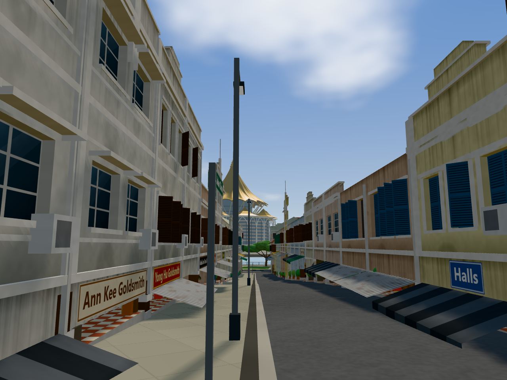
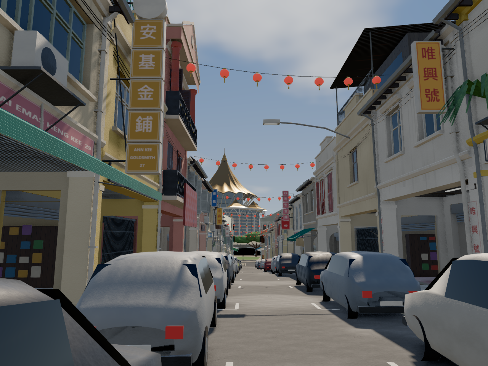
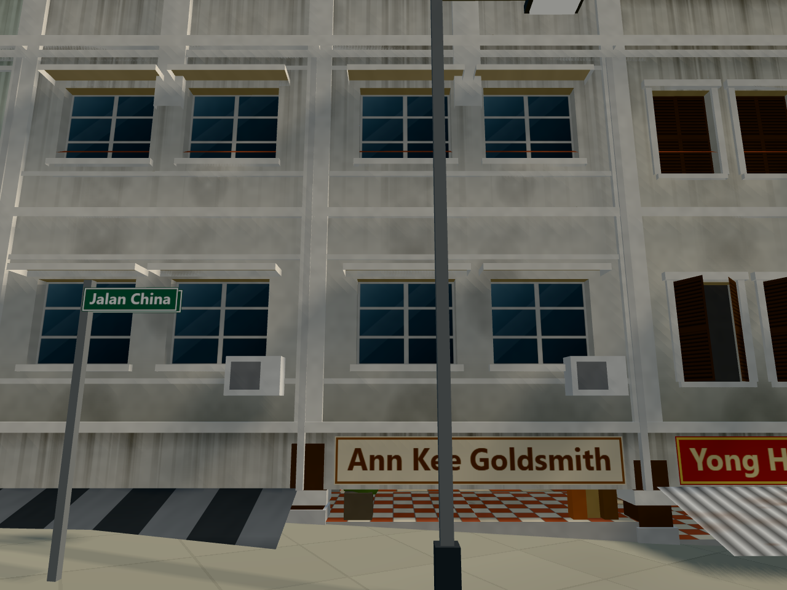
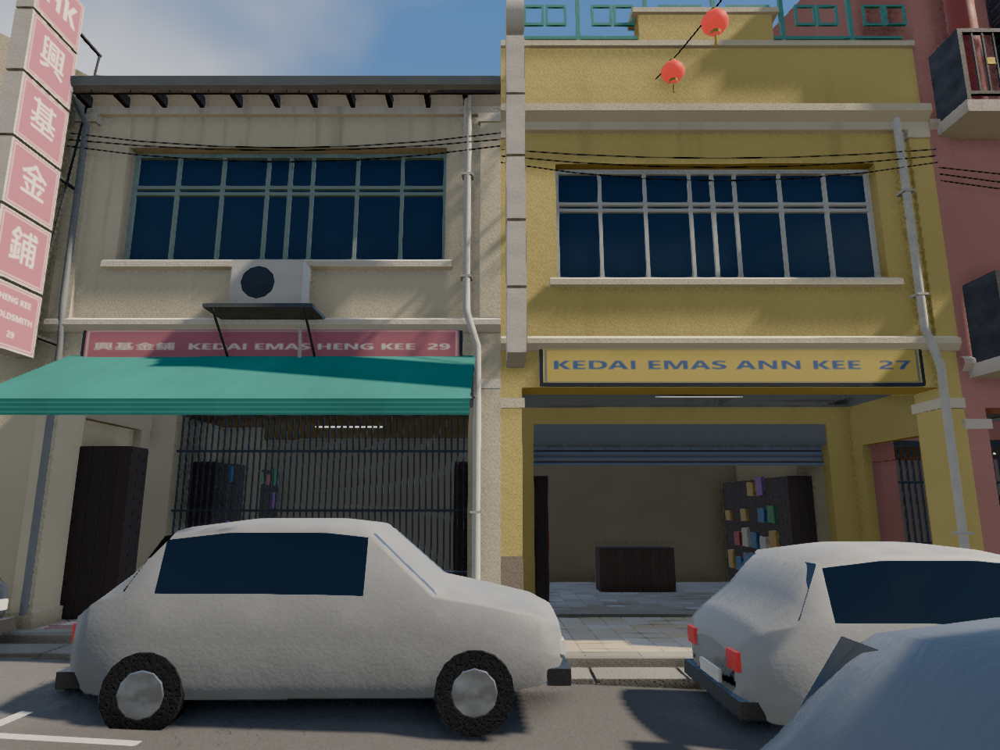
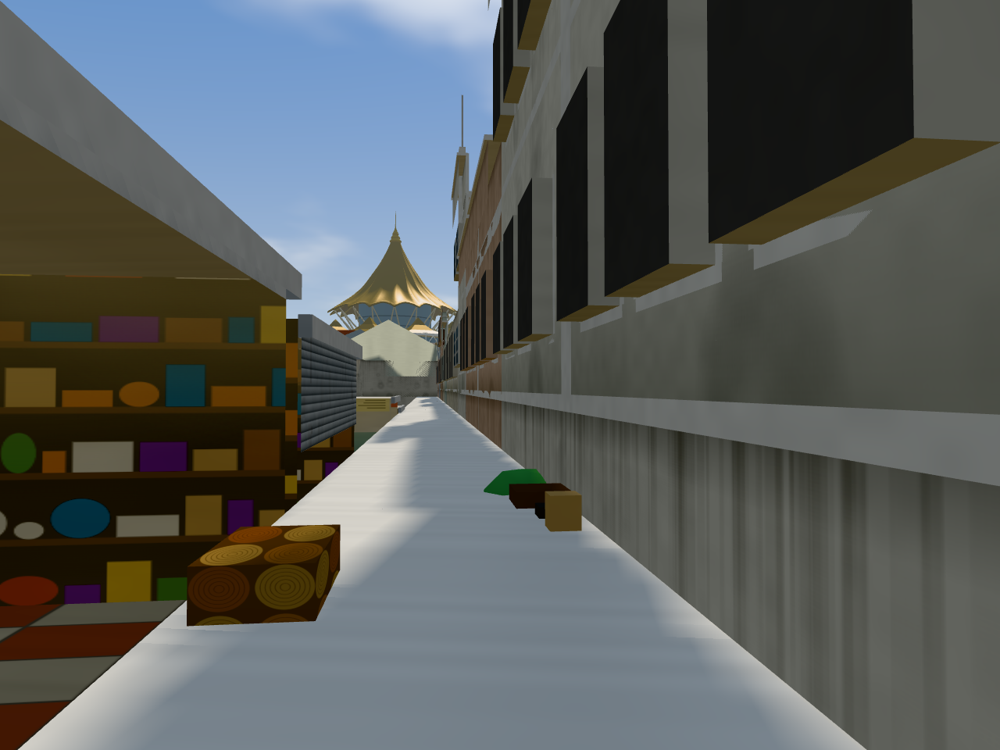
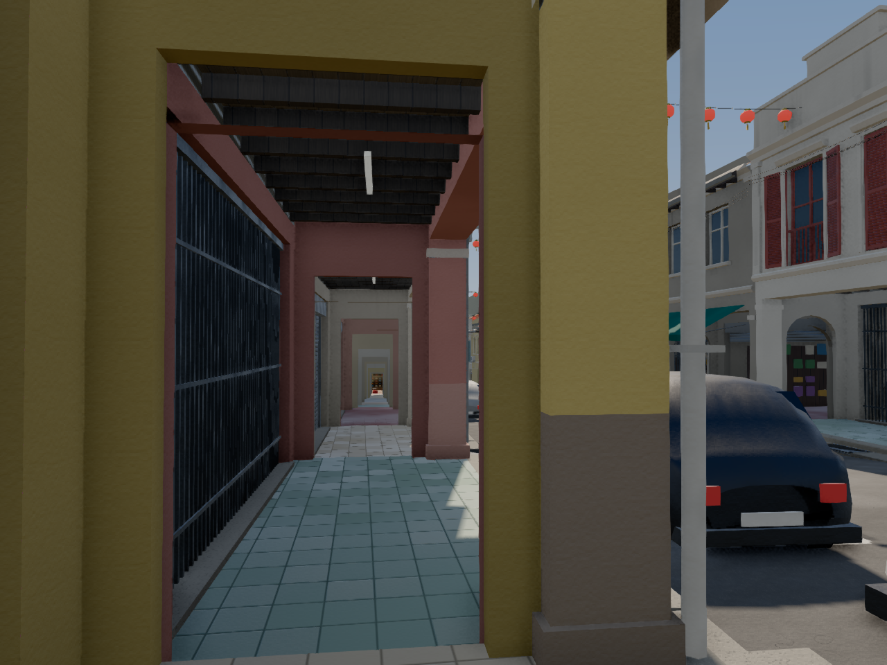
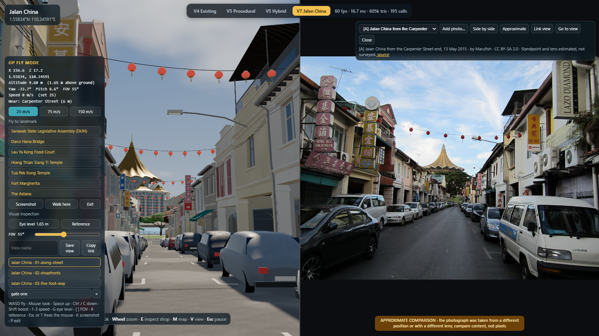

# V7: from 3D map to a realistic street — one section, with a reference comparison mode

Date: 2026-11-16. Nothing was committed, pushed or deployed. No engine, renderer or dependency was
added. The map projection, coordinates, road data and gameplay are unchanged.

## Read this first: the section is Jalan China, not Main Bazaar

The brief asked for 80 to 120 m of Main Bazaar "with strong publicly accessible and appropriately
licensed photographic references", and said: *if reliable photographs are unavailable, report the gap
and choose a better-documented nearby section.* That is what happened.

- **Gap.** Wikimedia Commons was searched again (the Main Bazaar category, six text searches, a
  geosearch within 180 m and a 500-image contact sheet). It still holds no modern street-level
  photograph of the Main Bazaar shophouse fronts: three files in the category, none showing a
  facade row. Google Street View was not used.
- **Chosen instead: Jalan China (China Street)**, the 88 m street that runs from Jalan Carpenter
  into Main Bazaar between No. 22 and No. 23. A walking sequence by one photographer looks down
  its whole length to the DUN building, with shop signs legible.

To do Main Bazaar itself to this standard, the missing asset is **a licensed photo walk of its
frontage** (your own photographs would do: about one frame per two shopfronts, plus one oblique
view per block). The comparison panel below accepts them directly.

## How to see it

1. Run the app and press **Start**.
2. Press **P** (OP mode). In the panel, under *Visual inspection*, click
   **Jalan China · 01-along-street**. The section switches on and the camera goes to the first
   fixed viewpoint at eye level.
3. **G** holds the camera 1.65 m above the ground at walking pace; walk the street with WASD.
   **Walk here** hands over to the normal character.
4. **R** opens the reference photograph. Key **4** (or the bar at the top) switches the section
   on and off outside OP mode; `/?at=china` starts there.

## Change 1: reference comparison mode (OP mode only)

| Requirement | What was built |
| --- | --- |
| Save and restore exact position, coordinates, orientation, height, FOV | **Save view** stores x / y / z, latitude / longitude, yaw, pitch and FOV under a name (this browser's localStorage). Clicking it restores them exactly. |
| Pedestrian eye level, about 1.65 m | **Eye level 1.65 m** button / **G**: stays 1.65 m above the walkable surface (terrain or five-foot-way floor), walking speed, Shift to run. |
| Screenshots of the rendered scene | Existing **K** / Screenshot, unchanged: saves the canvas only, never the photograph. |
| Reference panel for local, licensed photographs | **Reference** button / **R**. Photographs come from `public/reference/manifest.json` (credit, licence and source shown) or from **Add photo…** / drag and drop. Local files stay in the browser and are not uploaded. |
| Side by side and adjustable opacity | **Side by side** gives the photograph the right half and re-renders the scene in the left half. **Overlay** lays it over the scene with an opacity slider. |
| Return to an identical viewpoint after code changes | Saved views survive reloads. **Copy link** gives a URL (`?view=x,y,z,yaw,pitch,fov`) that reopens the app at that exact camera. The three quality-gate cameras are built in. |
| Separate from normal gameplay | Everything is inside the OP panel; the photograph closes when OP mode is left, and the walking camera returns to 60°. |
| Different camera angle labelled approximate | Every photograph is labelled **APPROXIMATE COMPARISON** until it is marked *Aligned*. The bundled ones are all approximate (see below). |

Also added: a FOV slider (20 to 100°, **[** and **]**), a yaw / pitch / FOV line in the read-out, and
a fix so that keys 1 to 3 no longer switch the rendering mode while they set the fly speed.

Checked in a real browser (`tools/dev/op-inspect-check.ts`): a saved pose restored after moving the
camera 250 m away and after a full reload was identical to three decimals; eye level measured
1.650 m above the walkable surface; both panel layouts rendered; the screenshot downloaded; no
console errors. Result images: `screenshots/v7/compare-side-by-side.png`, `compare-overlay.png`.

## Change 2: the Jalan China section

Code: `src/v5/china.ts` (lot table and reference-specific parts), geography in `src/v5/geo.ts`.
It reuses the V5 geometry kit, materials and lot generator and is shown as render mode
**V7 Jalan China** together with the V5 Carpenter Street section it adjoins.

**Corrected proportions.** Both frontage lines are the mapped block edges. They are 8.1 m apart,
so the old rendering was wrong in kind, not in detail: it drew pavements and zinc awnings *outside*
the buildings. The street is now what the photographs show: asphalt from pier line to pier line,
cars parked against the piers, and the five-foot ways inside the building line.

**31 lots**, 5.5 m wide (15 west, 16 east). Lot width is fitted, not surveyed: house numbers read
off the photographs (29, 27, 21) and address records (13, 14, 34) fit `29 - 2i` west and `34 - 2i`
east, good to about one lot.

| Lot | Status | Basis |
| --- | --- | --- |
| West 29 Heng Kee Goldsmith | **Verified from photo A** | cream wall, strip of glazed casements, deep eave, pink plaque column 興基金鋪 and fascia, teal awning, grille |
| West 27 Ann Kee Goldsmith | **Verified** (photo A + OSM point) | yellow wall, glazed casements, roof terrace with green railing, yellow plaque column. First plaque character is cursive in the photo and is shown as 安 from the romanised name: approximated |
| West 25 | **Verified form**, sign blank | three storeys, rose pink, gable pediment, balconies, round columns, red signboard (wording not legible, so none is shown) |
| West 23 | Verified form, sign blank | cream, three grey louvred shutters, white board (a barber; wording not legible) |
| West 21 Kedai Jam Chan Chong | Verified (photo B + OSM point) | pink wall, "21" board, blue 泉昌 sign |
| West 19 Buan Choon Tng | Verified sign (photo B + OSM point) | yellow 永春堂 sign; facade approximate |
| West 13 Lee Heng | Verified sign (photo B + address) | white 麗興 box sign; facade approximate |
| East 32 Lazo Diamond | **Verified from photo A** | white wall, yellow panel, brown eave, box sign, fascia, three condensers on a shelf, roller shutter, fern |
| East 30 Wai Hing | **Verified from photo A** | white wall, moulded capitals, yellow 唯興號 box sign, red characters on the piers |
| East 28, 26, 24 | Verified form | rooftop room and lamp arm; red louvred shutters; grey wall with teal awning |
| East 22 Lee Sang, East 20 Sports Toto | Verified signs | facades approximate |
| West 17, East 14 | Name by map position only | facades approximate |
| The other 15 lots | **Approximated** | "typical" forms in the colour range of photo B; marked as such in the lot table |

Shop names are those of the 2015 photographs. Businesses may have changed since.

Also built from the photographs: red lantern strings across the street, the lamp arm on the east
facade, parked cars on both sides, bay marks, downpipes, cables, condensers.

**Heights.** Not measured. Storey counts are from the photographs; storey heights are the generator's
(3.6 m ground floor, 3.15 m upper). The street falls about 5 m toward the river in the terrain model, so
each lot steps down from its neighbour, which also gives the roofline its variation.

**GLB assets:** none were added. Every building here could be built adequately with the procedural
kit; a GLB would only have been a different container for the same level of information.

## Change 3: lighting and environment (this section only)

Applied only while the section is shown: sun-to-sky balance retuned (softer shadow edge, more sky
fill), haze cut so the DUN keeps its gold at 450 m, PBR materials, baked contact shading plus
screen-space ambient occlusion on High, AgX tone mapping, no bloom, grain or grading. Asphalt and
tiled five-foot-way materials, kerb and covered drain per lot, footings where the road falls away.
Sign text is drawn at twice the previous resolution. Vegetation: only the fern photographed on the
Lazo Diamond canopy. No trees were added because none are mapped or photographed in the street.

## Visual quality gate

Three fixed cameras (`tools/dev/street-views.json`), identical before and after, High preset,
1280 x 960. Regenerate with `node tools/dev/street-shots.ts docs/screenshots/v7 --mode=c --prefix=after-`.

| View | Before | After |
| --- | --- | --- |
| 1 Along the street |  |  |
| 2 Shopfronts at eye level |  |  |
| 3 Five-foot way |  |  |

Against the photograph: 

### Independent critic (one run, images only)

A separate reviewer saw only the six renders and the photographs: no code, no claims from the developer.

| Criterion | Before | After |
| --- | --- | --- |
| Building recognition | 1.5 | 6 |
| Rooflines and proportions | 2 | 5.5 |
| Window and doorway placement | 2 | 5 |
| Facade authenticity | 2 | 5 |
| Road and walkway proportions | 2 | 6 |
| Material and shadow realism | 2.5 | 4 |
| Overall credibility | 2 | 5 |

Scale: a plain untextured 3D map = 2, a modern AAA open-world game = 9 to 10.

- All three views judged better; views 1 and 2 "far better". Of the old view 3: "not a covered walkway at all".
- Recognisable to someone who knows the street: **"partly, tipping to yes"** for view 1. Strongest cues: the
  gold roof closing the vista under the lantern strings, and the Heng Kee / Ann Kee pair beside the
  pedimented pink building.
- **It did not call the scene realistic.** Material and shadow realism scored 4.

Four things it found that contradicted the photographs were corrected afterwards, and the "after"
images above were re-captured: a teal awning on No. 27 that the photograph does not show; pale Ann Kee
plaques (now mustard with pale characters); round arches in the west five-foot way (now
square-headed); nearly all-white cars (repainted darker and silver, though the sunlit ones still read as pale). The critic did not see the
corrected images, so the scores describe the version before those four fixes.

### Verified, approximated, missing

| Element | Status |
| --- | --- |
| Street width, frontage lines, five-foot ways inside the building line | Verified (mapped outlines, consistent with photos A and B) |
| Which shop stands where: 29, 27, 21, 19, 13 west; 32, 30, 22, 20 east | Verified by photograph, most also by map point |
| Storey counts, colours and window types of West 29 to 21 and East 32 to 24 | Verified from photo A |
| Roofline: stepped row, three-storey gable at West 25, rooftop room at East 28 | Verified in form; heights estimated |
| Lantern strings, facade lamp arm, cars against the piers, DUN on the axis | Verified present; positions approximate |
| Lot width and house numbers | Fitted, good to about one lot |
| Facades of 15 lots, mostly the northern half | Approximated ("typical") |
| Every height, the shop interiors, shutter states | Approximated |
| Sign lettering | Approximated: correct wording and colours in a system font, not the real calligraphy |
| Heng Kee's large tilted fascia board; Ann Kee's round diamond emblem artwork; "WAI HING" and "astra" panels; satellite dishes, antennae | Missing or reduced to a plain shape |
| The rain tree and teal-roofed building that hide the base of the DUN at the far end | Missing: they stand across Main Bazaar, outside the section |
| Weathering: stains, patched plaster, clutter in the five-foot ways | Missing |
| People | Missing (no NPC system; out of scope) |

## References

All Wikimedia Commons, author Marufish, 13 May 2015, CC BY-SA 2.0. 1280 px copies are in
`public/reference/` with a manifest carrying the credit; they load only when the panel is opened.

- [A] [Kuching City (17155538163)](https://commons.wikimedia.org/wiki/File:Kuching_City_(17155538163).jpg): wide view down Jalan China
- [B] [Kuching City (17776339811)](https://commons.wikimedia.org/wiki/File:Kuching_City_(17776339811).jpg): telephoto of the same view
- [C] [Kuching City (17588324240)](https://commons.wikimedia.org/wiki/File:Kuching_City_(17588324240).jpg): the Carpenter Street corner, with the "Jalan China" street sign that fixes the location

Map evidence: OpenStreetMap block outlines (ways 233690739, 236495396), road way 124545031 and
shop points; Overture address records.

## Performance and regression

Machine: Intel UHD integrated graphics (ANGLE D3D11), Edge, adaptive resolution off for the
measurements. Raw figures: `screenshots/v7/before-stats.json`, `after-stats.json`.

| | Before (default rendering) | After (section on) |
| --- | --- | --- |
| Frame rate, High, 1280 x 960, three gate views | 60 fps | 39 to 44 fps (23 to 26 ms average, p95 31 to 37 ms) |
| Draw calls | 171 to 240 | 424 to 571 |
| Triangles on screen | 235k to 260k | 746k to 1,043k |
| Section geometry | n/a | about 184,000 triangles in 52 draw calls, built in about 0.7 s |
| JS heap | 70 to 78 MB | 98 to 103 MB in the first run, 155 to 184 MB in a later run (not investigated; garbage collection timing is the likely cause but that is unconfirmed) |
| GPU memory, section geometry / textures (estimates from sizes) | n/a | 12.5 MB / 28 MB |
| Low preset, 390 x 844 at 2x, touch emulation on the same GPU | not measured | about 42 fps (18 ms average); one 3 s stall was recorded while moving to view 2 |

The Low row is desktop emulation, **not a phone**. No real phone and no discrete GPU were available.
The 40 fps figure is the High preset on integrated graphics, in line with V5's High figures on this
machine (26 to 37 fps). With adaptive resolution on (the default) the same views ran at 52 to 60 fps.

| Download | Before | After |
| --- | --- | --- |
| Main bundle | 782.0 KB (the previous build on disk, which predates V6; a V6 build was not measured) | 805.9 KB (234.2 KB gzip) |
| V5 / V7 code chunk | 147.4 KB (same caveat) | 165.5 KB (55.8 KB gzip) |
| Transferred to reach the start screen (dev server, uncompressed) | 8.90 MB | 8.91 MB |
| Extra when the section is switched on | n/a | 0.43 MB: the existing Carpenter Street landmark models and atlas. Jalan China itself downloads nothing |
| Reference photographs | n/a | 0.80 MB, only when the panel is opened |

The production test still reports 1.84 MB of application assets (gzip) and passes its size targets.

**Loads only near the street:** the section exists only while render mode *V7 Jalan China* is on. It is
never built at start-up and nothing in the rest of the city changed. Switching back restores the old
rendering, lighting and collision (checked).

**KTX2 / GLB:** not used. The section has no image textures beyond the run-time sign canvas, so there
was nothing to compress; no Basis encoder is installed here in any case.

| Regression check | Result |
| --- | --- |
| TypeScript | clean |
| Unit tests | 45 of 45 pass |
| Browser tests: OP fly mode, landmark teleport, DUN and other landmarks, walking and running, Main Bazaar district, shop inspection, chunk streaming, touch, layout, production build | 28 of 28 pass (run before the last four small fixes; TypeScript and the captures were re-run after them) |
| Console errors | none in the capture, inspection and collision runs (shader compile warnings from the existing FXAA / AO passes only) |
| Walking collisions in the section | street and both five-foot ways walkable; shopfronts, piers and parked cars block; a 4 s walk covered 6.2 m and followed the slope |
| Shop inspection | "Ann Kee Goldsmith" and "Yong Hu Goldsmith" still offered beside their lots |
| Landmark guard | 0 violations |
| Cloudflare static build | `vite build` succeeds; static files only |

The browser suite rewrites the screenshots in `docs/screenshots/` and rebuilds `dist/` as a side effect.
The screenshots were restored to their committed versions; `dist/` (git-ignored) now holds this build.

## Remaining shortcomings

1. **Cars.** Low-polygon placeholders with flat lights. They fill the lower third of views 1 and 2 and were the
   critic's first complaint. Needs two or three authored vehicle models (compressed GLB, about 5k triangles each).
2. **Materials are clean and flat.** No stains, patching or weathering; the road is too uniform. Needs a small
   licensed tileable texture set (plaster, asphalt, concrete) or per-facade painted detail.
3. **Half the lots are typical forms**, mostly the northern half, because two photographs cannot resolve them.
4. **Signs use a system font.** Wording and colour are right; the real boards are hand-lettered. Getting closer
   means painted sign textures per shop from sharper photographs.
5. **The far end of the vista is too open.** The real view has a large rain tree and a teal-roofed building in
   front of the DUN's base; they belong to the Main Bazaar corner and waterfront, outside this section.
6. **Shop interiors are generic** (coloured blocks on shelves), visible where a shopfront is open.
7. **Shadows are soft and coarse** at street scale; one shadow map still covers the area round the camera.
8. **No people**, by scope.
9. **The style boundary is visible** where the section meets the unchanged Main Bazaar corner buildings.
10. **Road centre line.** The mapped road way runs about 2 m east of the middle of the gap between the mapped
    buildings. The section follows the buildings; the map data was not edited.
11. **2015 evidence.** Shop names and paint are as photographed in 2015.
12. Keys 1 to 4 still switch rendering modes outside OP mode, as before. Evening lighting falls back to the old
    lighting, as in V5.

## Recommendation

**Expand, but only where photographs exist, and fix the two shared weaknesses first.**

The approach worked on the thing it was meant to prove: with real footprints, correct street proportions and
per-lot evidence, the existing engine moved from "generic 3D map" (2 / 10) to a street a reviewer could
partly recognise (5 to 6 / 10) with no new engine, dependency or download. What separates it from "realistic"
is no longer architecture. It is shared assets: vehicles, surface weathering and people.

Suggested order, each step small:

1. **You photograph Main Bazaar** (or whichever street comes next): one frame per two shopfronts plus an oblique
   per block. Without this the next section will be half "typical" again. This is the real blocker.
2. **Shared assets once:** two or three vehicle GLBs and one tileable texture set. They lift every section.
3. **Then one Main Bazaar block** (about 100 m) with the same lot-table method. Budget from this section: about
   6k triangles and one table row per lot.
4. Do **not** roll this out city-wide by rule. The lots built without evidence are visibly the weakest part.
