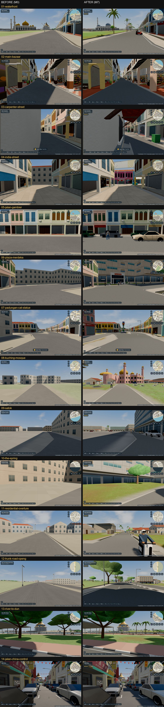

# Kuching 3D: night 1 report (2026-11-25 to 2026-11-26)

Branch `night/city-realism-1`, from `1e16c25`. Everything is committed locally. **Nothing was pushed, deployed or merged
into `main`.** All milestones M0 to M8 are closed.

## Open this first

1. The before / after sheet: [before-after.jpg](before-after.jpg) (the same 14 cameras at M0 and after M7).
2. The game:

   ```powershell
   npm run dev
   ```

   Open http://localhost:3000, pick a character, press **Start Exploring**. You are on the Waterfront.
3. Five things to try (about ten minutes): look along the Waterfront and Carpenter Street; walk to the parked taxi
   30 m from the yellow car by Jalan China; press **T** and take a taxi fare; wait about six minutes (or add
   `?time=night`) for the lit city; add `?rain=on`.
4. Play screenshots: [m7/play/](m7/play/). Night shots: [m6a/night/](m6a/night/).
5. Then read "Known issues" below. The first two are the ones to decide on.

Every night-1 feature from M5 on, and the merged experiments, can be switched off in the address bar (`?m7=0`,
`?life=0`, `?m5=0`, `?c1=0`, `?v9=0`, `?ux1=0`, `?char=0`; see [README](../../README.md)). M2 to M4 have no switch.

## What changed, per milestone

| # | Commits | What a player sees |
|---|---|---|
| M0 | `2232f94` | Baseline numbers and the fixed 14-view tour with a critique (mean 2.3 of 5) |
| M1 | `bd24fe7`, `b1aa0bc`, `b9dbe5c`, `43dcee5` | Main Bazaar arcade, Upper China Street, controls guide and a six-character picker, on by default. `experiment/omb-gps` left out (it freezes the data that M3 and M4 regenerate) |
| M2 | `5e09d43` | Humid haze to the chunk edge, equatorial sun, photo-textured ground, rain-tree avenues, a silty river |
| M3 | `5c68ce3`, `7b1ec7d` (M3b) | Eleven generic Kuching building types instead of grey boxes; M3b halved the wait at start-up and removed a 6 s freeze after "Ready" |
| M4 | `2f7e548` | Kerbs, footpaths, open drains, lane lines, crossings, bus stops, lamps and signs on every street |
| M5 | `a07fa37`, `2145982`, `909bc1d`, `ede7761`, `46339d5`, `f41c9db`, close `65fcecb` | Six hand-built places: Waterfront and Main Bazaar, Carpenter Street, India Street and Jalan Gambier, Plaza Merdeka and the Courthouse, Padungan and the cats, the two mosques |
| M6 | `6723299`, `ddc8a87` | Day and night, tropical rain, traffic keeping left and walkers citywide |
| M7 | `2721c9b`, `9265be1`, `777a12c` | Take any rule-parked car, kapcai, taxi or pickup; delivery and taxi jobs by phone with GPS; money, collisions, horn, saved progress; works by touch |
| M8 | the commit holding this file | README, limitations, assets, this report, full test run |

## Before and after



Phone versions: [m0/sheet-phone.jpg](m0/sheet-phone.jpg) and [m7/sheet-phone.jpg](m7/sheet-phone.jpg).

## Realism score trend

Mean of 14 views, 1 = toy, 5 = reads as Kuching. **Each score was given by the agent that built the milestone**, not by a
resident; treat the trend as a guide.

| M0 | M1 | M2 | M3 | M4 | M5a | M5b | M5c | M6a | M6b | M7 |
|---|---|---|---|---|---|---|---|---|---|---|
| 2.3 | 2.4 | 2.9 | 3.3 | 3.5 | 3.5 | 3.7 | 3.8 | 3.8 | 4.0 | 4.0 |

Night scenes scored 3.5 and rain 3.5 (M6a). The weakest views now: 10 The Spring (3; the camera faces a wall), then
several 4s that are still thin on people and traffic. Per-view tables: each milestone's `CRITIQUE.md`.

## Performance against the baseline

Limits: phone p95 frame time at most +15 %, start-up to ready at most +20 %, triangles at most +60 %, no shader compile
stall over 200 ms, desktop at least 50 fps. Each figure compares builds measured in the same session; absolute numbers
differ between milestones because the machine's speed drifted.

| Milestone | Phone p95 vs baseline | Phone triangles | Start-up to ready | Desktop fps (median / min) |
|---|---|---|---|---|
| M1 | A +10 %, B and C better | +3 % | +6 % | 60 (vsync cap) |
| M2 | within limit on the final pair; an earlier pair B +28 %, C +36 % led to a fix | +13 % (tour) | +10 % | 60 / 52.5 |
| M3 | -2 to +15 % | +11 to +14 % | **+37 % (missed)** | 60 / 56.1 |
| M3b | not re-benched | | -16 % | |
| M4 | -12 to +10 % | +15 to +19 % | -15 % | 60 / 59.8 |
| M5c | -10 to +3 % | +34 to +37 % | -13 % | 60 / 59.9 |
| M6a | -12 to +1 % | +34 to +37 % | -14 % | 60 / 58 |
| M6b | on/off test +5 to +11 %; bench pairs inconclusive | +46 % | -10 % | 60 / 58 |
| M7 | on/off test -5 to +6 %; bench pairs inconclusive (0 to +26 %) | +49 % | **+28 to +41 % (missed in that session)** | 60 (view 05 read 53 once) |
| M8 (start-up only) | not re-benched | | **+30 %** in one set, **+11 %** in a second | |

Start-up, M8 measurement (desktop, cold, medians of 3 alternating runs; raw: [m8/load-probe.txt](m8/load-probe.txt),
[m8/load-probe-2.txt](m8/load-probe-2.txt)):

| Set | Baseline ready | M8 ready | Baseline ready + first frames | M8 ready + first frames |
|---|---|---|---|---|
| 1 (baseline, M8) | 5.82 s | 7.56 s (+30 %) | 12.1 s | 8.0 s (-34 %) |
| 2 (baseline, M3b, M5c, M8) | 6.54 s | 7.28 s (+11 %) | 12.4 s | 7.6 s (-39 %) |

In set 2 the M3b and M5c builds read 6.49 s and 6.27 s (about the baseline), against -10 to -23 % in their own sessions,
so part of the spread is the machine. M8 is not clearly over the +20 % limit and was not investigated. It does read 12
to 16 % slower than M3b and M5c in the same set, with 73 shader programs at ready against 65 and 66. What the player
waits for (ready plus the first frames) is well under the baseline in both sets.

Size: chunk JSON +1.8 % (limit +35 %). New files in the repository 9.4 MB (guide 8 MB): 5.7 MB character models (a
player downloads only the chosen one), 3.3 MB reference photographs (only when the comparison panel opens), under
0.5 MB of textures, portraits and job data.

No phone figure comes from a physical phone: it is Chromium emulation with 4x CPU throttling.

## Full test run (M8)

All 170 browser tests (Edge with GPU, 1 worker, about 1 h), plus typecheck (clean) and 315 unit tests (all pass).

| Run | Passed | Failed | Did not run |
|---|---|---|---|
| Full suite, first pass (code of `777a12c`) | 124 | 17 | 29 (blocked behind a failure in the same file) |
| After fixing stale expectations, affected files only | **168 of 170 in total** | **2** | 0 |

Fixed in M8 (test files only, no game code):

- 14 failures in the character, picker and request-order specs: since M6 the walkers load the default character model
  too, so "exactly one model request" no longer held. Those specs now run with `?life=0`. Consequence worth knowing:
  with traffic on, `casual-character.glb` is requested even while the picker is open and alongside the chosen character.
- The production boot test never skipped the first-launch picker (on since M1); it now seeds a saved character.
- The GPS route test failed once (the car was not where the test expected) and passed on re-run with no change: flaky,
  likely because its driver cannot give way to traffic.

Still failing (listed below, not changed):

1. `character-p5` "4x CPU throttle: worst frame <= 100 ms": over the line in both runs (worst 133 ms in one). It also
   flaked in M1 and passed then. The other 8 tests of that file pass when it is left out.
2. `production` "initial download stays within the size targets": 10.35 MB gzipped against 5 MB. The test adds up every
   file in `dist/` except map data, including the character models and reference photographs that are fetched only when
   used. Either the files or the measure needs a decision.

## Known issues

Decide on these:

1. **MIT notice for the character animations.** The picker is on by default and the Rocketbox clips need their copyright
   notice on a credits page. The notice file ships; no in-game credits page exists. Build it before publishing.
2. **Nothing has run on a real phone**, and the phone bench was inconclusive for traffic and the play loop (M6b, M7).

Gameplay and looks:

- Nobody stands at a pick-up or drop-off; walkers are not hit; vehicles do not deform.
- The parked cars of the hand-built streets cannot be taken, and a new player meets them first.
- Streets are thin: a trunk-road frame shows one to three cars. No walkers in India Street or the Main Bazaar arcades.
- Kerbs and drains have no collision; signal heads do not change colour; rain falls through roofs; night lamps light
  only the ground.
- Satok has no market, The Spring reads as an office block with no entrance.
- Almost every building type, every street detail and most trees are inferred; all hand-built lots are "Approximate".
- Several places are far over the per-place triangle guide (India Street chunk +70 %, City Mosque chunk +65 %).

Engineering:

- The start screen and settings text in `index.html` still say machine-detected buildings "are drawn plain grey". Not
  true since M3 (left alone: M8 changed no source).
- The two failing tests above: character swap frames on a slow CPU, and the size of the built site.
- With traffic and walkers on, the default character model is downloaded even if another character is chosen.
- The GPS route test is flaky with traffic.
- Start-up to ready, see above.
- Two shadow-pass programs compile on first walking to the waterfront (found in M7).
- Idle Vite servers from night sessions may still be listening (ports 5175 and 4199 at the time of writing). Close
  them before benchmarking.

## Recommended plan for the next night

1. **Make it trustworthy** (first, short): credits page; fix the two stale `index.html` sentences; decide the download-size target and the
   swap-frame test; a quiet-machine bench (three alternating pairs, nothing else running) and one real phone; profile start-up.
2. **People where the player looks:** walkers in India Street and the arcades, more traffic on trunk roads, a person at
   each job end, takeable cars on the hand-built streets.
3. **Weakest places:** Satok market, The Spring frontage and entrance, parking bays from `amenity=parking`.
4. **Night:** lamp light on walls and vehicles, signal colours, rain stopped by roofs.
5. **Feel:** kerb collision for the car, walkers that react, a second job type that uses the vehicles' differences.
