# M5 place 2: Carpenter Street, the rest of it

The hand-built section used to stop at the Jalan China junction. It now runs on to Jalan Bishopgate: 110 m more street,
41 lots in five rows, built with the same shophouse kit, materials and lighting. Switch: `?m5=0` gives the N1-M4 state.

## What a player now sees
- Both sides of the street east of Jalan China as hand-kit shophouse rows with walkable five-foot ways, kerb and covered
  drain, cables under the eaves, five street lamps, lantern strings from eave to eave and six parked cars.
- Twelve boards with shop names taken from the map, thirteen with a trade word only.
- At the Bishopgate corner the five-foot way turns the corner (the C1 corner-wrap, reused).
- **Tour view 03's grey slab is gone.** It was the side wall of the Jalan China corner lot, standing bare at the road
  edge. It now has a plinth, two timber doors, a barred window, a tiled pent roof on brackets over a narrow footway, a
  string course, air-conditioners and a downpipe, and it finally stops a walker (who used to pass 3 m into it).

## References
| Photo (Wikimedia Commons) | Author, licence | Used for | Shipped |
|---|---|---|---|
| `Chinese-style Gate.jpg` | Travelust from Southeast Asia, CC BY 2.0 | two-storey rows on both sides, lantern strings across the street, cars at the kerb | `public/reference/carpenter-street-gate.jpg` |
| `Kuching City (17588324240).jpg` (reference [C]) | Marufish, CC BY-SA 2.0 | a corner building's side wall with a tiled pent roof; lanterns | already shipped |
| `Chinese Temple on Carpenter Street, Kuching.jpg` | chipmunk_1, CC BY-SA 2.0 | street character only (Hong San Si stands on Jalan Ewe Hai, outside this place) | no (`consulted`) |

**Gap:** no licensed photograph shows the rows east of Jalan China (docs/night/refs/PLACES.md, section 2). Every lot is
therefore Approximate. No Google imagery.

## Street frame (measured before modelling)
- Frontages are mapped block edges: north = the closing edge of OSM way 236495388 (92.7 m), south = edges 7 and 8 of
  way 236495302 (8.3 m under the separately mapped Hainan Association, then 73.7 m).
- Between them the street is **8.9 m wide at the west end and 7.7 m at Bishopgate**. The mapped centre line runs 3.6 m
  from the north frontage and 5.3 m from the south one, so the carriageway is laid on the middle line (`CARP_E`).
- Between the Jalan China corner block and block 236495235 the mapped outlines leave only **5 m**: an outline error
  of about 4 m in one of them. Nothing was moved; the neck is kept and logged in LIMITATIONS.md.
- The terrain falls 0.9 m along the street and up to 0.7 m across it. Lots are level and step with it; the carriageway
  follows it.

## Elements: verified or not
| Element | Status | Basis |
|---|---|---|
| Block outlines, street line, shop positions (OSM nodes) | Verified | OpenStreetMap |
| Two-storey shophouse rows with five-foot ways on both sides | Verified form | gate photograph (for the street as a whole) |
| Lantern strings across the street | Verified form | gate photograph, reference [C] |
| Cars parked at the kerb | Verified form | gate photograph; positions Approximate, all on the south side (see below) |
| Corner block side elevation with a pent roof | Approximate | the type is seen on the opposite corner in [C]; this wall is not photographed |
| Every lot's colour, windows, shopfront, roof and storey count | Approximate | typical Carpenter Street forms |
| Trade-word boards | Approximate | generic; no name or number invented |

## Lot table
Status per lot: **Verified** = form and name from a photograph or the map; **Verified form** = form from a photograph;
**Approximate** = neither. A board with a mapped name is the map's name on an Approximate facade.
Positions are world metres (x east, z south) of the lot's middle on the frontage.

| Row | Lot | Side, position | Storeys | Windows | Shopfront | Roof | Board | Status | Basis |
|---|---|---|---|---|---|---|---|---|---|
| CN | 0 | north, (174, 32) | 2 | louvre | roller | tile | none | Approximate | plausible form for Carpenter Street, not surveyed |
| CN | 1 | north, (179, 33) | 2 | casement | folding | tile | trade word "KEDAI TIMAH" | Approximate | plausible form for Carpenter Street, not surveyed |
| CN | 2 | north, (184, 34) | 2 | louvre | open | tile | trade word "KEDAI KOPI" | Approximate | plausible form for Carpenter Street, not surveyed |
| CN | 3 | north, (189, 35) | 2 | slider | roller | zinc | none | Approximate | plausible form for Carpenter Street, not surveyed |
| CN | 4 | north, (194, 36) | 2 | arched | grille | tile | trade word "KEDAI EMAS" | Approximate | plausible form for Carpenter Street, not surveyed |
| CN | 5 | north, (199, 37) | 2 | louvre | open | tile | mapped name: Yee Siang Dumpling House (osm:node/12060913269) | Approximate | plausible form for Carpenter Street, not surveyed |
| CN | 6 | north, (204, 39) | 3 | casement | folding | zinc | trade word "KEDAI PERABOT" | Approximate | plausible form for Carpenter Street, not surveyed |
| CN | 7 | north, (209, 40) | 2 | louvre | grille | tile | none | Approximate | plausible form for Carpenter Street, not surveyed |
| CN | 8 | north, (213, 41) | 2 | louvre | open | tile | trade word "KEDAI KOPI" | Approximate | plausible form for Carpenter Street, not surveyed |
| CN | 9 | north, (218, 42) | 2 | arched | roller | tile | none | Approximate | plausible form for Carpenter Street, not surveyed |
| CN | 10 | north, (223, 43) | 2 | louvre | folding | zinc | trade word "KEDAI RUNCIT" | Approximate | plausible form for Carpenter Street, not surveyed |
| CN | 11 | north, (228, 45) | 2 | casement | open | tile | none | Approximate | plausible form for Carpenter Street, not surveyed |
| CN | 12 | north, (233, 46) | 2 | slider | glass | zinc | mapped name: Tai Moh & Co (osm:node/12779002955) | Approximate | plausible form for Carpenter Street, not surveyed |
| CN | 13 | north, (238, 47) | 2 | louvre | grille | tile | mapped name: Zoey Coffee (osm:node/12060534269) | Approximate | plausible form for Carpenter Street, not surveyed |
| CN | 14 | north, (243, 48) | 2 | louvre | open | tile | trade word "KEDAI JAHIT" | Approximate | plausible form for Carpenter Street, not surveyed |
| CN | 15 | north, (248, 49) | 2 | louvre | roller | tile | mapped name: Zoey's Books & Coffee (osm:node/11752139826) | Approximate | plausible form for Carpenter Street, not surveyed |
| CB | 0 | Bishopgate (west side), (263, 50) | 2 | louvre | open | tile | mapped name: The Fern (osm:node/12779002952) | Approximate | plausible form for Carpenter Street, not surveyed; five-foot way turns the corner |
| CB | 1 | Bishopgate (west side), (265, 45) | 2 | casement | roller | tile | none | Approximate | plausible form for Carpenter Street, not surveyed |
| CB | 2 | Bishopgate (west side), (267, 40) | 2 | louvre | folding | zinc | trade word "KEDAI RUNCIT" | Approximate | plausible form for Carpenter Street, not surveyed |
| CB | 3 | Bishopgate (west side), (269, 34) | 2 | arched | grille | tile | mapped name: Saigon cuisine (osm:node/4191191194) | Approximate | plausible form for Carpenter Street, not surveyed |
| CH | 0 | south, (186, 44) | 3 | casement | folding | tile | mapped name: Kuching Hainan Association (osm:way/1388134056) | Approximate | mapped: Kuching Hainan Association (OSM way 1388134056); form typical, not surveyed |
| CH | 1 | south, (182, 43) | 3 | casement | folding | tile | none | Approximate | mapped: Kuching Hainan Association (OSM way 1388134056); form typical, not surveyed |
| CS | 0 | south, (258, 60) | 2 | louvre | roller | tile | none | Approximate | plausible form for Carpenter Street, not surveyed |
| CS | 1 | south, (253, 59) | 2 | casement | open | tile | mapped name: Drunk Monkey (osm:node/4186870293) | Approximate | plausible form for Carpenter Street, not surveyed |
| CS | 2 | south, (248, 57) | 2 | louvre | folding | tile | mapped name: Hui Fua Furniture Trading (osm:node/12779002954) | Approximate | plausible form for Carpenter Street, not surveyed |
| CS | 3 | south, (243, 56) | 2 | slider | roller | zinc | mapped name: Benzamine Book Centre (osm:node/12779002953) | Approximate | plausible form for Carpenter Street, not surveyed |
| CS | 4 | south, (239, 55) | 2 | arched | open | tile | mapped name: DIY Dorm (osm:node/5157090122) | Approximate | plausible form for Carpenter Street, not surveyed |
| CS | 5 | south, (234, 54) | 2 | louvre | grille | tile | trade word "KEDAI EMAS" | Approximate | plausible form for Carpenter Street, not surveyed |
| CS | 6 | south, (229, 53) | 2 | louvre | open | tile | none | Approximate | plausible form for Carpenter Street, not surveyed |
| CS | 7 | south, (224, 52) | 2 | casement | folding | zinc | trade word "KEDAI RUNCIT" | Approximate | plausible form for Carpenter Street, not surveyed |
| CS | 8 | south, (219, 51) | 3 | slider | roller | zinc | none | Approximate | plausible form for Carpenter Street, not surveyed |
| CS | 9 | south, (215, 50) | 2 | louvre | open | tile | trade word "KEDAI KOPI" | Approximate | plausible form for Carpenter Street, not surveyed |
| CS | 10 | south, (210, 49) | 2 | arched | grille | tile | mapped name: Seng Furnishing (osm:node/12779002971) | Approximate | plausible form for Carpenter Street, not surveyed |
| CS | 11 | south, (205, 48) | 2 | louvre | folding | tile | none | Approximate | plausible form for Carpenter Street, not surveyed |
| CS | 12 | south, (200, 47) | 2 | casement | open | tile | trade word "KEDAI JAHIT" | Approximate | plausible form for Carpenter Street, not surveyed |
| CS | 13 | south, (195, 46) | 2 | louvre | roller | tile | none | Approximate | plausible form for Carpenter Street, not surveyed |
| CS | 14 | south, (191, 45) | 2 | louvre | grille | tile | trade word "KEDAI EMAS" | Approximate | plausible form for Carpenter Street, not surveyed |
| CR | 0 | south block, rear, (184, 81) | 2 | louvre | roller | tile | none | Approximate | plausible form for Carpenter Street, not surveyed |
| CR | 1 | south block, rear, (189, 81) | 2 | casement | roller | tile | none | Approximate | plausible form for Carpenter Street, not surveyed |
| CR | 2 | south block, rear, (193, 82) | 2 | louvre | folding | zinc | none | Approximate | plausible form for Carpenter Street, not surveyed |
| CR | 3 | south block, rear, (198, 83) | 2 | louvre | roller | tile | none | Approximate | plausible form for Carpenter Street, not surveyed |

41 lots: 12 boards with a mapped name, 13 with a trade word, 16 blank. Row CR is the south block's short mapped frontage
toward Jalan Wawasan (simplified geometry, no boards). Lot widths 4.2 to 5.6 m (each frontage divided evenly).

## Before and after (fixed cameras)
Cameras: `tools/dev/m5-carpenter-views.json`, captured as for place 1. "Before" is the same build with `?m5=0`.

| View | Before | After |
|---|---|---|
| 01 tour view 03 (the slab) | 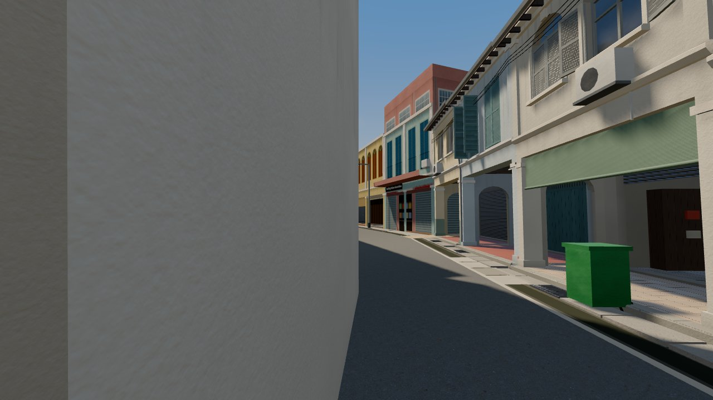 | 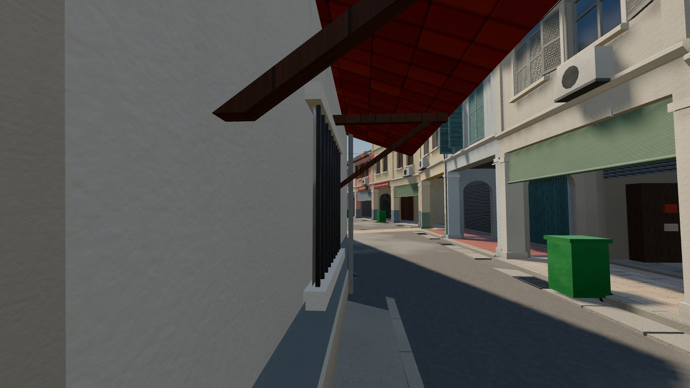 |
| 02 from the Jalan China junction | 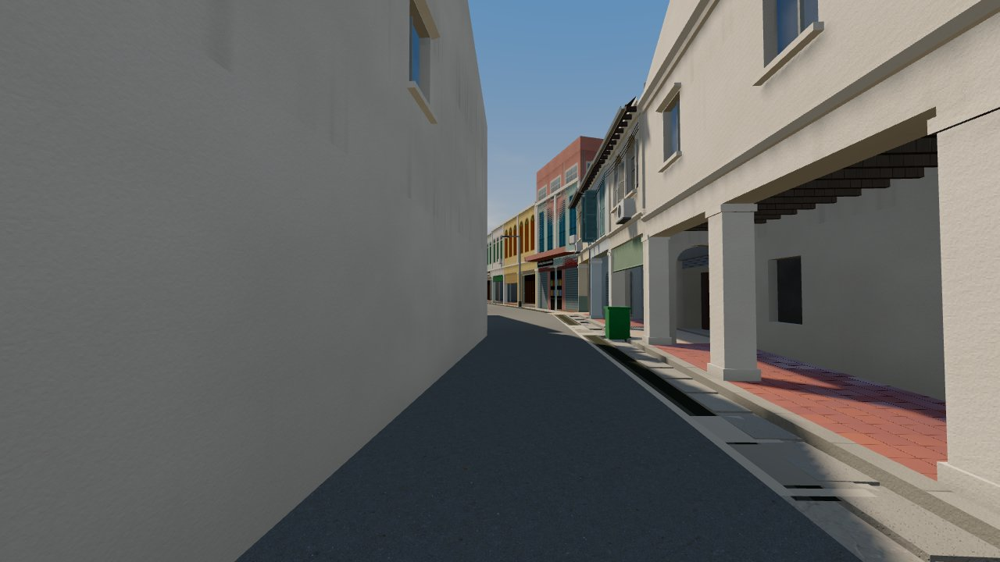 | 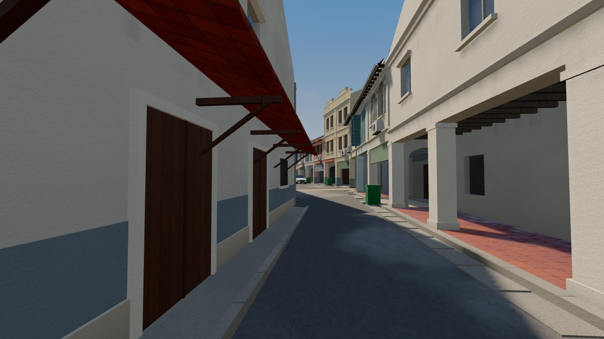 |
| 03 mid street, looking east | 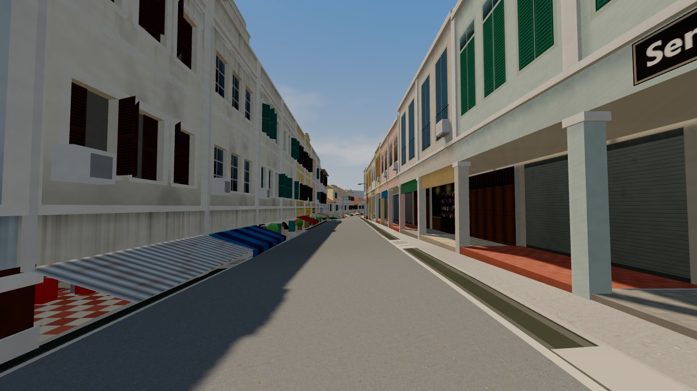 | 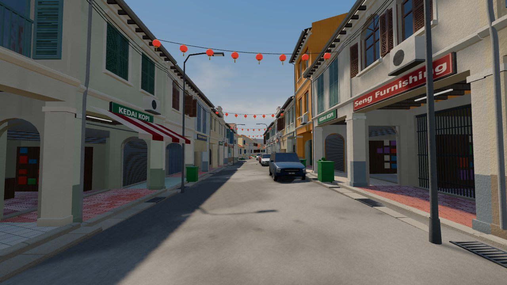 |
| 04 from Jalan Bishopgate | 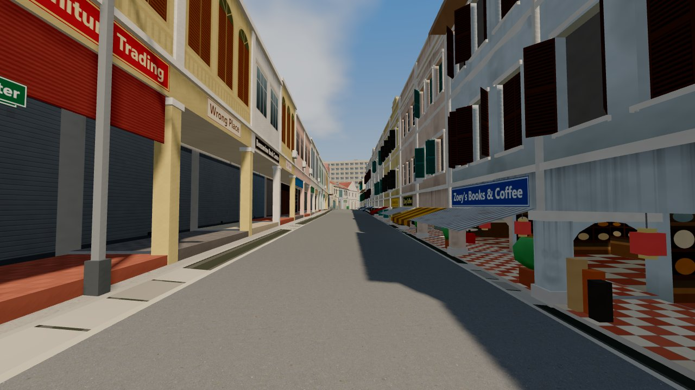 | 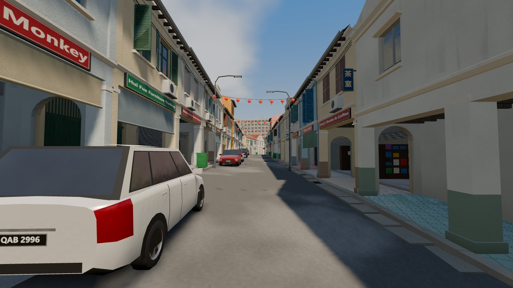 |
| 05 north five-foot way | 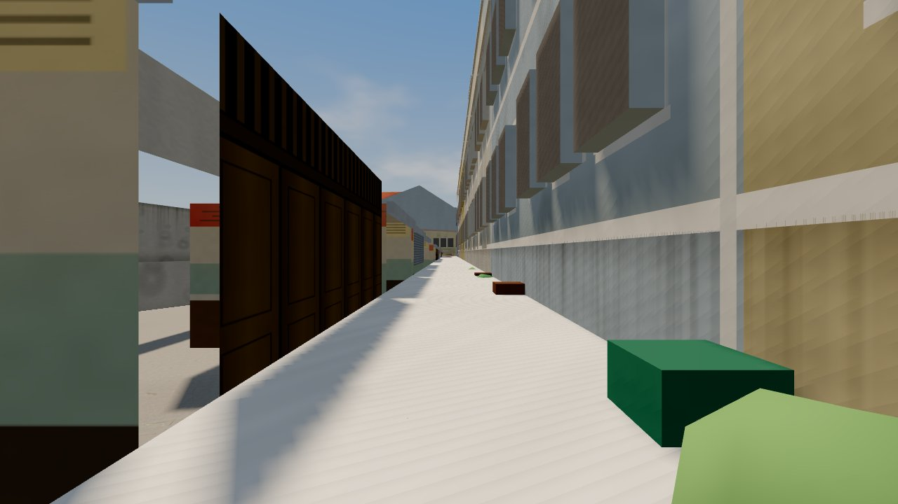 | 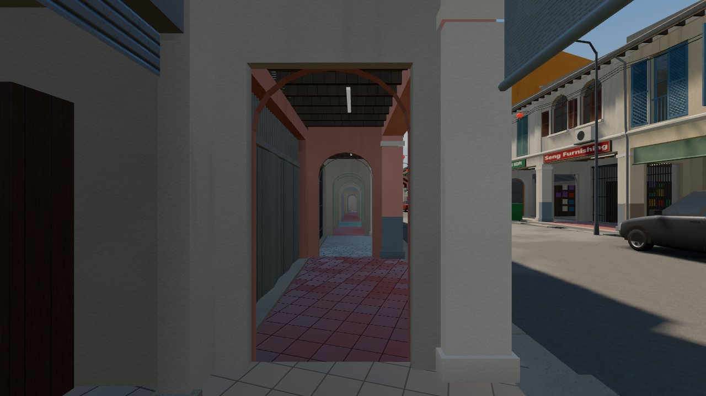 |
| 06 south row | 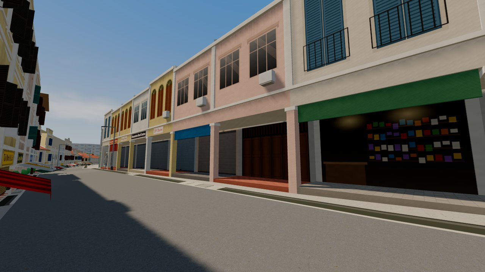 | 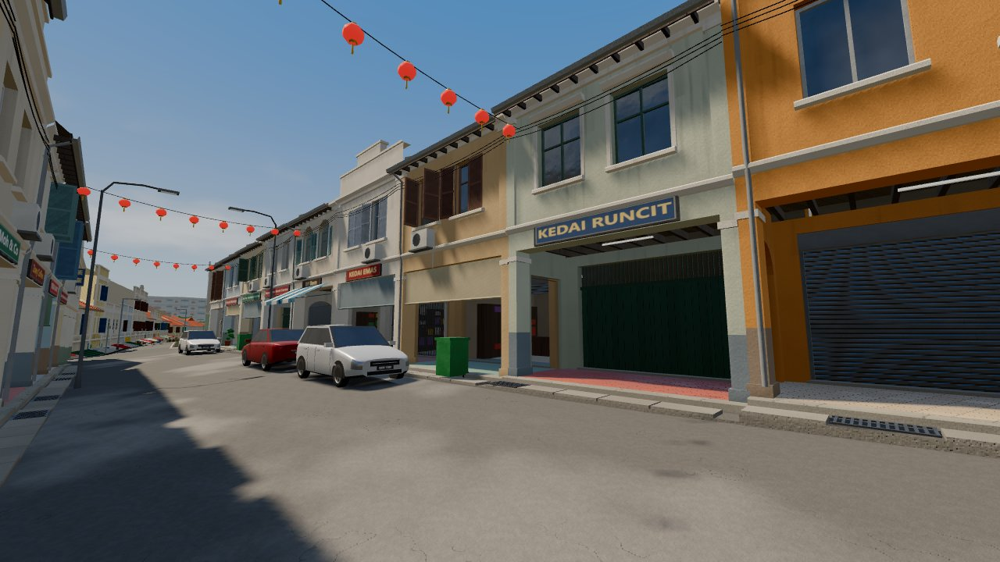 |
| 07 Bishopgate corner | 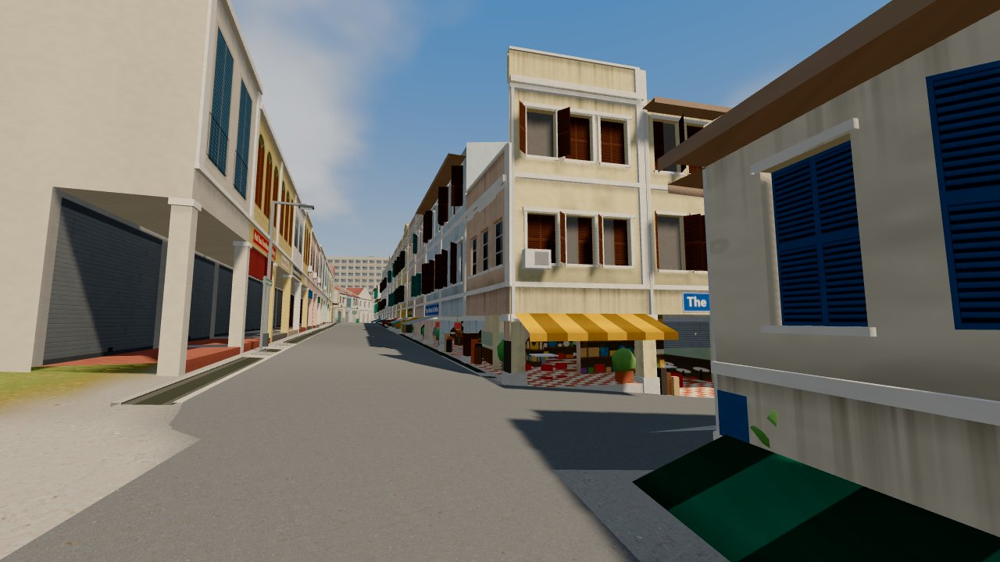 | 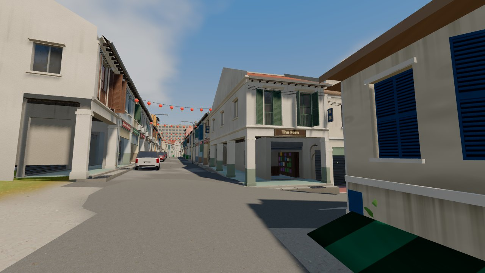 |
| 08 from above | 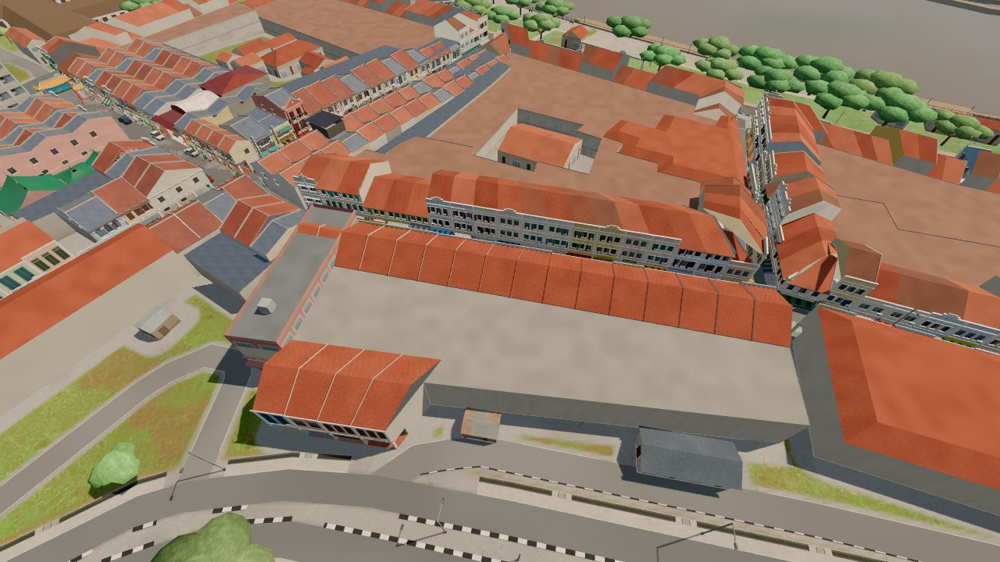 | 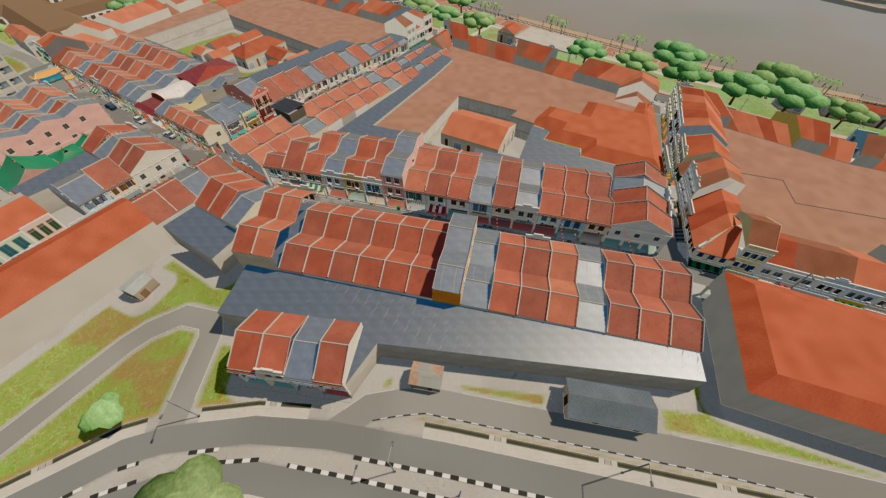 |

## Numbers (this place alone)
| Measure | Before | After |
|---|---|---|
| Street section (the hand-built scene): triangles / draw calls / lots | 229,250 / 56 / 65 | 314,962 / 56 / 106 |
| Chunk 0_0 triangles / meshes (its three blocks are no longer drawn by the chunk) | 36,919 / 22 | 21,561 / 21 |
| Section and chunk 0_0 together | 266,169 / 78 | 336,523 / 77 (**+26 %**) |
| Section on the Low preset | 229,250 | 300,806 |
| New materials, shader programs, downloads | | 0, 0, 0 |
| Desktop fps in the eight views (Medium, 1280x720) | 60 | 60 |

**Over the per-place guide** of about +12 % triangles: a hand-kit lot is about 2,100 triangles against roughly 400 for
the chunk's own shophouse lot, and there are 41 of them. No draw call was added (the rows are merged into the
section's one mesh per material; a second mesh set was measured and dropped: +15 to +19 draw calls wherever both were
in view). On Low the new rows drop ceiling joists, rafter tails, loose dressing and cables. The phone benchmark, which
drives this street in scenario C, stayed within budget: `docs/night/m5a/NOTES.md`.

## How it works
- `src/v5/geo.ts`: rows `CN`, `CB`, `CH`, `CS`, `CR`, the two block rings, the middle line `CARP_E`; the chunk road is
  cut to x = 262.4 and street furniture leaves the corridor. `src/v5/lots.ts`: the lot table and the trade-word boards.
- `src/v5/carpenterEast.ts`: carriageway (follows the terrain across as well as along), the corner block's side
  elevation, lamps, lantern strings, parked cars, with their collision.
- `src/v5/V5Scene.ts`: these rows step lot by lot with the ground, get a footing under the kerb, block at the shopfront
  line and the piers, and carry cables lot by lot; the Bishopgate corner return reads its rise from the terrain.
- `src/v5/controller.ts`: chunk 1_0 is rebuilt on a render-mode switch as well (the section now reaches into it).
- Tests: `tests/unit/m5-carpenter.test.ts` (7), `tests/e2e/m5-carpenter.spec.ts` (street, both five-foot ways, shopfronts
  and the corner wall); the C1 unit tests now pin `m5=0` so they still measure the C1 corner alone.

## Not done, honestly
- No lot is verified from a photograph. Hong San Si temple and Jalan Ewe Hai are outside this place.
- The Jalan Bishopgate frontage north of the corner (block 236495316) is still the chunk's own rendering.
- All parked cars stand at the south kerb: the mapped centre line, which the drive graph follows, runs 3.6 m from the
  north frontage.
- The 5 m neck at the Jalan China corner is a mapped-outline error and stays; the corner wall blocks a walker from
  0.3 m behind its face only, so that a car on the mapped line is not stopped.
- Tour view 03's camera stands 0.6 m from that wall, so the wall still fills the left of the frame: it now reads as
  the side of a building, not as a slab.
- The north row's first lot is 5.5 m deep and still overlaps the Jalan China block's rear by a wedge of about 5 m2
  (out of sight from the street).
