# M5 place 6: the Kuching City Mosque and the floating mosque

Two mosques on the river side of the old town. The City Mosque (Masjid Bandaraya Kuching, OSM way 233622270) was a
plain three-storey hall under a red tiled roof: the least recognisable landmark of the tour (view 08, score 2.5). The
floating mosque (Masjid India Bandar Kuching, way 568501301) had a model, but one drawn before any photograph was
looked at: gold domes, battlements and two minarets, none of which the photograph shows. Switch: `?m5=0` gives the
N1-M4 state of both.

## What a player now sees
- **City Mosque (tour view 08):** pink walls with pilasters that rise through a crenellated parapet, two storeys of
  dark windows under gold bonnets, a large ribbed gold onion dome on a windowed drum, four smaller gold domes on
  kiosks round it, four round pink minarets with an open top stage under a gold cap, small gold-capped turrets along
  the parapet, and an entrance under a flat canopy on slender columns with steps and a shallow gold dome above it.
- **The cemetery in front of it:** 332 graves, each a low white kerb round a strip of grass with a stone at either
  end, in rows that lie across the direction of Mecca.
- **Floating mosque:** a railed deck over the water, a low white hall behind a continuous arcade of round-headed
  openings, a set-back upper storey, a slate dome on a tall windowed drum, a smaller dome on a round drum towards the
  water, and one slender minaret with three balconies on a square base.

## References
| Photo (Wikimedia Commons) | Author, licence | Used for | Shipped |
|---|---|---|---|
| `Kuching Town Mosque.jpg` | Mx. Granger, **CC0** | walls, pilasters, parapet, windows under gold bonnets (two storeys), the entrance canopy on slender columns with steps, domes and minaret tops | `public/reference/city-mosque-front.jpg` |
| `Masjid Bandaraya Kuching.jpg` | Wee Hong, CC BY-SA 4.0 | the whole mosque across the cemetery: one large dome, smaller domes, minarets, the lawn of white grave markers | `public/reference/city-mosque-from-the-cemetery.jpg` |
| `Floating mosque near Kuching river.jpg` | Cerevisae, CC BY-SA 4.0 | the floating mosque at night: arcade, deck, upper storey, dome on a drum, small dome, one minaret | `public/reference/floating-mosque-night.jpg` |

All three are recorded in `public/reference/manifest.json`. No new photograph was downloaded: daylight photographs of
the floating mosque exist on Commons (docs/night/refs/PLACES.md, section 6) but are not in the local set, and a
download needs the owner. No Google imagery.

## Frames (measured before modelling)
- **City Mosque:** the mapped outline has 25 vertices: a hall about 36 by 38 m turned 24 degrees, stepped on two
  sides, with a round projection (a run of short edges, radius about 7 m) at its south end. The front photograph was taken
  from a car park looking at the entrance; the round projection faces the mapped service road and car park side, so
  it is taken as the entrance. Tour view 08 looks at the mosque from the south-east across the mapped cemetery,
  close to the standpoint of the second photograph.
- **Cemetery:** five mapped cemetery polygons in chunks -2_-1 and -2_0, crossed by a mapped lane, a path and steps.
- **Floating mosque:** the mapped outline is the whole deck, 63 by 38 m, standing in the mapped water. The water
  side is found from the height grid, as before.

## Elements: verified or not
| Element | Status | Basis |
|---|---|---|
| Outlines and positions of both mosques; the cemetery polygons, lanes and paths; both names | Verified | OpenStreetMap |
| City Mosque: pink, pilasters through a crenellated parapet, two storeys of windows under gold bonnets | Verified form | front photograph |
| City Mosque: one large gold onion dome, smaller gold domes round it, round minarets with an open top stage and gold cap, gold-capped turrets | Verified form | both photographs |
| City Mosque: entrance canopy on slender columns, steps | Verified form | front photograph |
| City Mosque: where on the outline the domes, the four minarets and the turrets stand; that there are exactly four small domes and four minarets; that the round projection is the entrance; the shallow dome over it; bay spacing (4.4 m); every height (walls 10.5 m, minarets 24.5 m, dome radius 6.4 m); the faces no photograph shows | **Approximate** | the photographs give number and order from two sides, not a plan |
| Cemetery: a lawn of low white grave markers | Verified form | second photograph |
| Cemetery: every grave (position, spacing, colour), their common direction | **Approximate** | by rule: rows 3.8 m apart, graves 2.5 m apart, 40 % of plots used, long axis square to 292.5 degrees |
| Floating mosque: deck with railing, arcade of round arches, set-back upper storey, dome on a tall windowed drum, small dome, **one** slender minaret with balconies on a square base | Verified form | night photograph |
| Floating mosque: colours (white walls, slate domes, nothing gold) | **Approximate** | the photograph is at night: the dome reads dark and the minaret is lit blue |
| Floating mosque: where along the water side the minaret and small dome stand; every dimension (minaret 29.8 m above the deck); three faces | **Approximate** | one photograph |
| The mosque's glass annex, its fence, palms and car park; the mosque's interior | **Not built** | |

Status per building: City Mosque **Verified form** (layout Approximate); floating mosque **Verified form** (colours
Approximate); every grave **Approximate**.

## Before and after (fixed cameras)
Cameras: `tools/dev/m5-mosque-views.json` (OP fly poses), captured with
`node tools/dev/street-shots.ts <dir> --url=http://localhost:5175/[?m5=0] --views=tools/dev/m5-mosque-views.json --quality=medium --size=1280x720 --jpeg --stats`.

| View | Before | After |
|---|---|---|
| 01 City Mosque (tour view 08) | 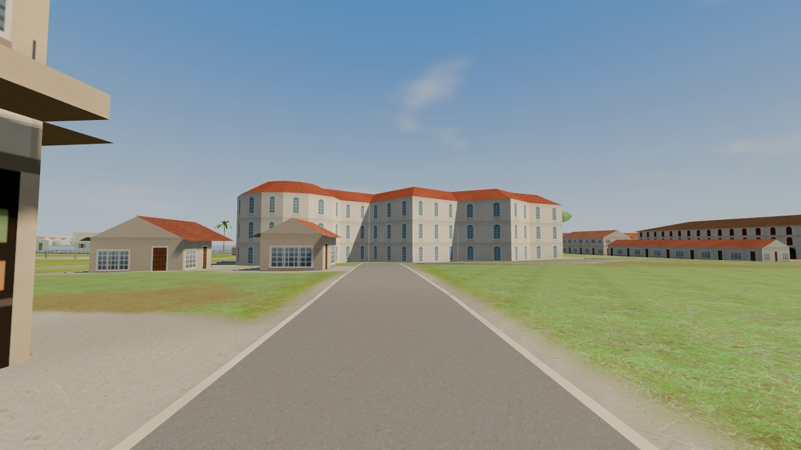 | 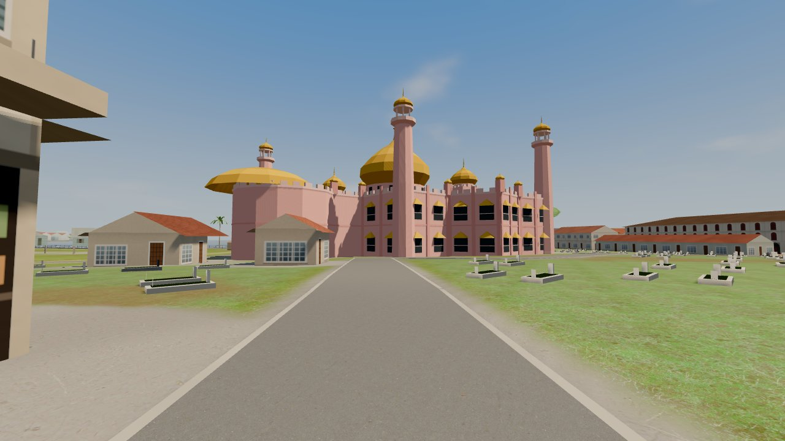 |
| 02 across the cemetery | 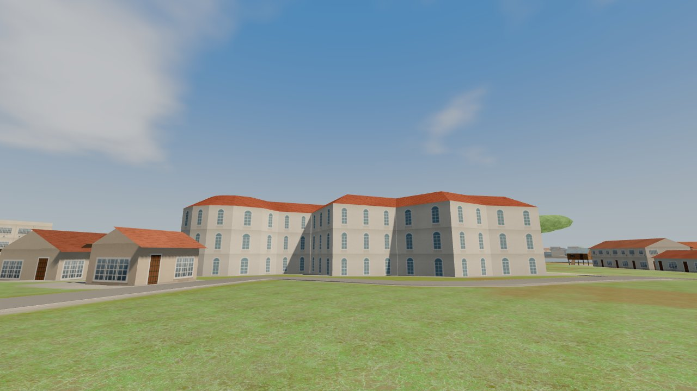 | 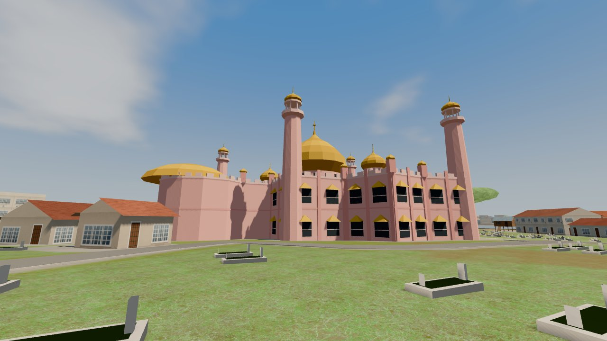 |
| 03 the entrance | 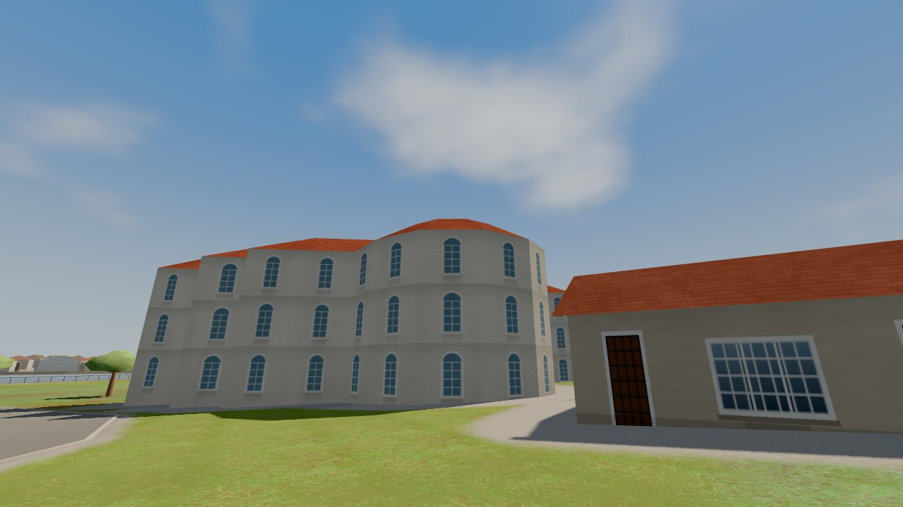 | 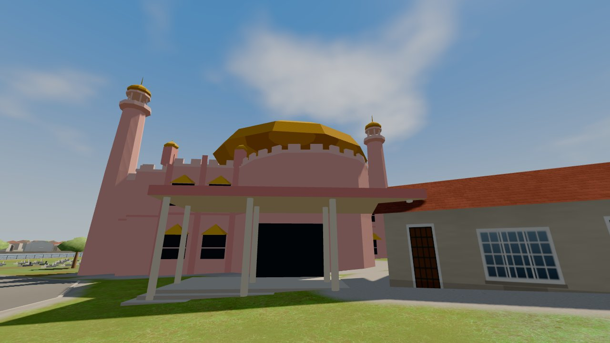 |
| 04 east side | 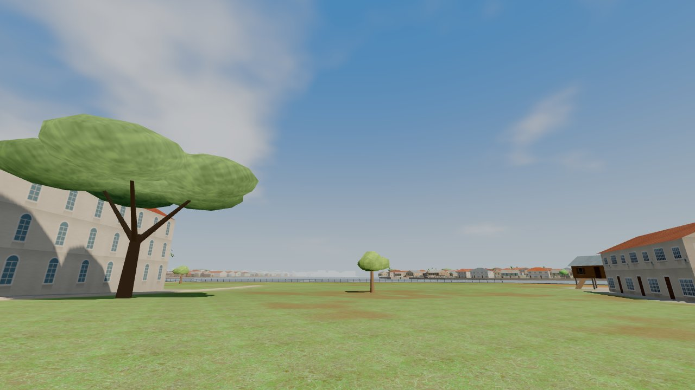 | 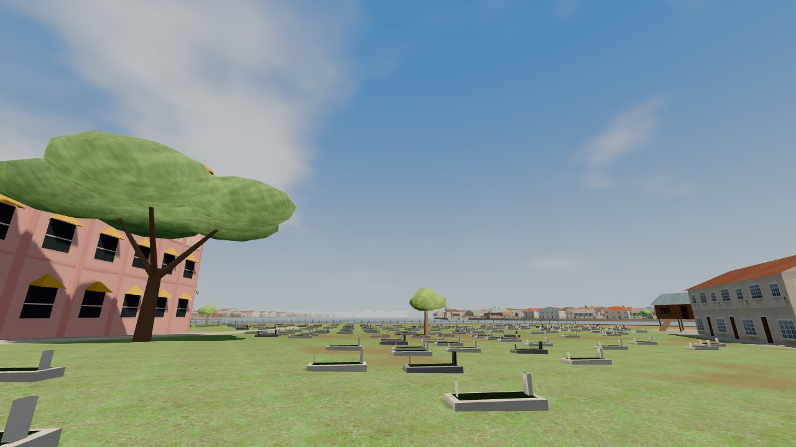 |
| 05 from above | 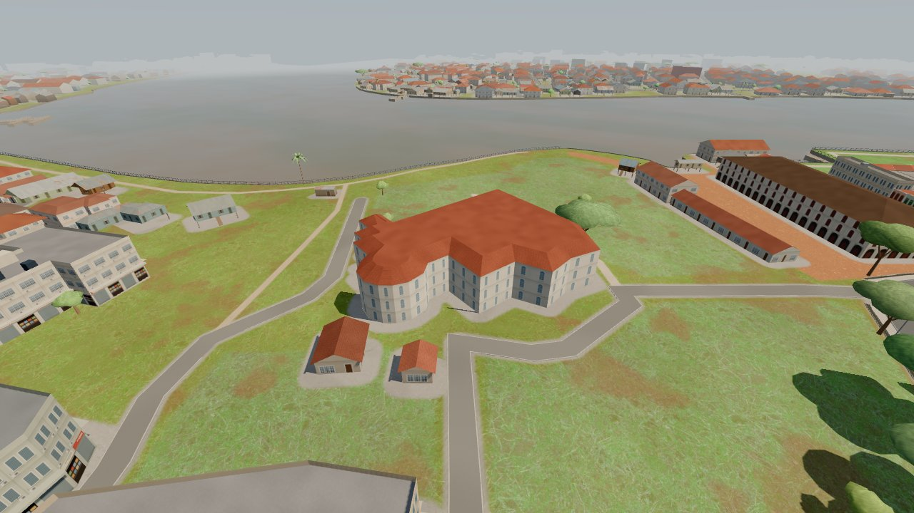 | 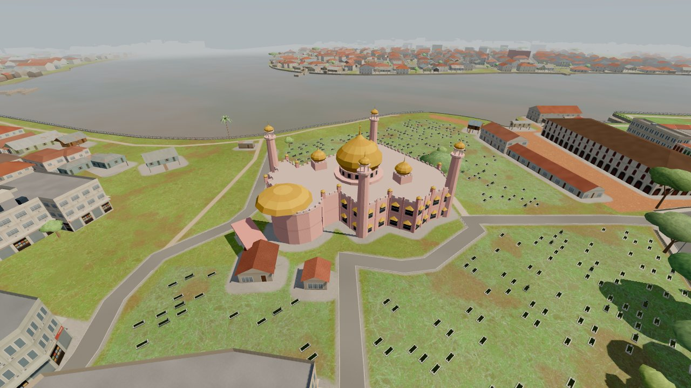 |
| 06 floating mosque from the riverside walk | 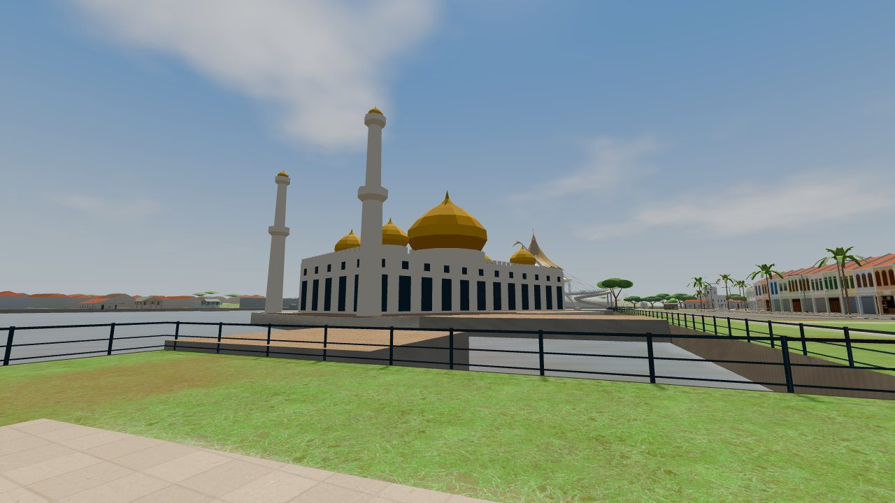 | 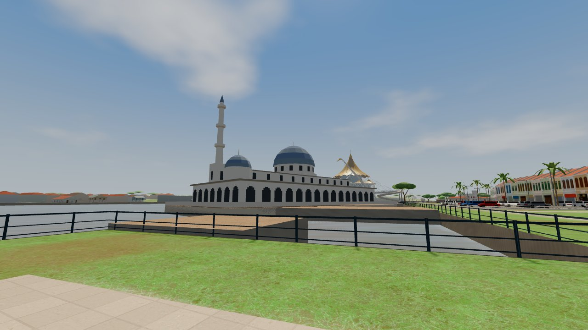 |
| 07 floating mosque from the east | 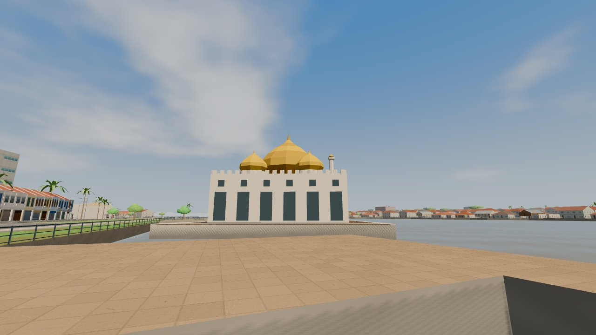 | 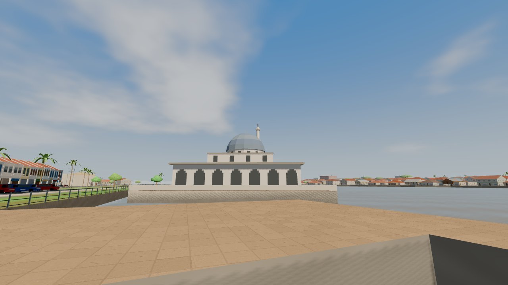 |
| 08 floating mosque from above | 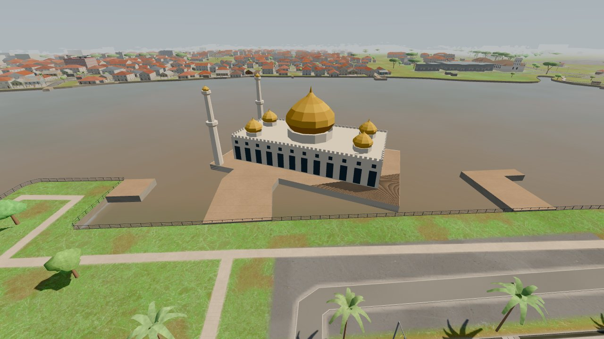 | 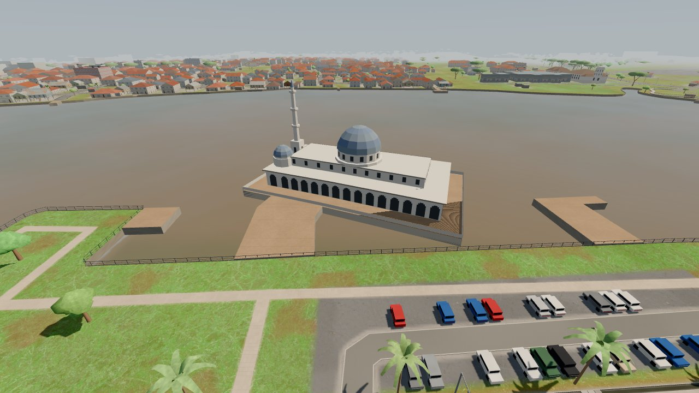 |

## Numbers (this place alone; read in the running game, Medium, `tools/dev/chunk-tris.mts`)
| Chunk | Before (triangles / meshes) | After | Change |
|---|---|---|---|
| -2_-1 (City Mosque, 287 graves) | 18,014 / 22 | 29,768 / 23 | **+65 %**, one mesh (the mosque's model) |
| -2_0 (45 graves) | 35,663 / 19 | 36,653 / 19 | +2.8 % |
| -1_-2 (floating mosque) | 3,613 / 9 | 2,313 / 9 | -36 % (the new model is lighter than the old) |

Chunk -2_-1 is far over the +12 % guide. About half of the growth is the graves (22 triangles each, after a first
version with 437 graves at 44 triangles was cut), the rest the mosque's model. It was a light chunk, and at 29.8 k it
is still lighter than its neighbour. One draw call was added. All eight cameras hold 60 fps on the desktop at Medium.
No download, no chunk JSON change.

## Collision and play
- The City Mosque blocks on its mapped outline, as before. The canopy columns, steps and graves have no collision: a
  walker passes through a headstone.
- The floating mosque's collision is unchanged (the mapped outline).

## Not done
- A daylight reference for the floating mosque's colours.
- The City Mosque's glass annex, fence, car park and palms; the cemetery's own paths and trees.
- Two machine-detected footprints stand in front of the entrance as small generic houses (probably the real canopy
  seen from the air); they were left alone.
- The Low preset draws only the two stones of each grave; on the phone tour they are barely visible.
