# M5 place 3: India Street and Jalan Gambier

India Street (Jalan India) is Kuching's covered pedestrian mall. In the game it was a strip of bare paving between
blank side walls with a four-storey grey block at one side: the data knew shop frontages only on mapped *ways*, and
India Street is mapped as an *area*. It is now a street. Switch: `?m5=0` gives the N1-M4 state.

## What a player now sees
- **Shops on both sides.** 74 two-storey lots with walkable five-foot ways front the mall, in bright paint (yellow,
  blue, green, orange, pink, teal, white), most with an air-conditioner on the upper wall.
- **The canopy.** A fabric vault on fourteen tall white steel columns down the middle of the street, 170 m long.
- **Diamond tile paving** from frontage to frontage: a grey diamond with a cream heart every 6 m, dark edge bands.
- **Street life.** 35 textile stalls (garment rails, cloth-covered tables with folded stacks, parasols), cloth awnings
  over 43 shopfronts, Malaysian flags on raked poles.
- **Seventeen real shop names** on the fascias, taken from the map (for example Bata, Sin Nam Fatt, Syarikat Jasmin
  Jawahar). A lot without a mapped business has no board.
- **Jalan Gambier:** cars and kapcai parked along the shophouse kerb, blinds on the five-foot way, and cars in the bays
  of the mapped riverside car park.
- Tour view 04 used to end on the grey block. It now ends on a pink shophouse under the canopy.

## References
| Photo (Wikimedia Commons) | Author, licence | Used for | Shipped |
|---|---|---|---|
| `India Street, Kuching, Sarawak.jpg` | Fabio Achilli, CC BY 2.0 | canopy on white columns, diamond tile paving, stalls in the street, bright two-storey shops | `public/reference/india-street-1.jpg` |
| `India Street, Kuching, Sarawak 2.jpg` | Fabio Achilli, CC BY 2.0 | air-conditioner units on the first-floor wall, Malaysian flags, the canopy | `public/reference/india-street-2.jpg` |

Both are recorded in `public/reference/manifest.json`. No new photograph was downloaded (both were already in
`docs/night/refs/img/`). No Google imagery. **Jalan Gambier has no licensed photograph** (docs/night/refs/PLACES.md,
section 3): everything added there is Approximate.

## Street frame (measured before modelling)
- India Street is OSM way 69928034, a pedestrian *area*. Its two long sides are block edges: north = two edges of way
  233689138 (73.8 m and 108.1 m); south = edges of ways 233689193, 235772981 and 235772967, with the 7.6 m mouth of
  Lorong Kai Joo between the last two.
- **Width between the frontages: 12.4 m at the west end, 9.9 m at the narrowest (65 m in), 14.6 m at the east end.**
- **The street climbs 3.0 m** from west (2.8 m) to east (5.8 m). The north block is one mapped outline, so one level row
  would have buried its east end by 1.5 m. Its street side is therefore built as seven pieces of five lots, each 14 m
  deep with its own floor level (0.4 m steps); the rest of the block stands behind them, two storeys high.
- The block's mapped height (12 m) was a default, not a survey; the photographs show two storeys, so 8.2 m is used.
- Jalan Gambier: way 217916874, one-way, 7.2 m (estimated width). The row fronting it (way 233689135) was already a
  shophouse row. The riverside car park (a mapped `amenity=parking` area) has its lane, way 217926882, through it.

## Elements: verified or not
| Element | Status | Basis |
|---|---|---|
| Outline of the paved strip, block outlines, Lorong Kai Joo, the car park and its lane | Verified | OpenStreetMap |
| Shop names on boards (17) | Verified (name and block) | OpenStreetMap nodes and Overture places inside the block; **which lot** is by nearest position, Approximate |
| Pedestrian street, shops on both sides, two storeys, bright paint | Verified form | both photographs |
| Canopy: fabric roof on tall white columns down the middle | Verified form | both photographs; span, height (9.6 to 10.75 m), column spacing (12 m), arm pattern and panel colours are **Approximate** |
| Diamond tile paving | Verified form | first photograph; colours and the 6 m module are Approximate |
| Air-conditioner units, Malaysian flags on raked poles, awnings | Verified form | second photograph; which lot has one is by rule |
| Textile stalls out in the street | Verified form | first photograph; positions, goods and parasols by rule |
| Five-foot ways on the India Street lots | Approximate | typical of Kuching rows; the photographs do not show whether these shops have them |
| Each lot: width (about 5.2 m), paint, shopfront, windows | Approximate | by rule; lot lines are not mapped |
| The star-burst ornament and banners hanging under the real canopy | **Not built** | |
| Jalan Gambier: parked cars, kapcai, blinds, cars in the car park | Approximate | no photograph; typical street life placed by rule |

## Lot table (India Street, west to east)
Status per lot: **Verified** = form and name from a photograph or the map; **Verified form** = form from a photograph;
**Approximate** = neither. No lot here is better than Approximate: the photographs cannot be tied to a lot. "Name mapped"
means the board's text is a mapped business in that block. No house number is shown (twelve are mapped; they were not
fitted to lots).

| Lot | Side | Block:edge | Paint | Dressing | Board (mapped business) | Status |
|---|---|---|---|---|---|---|
| 1 | north | 23368913801:0 | pink |  | Oriental Pharmacy (osm) | Approximate; name mapped |
| 2 | north | 23368913801:0 | green |  |  | Approximate |
| 3 | north | 23368913801:0 | white | flag, AC |  | Approximate |
| 4 | north | 23368913801:0 | pale yellow | awning, flag, AC |  | Approximate |
| 5 | north | 23368913801:0 | pink | awning, AC | Mee Hua Goldsmith (overture, "61, India St") | Approximate; name mapped |
| 6 | north | 23368913802:0 | yellow | awning, flag, AC | Bata (osm) | Approximate; name mapped |
| 7 | north | 23368913802:0 | blue | awning, AC | Sen Fah Co. (osm) | Approximate; name mapped |
| 8 | north | 23368913802:0 | blue | awning, AC |  | Approximate |
| 9 | north | 23368913802:0 | pale yellow | awning, flag |  | Approximate |
| 10 | north | 23368913802:0 | violet | awning, AC |  | Approximate |
| 11 | north | 23368913803:0 | orange | awning, flag, AC | India Street Bazar, Kuching (overture) | Approximate; name mapped |
| 12 | north | 23368913803:0 | pink | AC |  | Approximate |
| 13 | north | 23368913803:0 | pink | awning, flag, AC | Syarikat Jasmin Jawahar (osm, "43 Jalan India") | Approximate; name mapped |
| 14 | north | 23368913803:0 | pink | AC | Syarikat Quraisia Banu (osm, "41 Jalan India") | Approximate; name mapped |
| 15 | north | 23368913803:0 | sky blue |  | Pustaka Al Azhar (osm, "39 Jalan India") | Approximate; name mapped |
| 16 | north | 23368913804:0 | orange |  |  | Approximate |
| 17 | north | 23368913804:0 | orange | flag, AC |  | Approximate |
| 18 | north | 23368913804:0 | orange | AC |  | Approximate |
| 19 | north | 23368913804:0 | green | flag |  | Approximate |
| 20 | north | 23368913804:0 | pink | awning, AC |  | Approximate |
| 21 | north | 23368913805:0 | blue | awning, AC |  | Approximate |
| 22 | north | 23368913805:0 | red | awning, AC |  | Approximate |
| 23 | north | 23368913805:0 | red | awning |  | Approximate |
| 24 | north | 23368913805:0 | sky blue | awning | Fabriko (overture, "19, India St") | Approximate; name mapped |
| 25 | north | 23368913805:0 | white |  | Khin Kueh Khiong (osm, "15 Jalan India") | Approximate; name mapped |
| 26 | north | 23368913806:0 | pink | AC | Kedai Cheong Ming (osm, "13 Jalan India") | Approximate; name mapped |
| 27 | north | 23368913806:0 | pale yellow | awning |  | Approximate |
| 28 | north | 23368913806:0 | violet | awning, AC |  | Approximate |
| 29 | north | 23368913806:0 | sky blue | awning, AC |  | Approximate |
| 30 | north | 23368913806:0 | sky blue | awning, AC |  | Approximate |
| 31 | north | 23368913807:0 | violet | AC |  | Approximate |
| 32 | north | 23368913807:0 | violet | awning, AC |  | Approximate |
| 33 | north | 23368913807:0 | pale yellow | awning, AC | Nizamir Textiles Sdn. Bhd (overture, "No.7, India St") | Approximate; name mapped |
| 34 | north | 23368913807:0 | pink |  |  | Approximate |
| 35 | north | 23368913807:0 | pink | awning, AC |  | Approximate |
| 36 | south | 233689193:1 | white | AC |  | Approximate |
| 37 | south | 233689193:1 | white | awning, AC |  | Approximate |
| 38 | south | 233689193:1 | teal |  |  | Approximate |
| 39 | south | 233689193:1 | blue | flag |  | Approximate |
| 40 | south | 233689193:1 | white | awning |  | Approximate |
| 41 | south | 233689193:1 | red | AC |  | Approximate |
| 42 | south | 233689193:1 | red | awning, AC |  | Approximate |
| 43 | south | 235772981:3 | green | awning, AC |  | Approximate |
| 44 | south | 235772981:3 | pale yellow |  |  | Approximate |
| 45 | south | 235772981:3 | white | awning, AC |  | Approximate |
| 46 | south | 235772981:3 | white | awning, AC | Wall's (osm) | Approximate; name mapped |
| 47 | south | 235772981:3 | pale yellow | awning, AC | Jubilee Restaurant (osm) | Approximate; name mapped |
| 48 | south | 235772981:3 | pink | flag |  | Approximate |
| 49 | south | 235772981:3 | blue | awning, flag, AC |  | Approximate |
| 50 | south | 235772981:3 | violet | AC |  | Approximate |
| 51 | south | 235772967:3 | yellow | awning, AC |  | Approximate |
| 52 | south | 235772967:3 | yellow | awning, AC |  | Approximate |
| 53 | south | 235772967:3 | yellow |  |  | Approximate |
| 54 | south | 235772967:3 | sky blue | awning |  | Approximate |
| 55 | south | 235772967:3 | blue | awning |  | Approximate |
| 56 | south | 235772967:3 | blue | AC |  | Approximate |
| 57 | south | 235772967:3 | teal | awning | Sin Nam Fatt (overture, "32, India St") | Approximate; name mapped |
| 58 | south | 235772967:3 | teal | awning, AC |  | Approximate |
| 59 | south | 235772967:3 | teal | AC |  | Approximate |
| 60 | south | 235772967:3 | teal | AC |  | Approximate |
| 61 | south | 235772967:3 | violet |  |  | Approximate |
| 62 | south | 235772967:3 | pale yellow | flag, AC |  | Approximate |
| 63 | south | 235772967:3 | pale yellow | awning |  | Approximate |
| 64 | south | 235772967:3 | violet | AC | The Rock Shop (osm) | Approximate; name mapped |
| 65 | south | 235772967:3 | violet | awning, AC |  | Approximate |
| 66 | south | 235772967:3 | violet | flag | Salih Ahmad (overture, "27 India Street") | Approximate; name mapped |
| 67 | south | 235772967:3 | teal | awning |  | Approximate |
| 68 | south | 235772967:3 | violet | awning |  | Approximate |
| 69 | south | 235772967:3 | sky blue | awning, AC |  | Approximate |
| 70 | south | 235772967:3 | red | awning |  | Approximate |
| 71 | west mouth | 233689135:23 | sky blue | awning, AC |  | Approximate |
| 72 | west mouth | 233689135:23 | yellow | awning, flag, AC |  | Approximate |
| 73 | west mouth | 233689135:23 | yellow | AC |  | Approximate |
| 74 | west mouth | 233689135:23 | yellow |  |  | Approximate |

74 lots: 17 carry a mapped business name, 43 an awning, 14 a flag, 47 an air-conditioner unit.

## Before and after (fixed cameras)
Cameras: `tools/dev/m5-india-views.json` (OP fly poses), captured with
`node tools/dev/street-shots.ts <dir> --url=http://localhost:5175/[?m5=0] --views=tools/dev/m5-india-views.json --quality=medium --size=1280x720 --jpeg --stats`.
"Before" is the same build with `?m5=0` (with the flag off the chunk data and the tables are untouched: unit-tested).

| View | Before | After |
|---|---|---|
| 01 the mall, looking east | 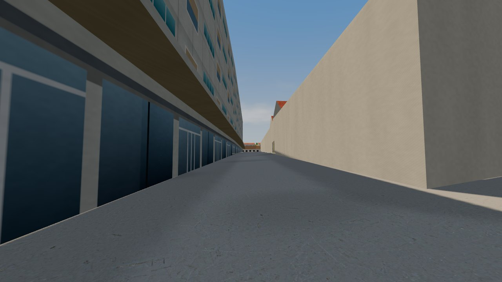 | 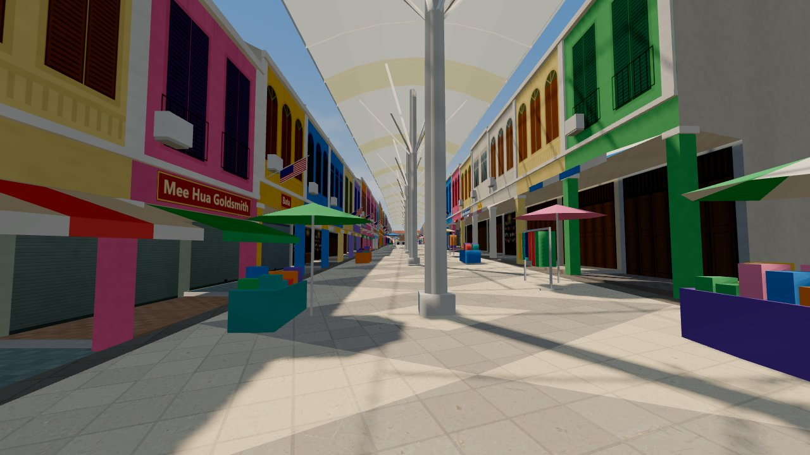 |
| 02 the mall, looking west | 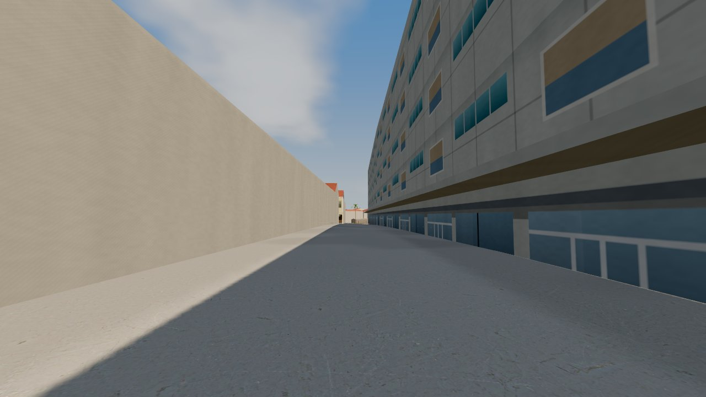 | 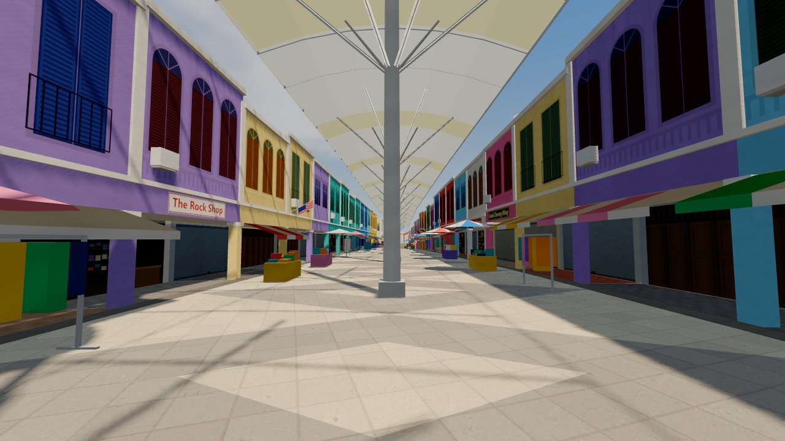 |
| 03 from Lorong Kai Joo (tour view 04) | 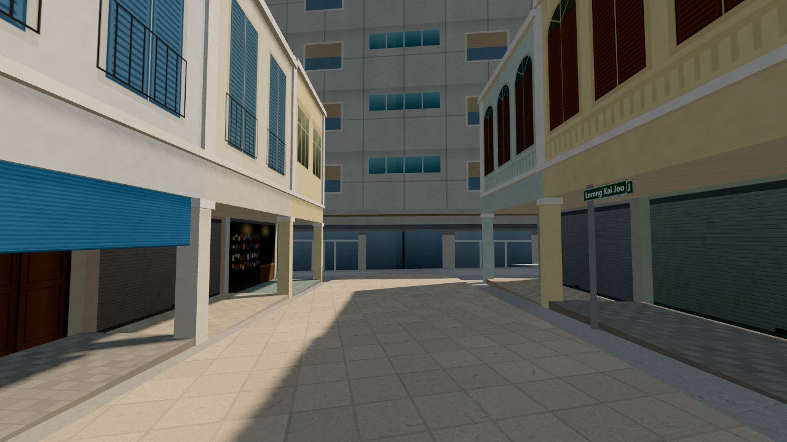 | 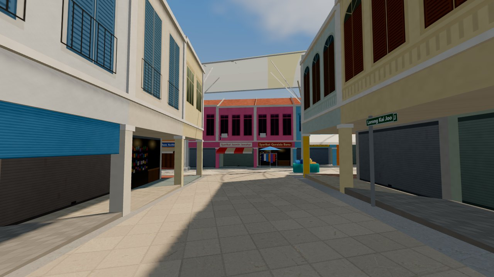 |
| 04 stalls and the south row | 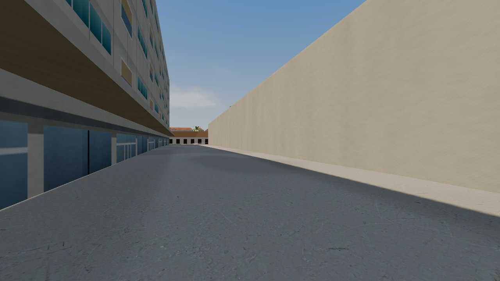 | 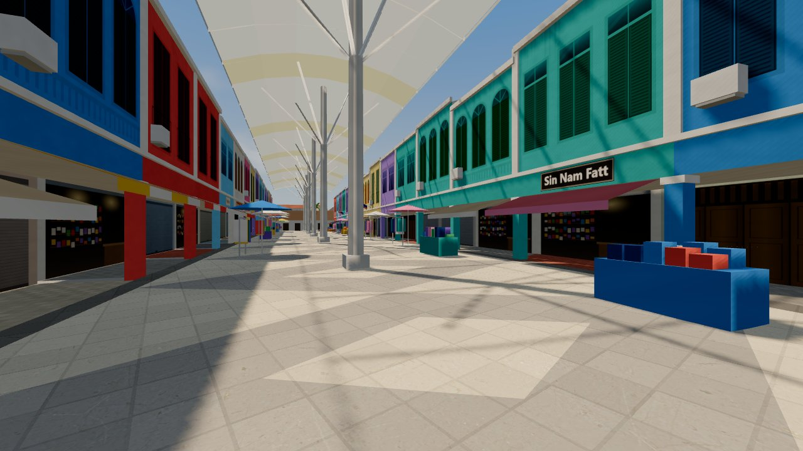 |
| 05 from above | 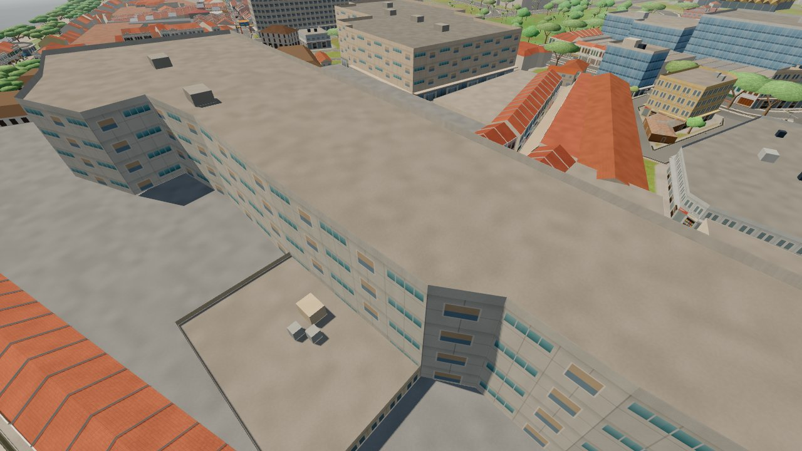 | 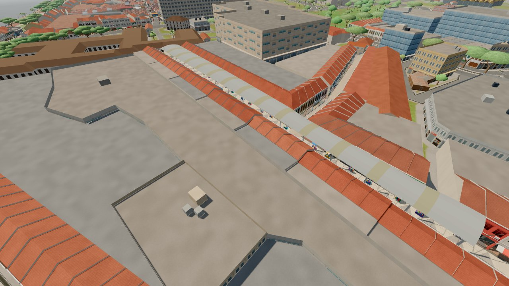 |
| 06 Gambier row from the car park (tour view 05) | 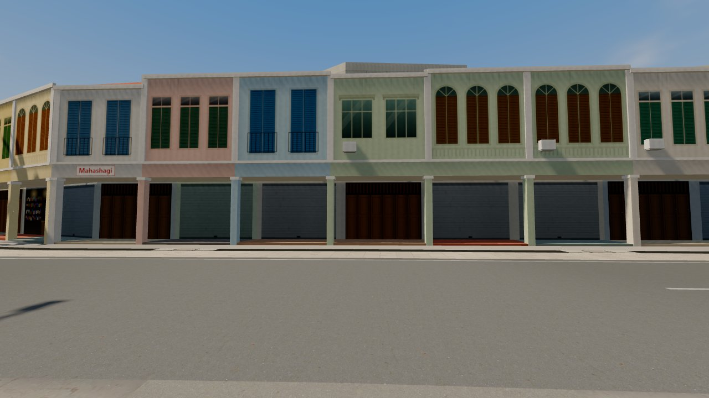 | 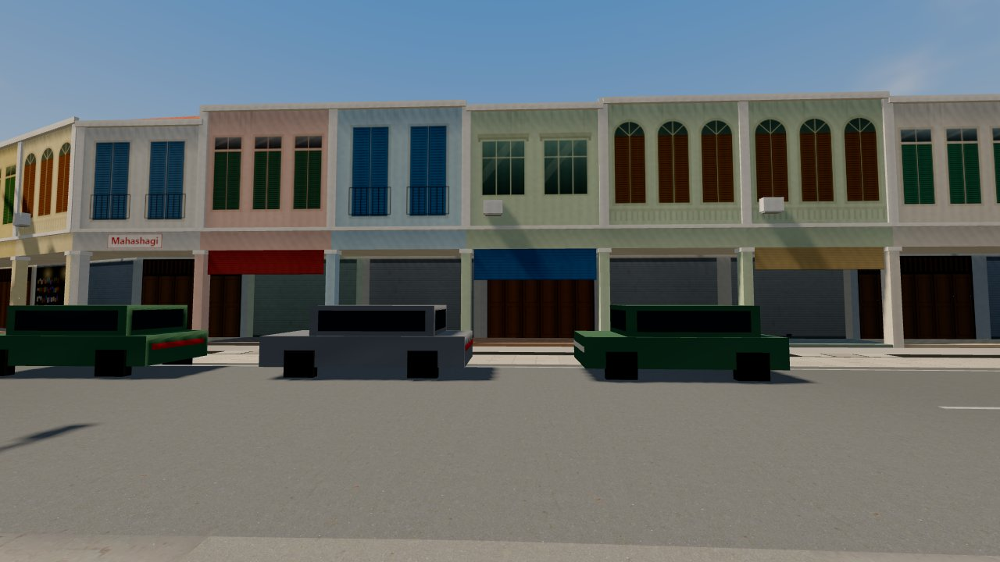 |
| 07 along Jalan Gambier (tour view 01) | 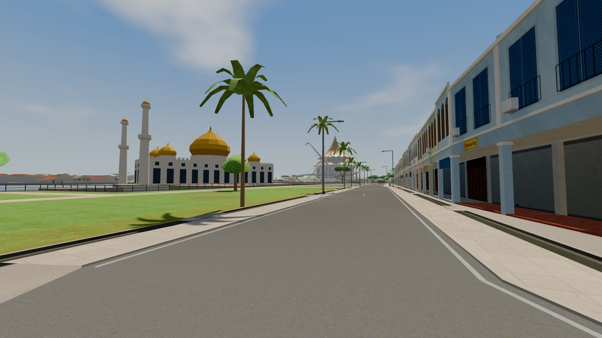 | 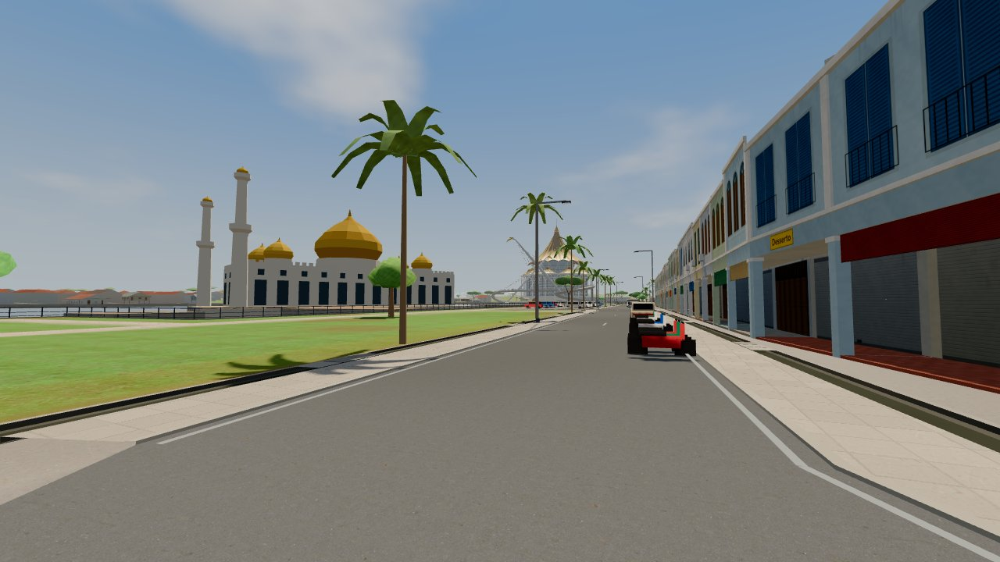 |
| 08 Gambier kerb, looking west | 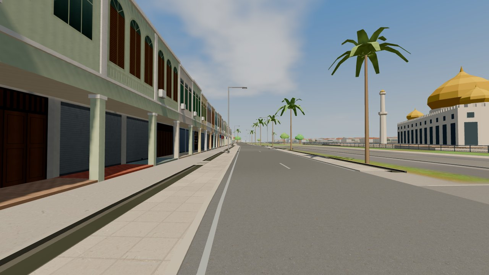 | 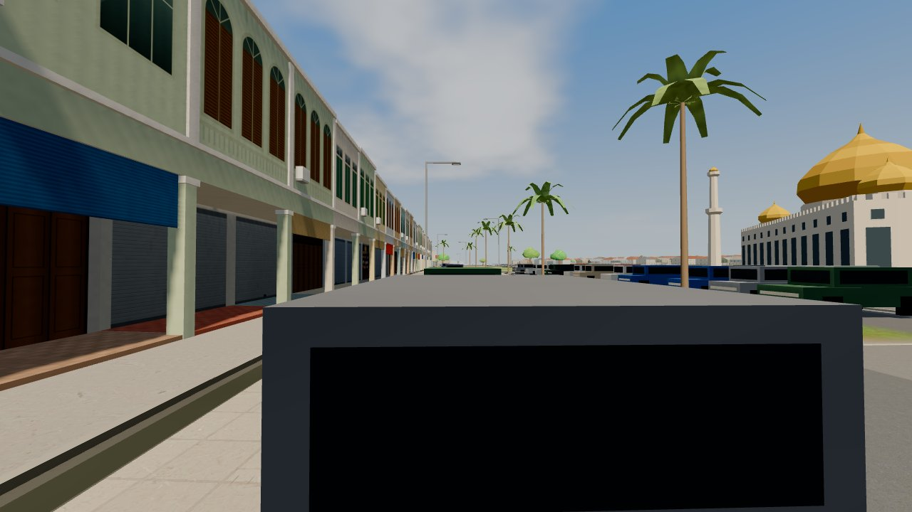 |
| 09 riverside car park | 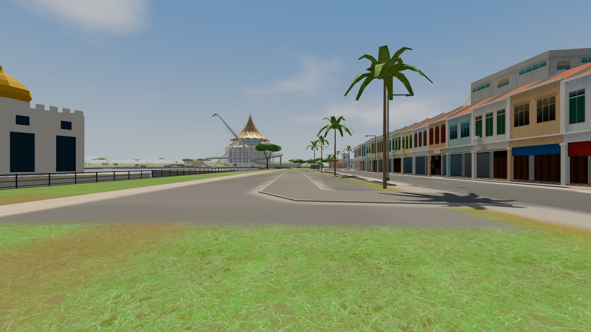 | 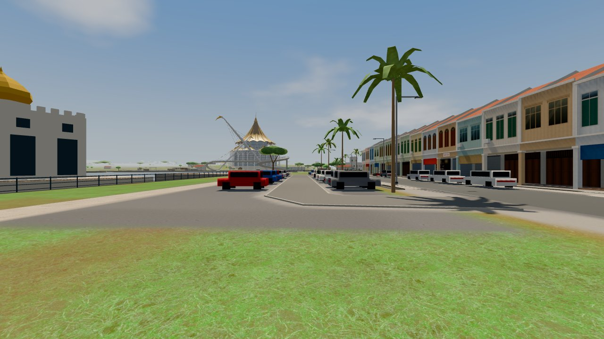 |

## Numbers (this place alone)
| Measure | Before | After |
|---|---|---|
| Chunk -1_-1 triangles / meshes (read in the running game, Medium) | 27,480 / 21 | 46,420 / 21 (+69 %) |
| New draw calls, materials, shader programs, textures, downloads | | 0, 0, 0, 0, 0 |
| Desktop fps in the nine views (Medium, 1280x720) | 60 | 60 |

**Over the per-place guide (+12 % triangles in its chunk).** Chunk -1_-1 was one of the lightest in the old town
(river, blank block interiors): the place adds about 18,900 triangles, the same order as the Waterfront kit (+20,900 over
three chunks), but here that is +69 % of a small chunk. After the place the chunk is still about half the size of
chunk 0_-1 (91,600). Where the triangles are: 74 new arcade lots (+6,700), stalls, cars, kapcai, columns, awnings and
flags in the structure mesh (+10,100), canopy fabric (+1,300), paving (+700).
Everything is merged into meshes the chunk already had: paving into the paving road layer, the canopy fabric into the
lane-marking mesh (unlit, so it reads as cloth with daylight behind it and throws no shadow on the street), everything
else into the structure mesh; the lots are ordinary rows of the generic shophouse generator. On the Low preset the
canopy has four panels across instead of six, stalls carry fewer goods, and there are no flags or awning valances.
The phone benchmark pair and the start-up reading cover places 3 and 4 together: `docs/night/m5b/NOTES.md`.

## How it works
- `src/world/district/indiaStreet.ts` (pure): the two frontage lines, the street frame (`indiaSpine`: a node every
  3 m with the width across), `patchHeroData` (rewrites the chunk's building list when it is loaded: seven stepped
  pieces for the north row, India Street added as a frontage to the other blocks), the lot paint rule
  (`heroLotStyle`, read by `arch/Shophouse.ts`), columns, stalls, parked vehicles, what blocks a walker
  (`heroObstacles`, read by `CollisionWorld`), and which lot a mapped business hangs its board on (`indiaSign`, read by
  `places/PlaceIndex.ts`).
- `src/world/district/IndiaStreetMesh.ts`: paving, canopy, stalls, awnings, flags, cars and kapcai, called from
  `RoadBuilder` for chunk -1_-1.
- Tests: `tests/unit/m5-india.test.ts` (7), `tests/e2e/m5-india.spec.ts` (the mall and the new arcade are walkable end
  to end; a canopy column stops a walker).

## Not done, honestly
- No lot is verified: the two photographs show the street's form, not which shop is which.
- The canopy is a plain vault. The real one has branching "tree" columns of a particular design, a blue star-burst
  ornament and hanging banners; ours only suggests them. It is unlit cloth, so it will not darken at night (M6).
- Stalls are blocks of colour: no people, no hangers, no price cards.
- Cars are simple boxes with a window band (the hand-built section's car models cannot be used in a chunk mesh).
- Jalan Gambier's shop side has no goods on the five-foot way (spice sacks, crates), and its river side is unchanged.
- The Kai Joo arcade and the India Street arcade of the same block meet at the corner without a corner pier.
- The rest of the north block behind the new row is a plain two-storey mass with a flat roof.
- Parked cars stand on the outer 1.9 m of Jalan Gambier's carriageway; no parking bays are painted.
