# M5 place 1: Main Bazaar frontage and the Kuching Waterfront promenade

Built on the V9 arcade (all 71 Main Bazaar lots already carry it). This place adds the **Waterfront identity kit** the
V3 review listed as missing, kapcai at the kerb, and the Square Tower's forecourt. Switch: `?m5=0` gives the N1-M4 state.

## What a player now sees
- A paved riverside walk up to 9 m wide behind the railing, in muted terracotta bays with granite cross bands, a granite
  coping and border, and a ring medallion every 33 m.
- A dark cast-iron railing with ring panels (posts with caps, three rails) in place of the three plain bars.
- Festoon lights slung from lamp post to lamp post; palms in pairs between the rain trees; litter bins.
- Rows of kapcai motorbikes, nose to the kerb, in the empty parking bays of Main Bazaar.
- The Square Tower stands on a paved apron with a lamp at each corner and benches. Its own form is unchanged.

## References
| Photo (Wikimedia Commons) | Author, licence | Used for | Shipped |
|---|---|---|---|
| `A five foot way in Kuching, Sarawak.jpg` | chipmunk_1, CC BY-SA 2.0 | arcade form (V9): painted round arches, tiled floor, chick blind | `public/reference/main-bazaar-five-foot-way.jpg` |
| `010984 Kuching (Borneo).jpg` | Matthias Bethke, CC BY-SA 4.0 | arcade form (V9): plastered arches, stalls | `public/reference/main-bazaar-arcade.jpg` |
| `Kuching Waterfront (15811151426).jpg` | Bernard Dupont, CC BY-SA 2.0 | palms and rain trees on the bank, a riverside pavilion | `public/reference/waterfront-east-end.jpg` |
| `The Waterfront, Kuching, Sarawak.jpg` | Fabio Achilli, CC BY 2.0 | paving, ring-panel railing, lamp posts | no (`consulted` in the manifest) |
| `Kuching Waterfront (17586892988).jpg` | Marufish, CC BY-SA 2.0 | promenade, benches, trees | no |
| `Kuching Waterfront - Flickr - Dustin Iskandar.jpg` | Dustin Iskandar, CC BY 2.0 | festoon lights | no |

All are recorded in `public/reference/manifest.json`. The last three were read by the V3 review (docs/V3_REPORT.md,
section 5 and item 10.2: "swirl-mosaic sett paving, the cast-iron railing with ring panels, festoon lights, tensile
canopies, food kiosks"); this session did not download them and built from that written reading. No Google imagery.
**Gap, unchanged:** no licensed photograph shows the Main Bazaar frontage lot by lot.

## Street frame
Unchanged from V3/V9: `MB_LINE` and `MB_NORTH` (the two mapped one-way carriageways, 5.4 m each, estimated), frontages
on mapped block edges, lots fitted to house numbers at 4.8 m. The promenade follows the mapped bank lines
(`ChunkData.rail`) within 120 m of Main Bazaar. The Square Tower apron follows OSM way 817868530.

## Elements: verified or not
| Element | Status | Basis |
|---|---|---|
| Bank line, Square Tower outline, jetties, mapped trees | Verified | OpenStreetMap |
| Five-foot-way arcade (V9) | Verified form | the two arcade photographs; which lots they show is unknown |
| Paved riverside walk | Verified form | photographs, as read by the V3 review; width 9 m, colours and bays are **Approximate** |
| Ring medallions in the paving | Approximate | a stand-in for the real swirl mosaics |
| Railing with ring panels | Verified form | as above; every dimension Approximate |
| Festoon lights, globe lamps, benches | Verified form | as above; positions Approximate (lamps every 11 m, by rule) |
| Palms on the bank | Verified form | `Kuching Waterfront (15811151426).jpg`; positions Approximate |
| Litter bins, kapcai at the kerb | Approximate | typical of the place |
| Square Tower apron, lamps, benches | Approximate | generic forecourt; the tower itself is hero place 4 |
| Tensile canopies, food kiosks | **Not built** | kiosk footprints stay generic |

## Lot table (Main Bazaar, Nos 1-71)
Status per lot: **Verified** = form and name from a photograph or the map; **Verified form** = form from a photograph;
**Approximate** = neither. No lot here is better than Approximate: house numbers are fitted (exact to about one lot) and
facades come from a rule matched to the street's general character. Twelve lots carry an occupant from open data.

| No | Block:edge | Storeys | Family | Shopfront | Status | Basis |
|---|---|---|---|---|---|---|
| 1 | 233690737:2 | 2 | Straits | doors | Approximate | number fitted from 11 addressed records; facade by rule |
| 2 | 233690737:2 | 2 | Straits | open | Approximate | number fitted from 11 addressed records; facade by rule |
| 3 | 233690737:2 | 2 | Straits | open | Approximate | number fitted from 11 addressed records; facade by rule |
| 4 | 233690737:2 | 3 | vernacular | open | Approximate | number fitted from 11 addressed records; facade by rule |
| 5 | 233690737:2 | 2 | vernacular | open | Approximate | number fitted from 11 addressed records; facade by rule |
| 6 | 233690737:2 | 2 | vernacular | open | Approximate | number fitted; occupant from open data: The Ranee Boutique Suites (osm, address+position). Facade not photographed |
| 7 | 233690737:2 | 2 | vernacular | half open | Approximate | number fitted; occupant from open data: The Ranee Boutique Suites (osm, address+position). Facade not photographed |
| 8 | 233690737:2 | 2 | vernacular | open | Approximate | number fitted from 11 addressed records; facade by rule |
| 9 | 233690737:2 | 2 | vernacular | doors | Approximate | number fitted from 11 addressed records; facade by rule |
| 10 | 233690737:2 | 2 | vernacular | open | Approximate | number fitted from 11 addressed records; facade by rule |
| 11 | 233690737:2 | 2 | vernacular | open | Approximate | number fitted; occupant from open data: Winnie’s Cafe (osm, address-only). Facade not photographed |
| 12 | 233690737:2 | 2 | Straits | half open | Approximate | number fitted; occupant from open data: Little Borneo (osm, address+position). Facade not photographed |
| 13 | 233690737:2 | 3 | vernacular | half open | Approximate | number fitted from 11 addressed records; facade by rule |
| 14 | 233690737:2 | 3 | vernacular | half open | Approximate | number fitted from 11 addressed records; facade by rule |
| 15 | 233690737:2 | 2 | Straits | half open | Approximate | number fitted from 11 addressed records; facade by rule |
| 16 | 233690737:2 | 2 | Straits | half open | Approximate | number fitted from 11 addressed records; facade by rule |
| 17 | 233690737:2 | 2 | Straits | half open | Approximate | number fitted from 11 addressed records; facade by rule |
| 18 | 233690737:2 | 3 | Straits | doors | Approximate | number fitted; occupant from open data: Johns Gallery (overture, address+position). Facade not photographed |
| 19 | 233690737:2 | 3 | Straits | doors | Approximate | number fitted from 11 addressed records; facade by rule |
| 20 | 233690737:2 | 3 | Straits | open | Approximate | number fitted from 11 addressed records; facade by rule |
| 21 | 233690737:2 | 3 | Straits | half open | Approximate | number fitted from 11 addressed records; facade by rule |
| 22 | 233690737:2 | 2 | Straits | open | Approximate | number fitted from 11 addressed records; facade by rule |
| 23 | 236495303:18 | 3 | Straits | half open | Approximate | number fitted from 11 addressed records; facade by rule |
| 24 | 236495303:18 | 3 | Straits | half open | Approximate | number fitted from 11 addressed records; facade by rule |
| 25 | 236495303:18 | 2 | vernacular | open | Approximate | number fitted from 11 addressed records; facade by rule |
| 26 | 236495303:18 | 2 | Straits | open | Approximate | number fitted from 11 addressed records; facade by rule |
| 27 | 236495303:18 | 2 | Straits | roller shutter | Approximate | number fitted from 11 addressed records; facade by rule |
| 28 | 236495303:18 | 2 | Straits | roller shutter | Approximate | number fitted from 11 addressed records; facade by rule |
| 29 | 236495303:18 | 2 | Straits | open | Approximate | number fitted from 11 addressed records; facade by rule |
| 30 | 236495303:18 | 3 | vernacular | half open | Approximate | number fitted from 11 addressed records; facade by rule |
| 31 | 236495303:18 | 3 | vernacular | half open | Approximate | number fitted from 11 addressed records; facade by rule |
| 32 | 236495303:18 | 3 | Straits | doors | Approximate | number fitted; occupant from open data: Kelvin Gallery (overture, address+position). Facade not photographed |
| 33 | 236495303:18 | 2 | vernacular | half open | Approximate | number fitted from 11 addressed records; facade by rule |
| 34 | 236495303:18 | 2 | vernacular | open | Approximate | number fitted from 11 addressed records; facade by rule |
| 35 | 236495303:18 | 2 | vernacular | open | Approximate | number fitted from 11 addressed records; facade by rule |
| 36 | 236495303:18 | 3 | vernacular | open | Approximate | number fitted from 11 addressed records; facade by rule |
| 37 | 236495303:18 | 3 | vernacular | open | Approximate | number fitted from 11 addressed records; facade by rule |
| 38 | 236495303:18 | 3 | vernacular | doors | Approximate | number fitted from 11 addressed records; facade by rule |
| 39 | 236495303:18 | 3 | vernacular | open | Approximate | number fitted; occupant from open data: 328 Gallery (overture, address+position). Facade not photographed |
| 40 | 236495776:0 | 3 | deco | open | Approximate | number fitted from 11 addressed records; facade by rule |
| 41 | 236495776:0 | 2 | vernacular | open | Approximate | number fitted; occupant from open data: Guan Ho Leong Optical (overture, address+position). Facade not photographed |
| 42 | 236495776:0 | 2 | Straits | half open | Approximate | number fitted; occupant from open data: JD Massage Centre (osm, osm-name-match+address-duplicate). Facade not photographed |
| 43 | 236495776:0 | 2 | Straits | open | Approximate | number fitted from 11 addressed records; facade by rule |
| 44 | 236495776:0 | 2 | vernacular | open | Approximate | number fitted from 11 addressed records; facade by rule |
| 45 | 236495776:0 | 2 | vernacular | open | Approximate | number fitted from 11 addressed records; facade by rule |
| 46 | 236495776:0 | 3 | vernacular | doors | Approximate | number fitted from 11 addressed records; facade by rule |
| 47 | 236495776:0 | 3 | vernacular | open | Approximate | number fitted from 11 addressed records; facade by rule |
| 48 | 236495776:0 | 2 | Straits | open | Approximate | number fitted from 11 addressed records; facade by rule |
| 49 | 236495776:0 | 2 | vernacular | open | Approximate | number fitted from 11 addressed records; facade by rule |
| 50 | 236495776:1 | 3 | Straits | doors | Approximate | number fitted from 11 addressed records; facade by rule |
| 51 | 236495776:1 | 2 | vernacular | half open | Approximate | number fitted from 11 addressed records; facade by rule |
| 52 | 236495776:1 | 2 | vernacular | open | Approximate | number fitted from 11 addressed records; facade by rule |
| 53 | 236495776:1 | 2 | Straits | open | Approximate | number fitted from 11 addressed records; facade by rule |
| 54 | 236495776:1 | 2 | Straits | open | Approximate | number fitted from 11 addressed records; facade by rule |
| 55 | 236495776:1 | 2 | Straits | half open | Approximate | number fitted; occupant from open data: Borneo Adventure (overture, address-only). Facade not photographed |
| 56 | 236495776:1 | 2 | Straits | roller shutter | Approximate | number fitted from 11 addressed records; facade by rule |
| 57 | 236495776:1 | 2 | Straits | half open | Approximate | number fitted from 11 addressed records; facade by rule |
| 58 | 236495776:1 | 2 | vernacular | doors | Approximate | number fitted; occupant from open data: Kek Lapis Sarawak Mama Su (overture, address+position). Facade not photographed |
| 59 | 236495776:1 | 2 | Straits | open | Approximate | number fitted from 11 addressed records; facade by rule |
| 60 | 236495776:2 | 2 | Straits | open | Approximate | number fitted from 11 addressed records; facade by rule |
| 61 | 236495776:2 | 2 | Straits | half open | Approximate | number fitted from 11 addressed records; facade by rule |
| 62 | 236495776:2 | 2 | vernacular | half open | Approximate | number fitted from 11 addressed records; facade by rule |
| 63 | 236495776:2 | 2 | vernacular | open | Approximate | number fitted from 11 addressed records; facade by rule |
| 64 | 236495776:2 | 2 | vernacular | open | Approximate | number fitted from 11 addressed records; facade by rule |
| 65 | 236495776:3 | 3 | deco | open | Approximate | number fitted from 11 addressed records; facade by rule |
| 66 | 236495776:3 | 2 | Straits | doors | Approximate | number fitted; occupant from open data: UD Siburan Jaya Sdn Bhd - LittleBorneo (overture, address-only). Facade not photographed |
| 67 | 236495776:3 | 2 | Straits | open | Approximate | number fitted from 11 addressed records; facade by rule |
| 68 | 236495776:3 | 2 | Straits | half open | Approximate | number fitted from 11 addressed records; facade by rule |
| 69 | 236495776:4 | 2 | Straits | roller shutter | Approximate | number fitted from 11 addressed records; facade by rule |
| 70 | 236495776:4 | 2 | Straits | open | Approximate | number fitted from 11 addressed records; facade by rule |
| 71 | 236495776:4 | 3 | deco | open | Approximate | number fitted from 11 addressed records; facade by rule |

Of the 71 lots, 22 are three storeys and 49 two (by rule). Generated by `planFront` (src/world/district/mainBazaar.ts).

## Before and after (fixed cameras)
Cameras: `tools/dev/m5-waterfront-views.json` (OP fly poses), captured with
`node tools/dev/street-shots.ts <dir> --views=tools/dev/m5-waterfront-views.json --quality=medium --size=1280x720 --jpeg --stats`.
"Before" is the same build with `?m5=0` (the flag-off path draws exactly what N1-M4 drew: unit-tested).

| View | Before | After |
|---|---|---|
| 01 promenade, looking west | 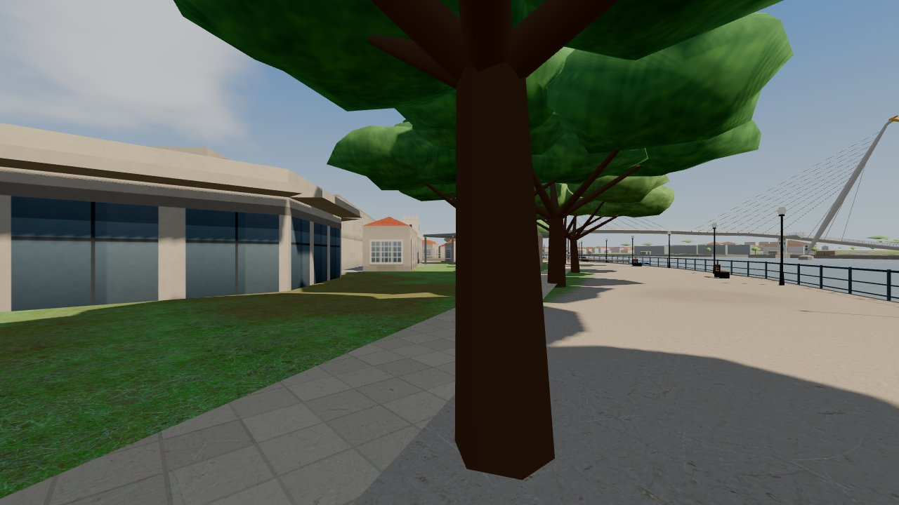 | 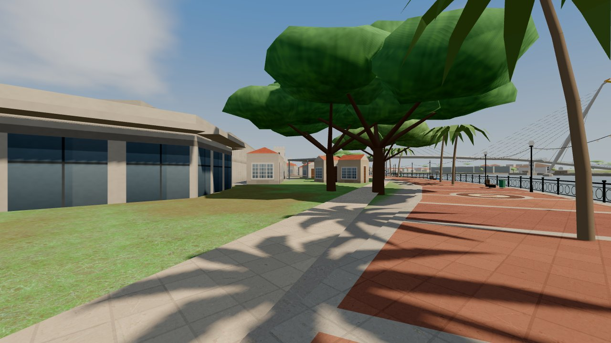 |
| 02 promenade, looking east | 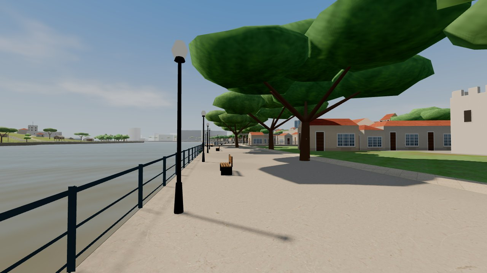 | 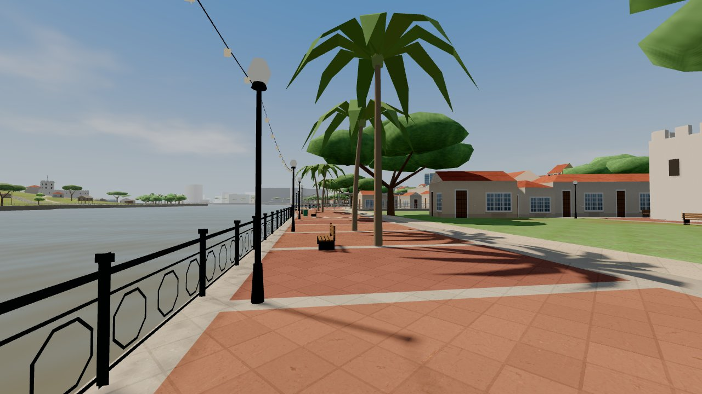 |
| 03 railing and the river | 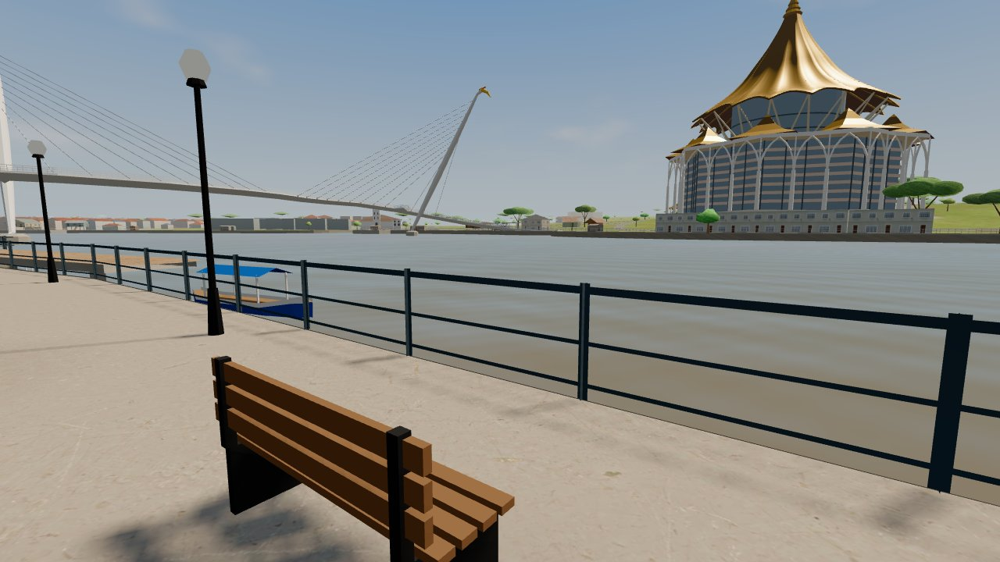 | 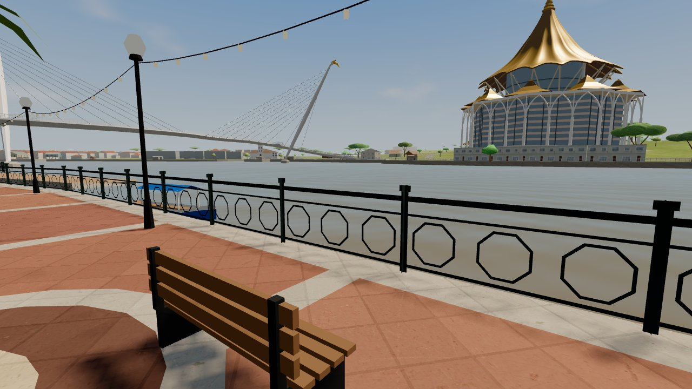 |
| 04 Square Tower forecourt | 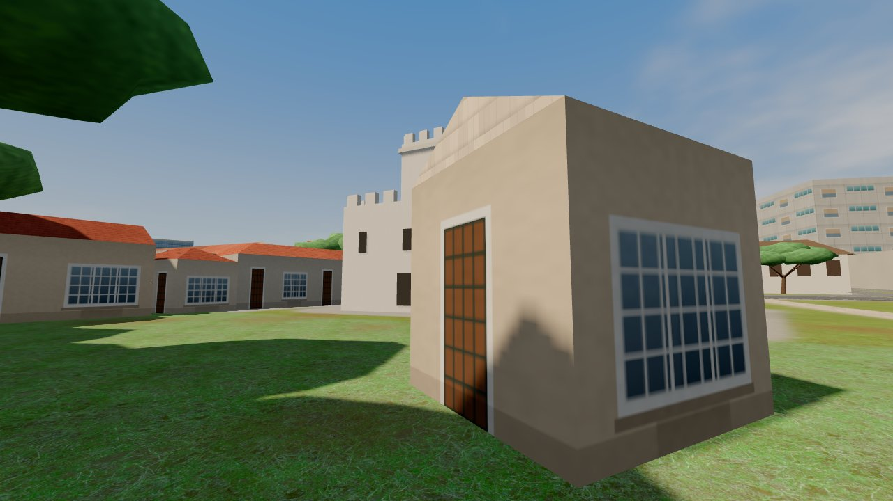 | 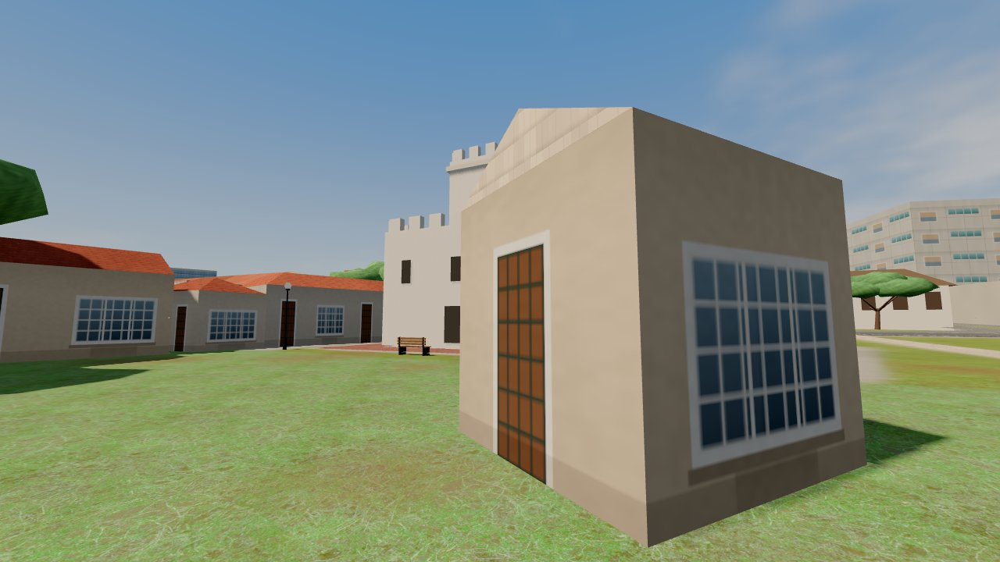 |
| 05 Main Bazaar from the kerb | 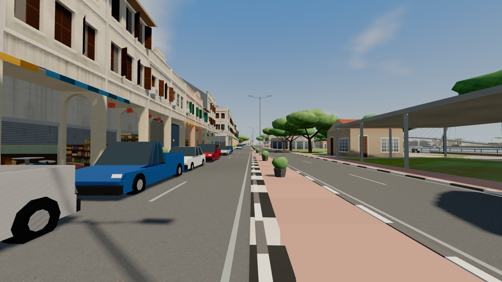 | 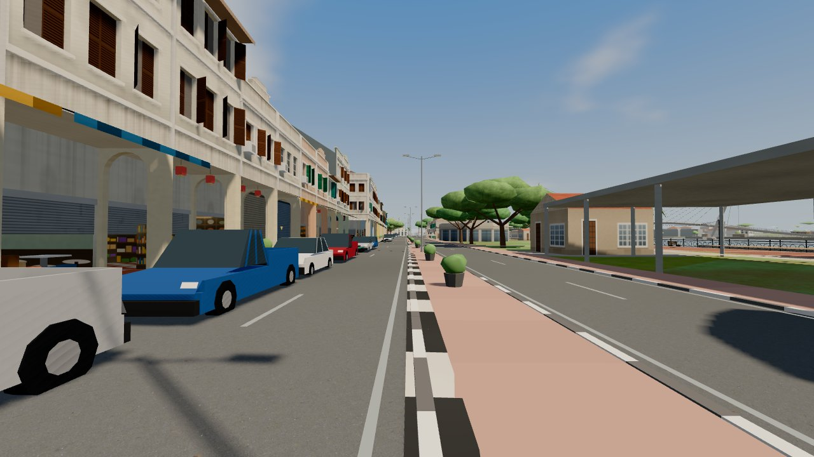 |
| 06 frontage from the walk |  | 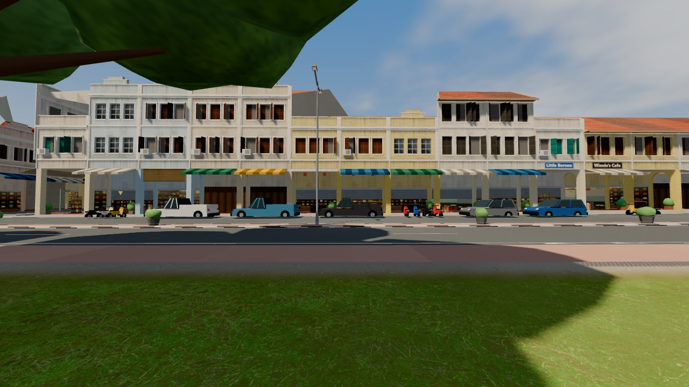 |
| 07 east promenade | 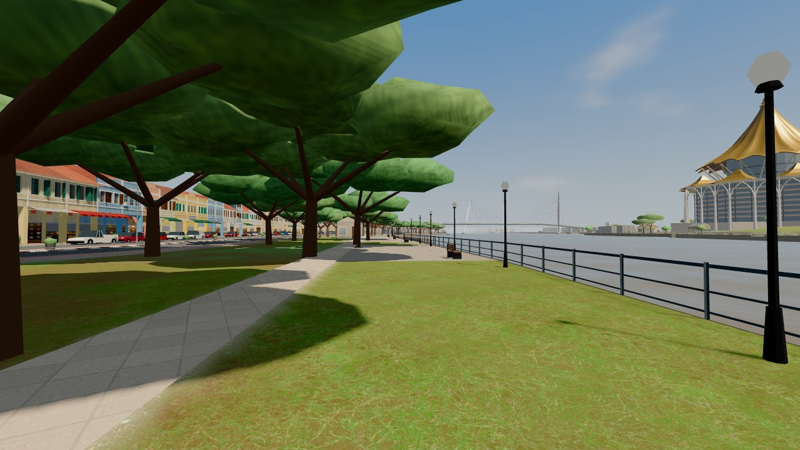 | 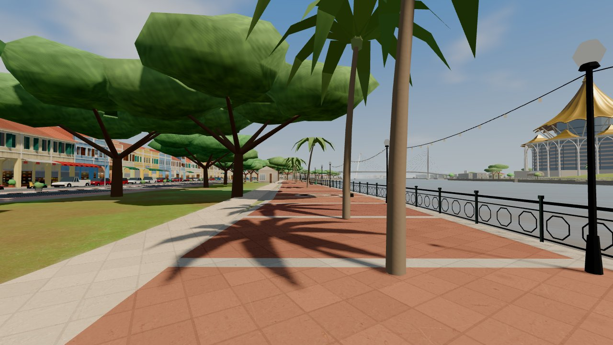 |
| 08 from above | 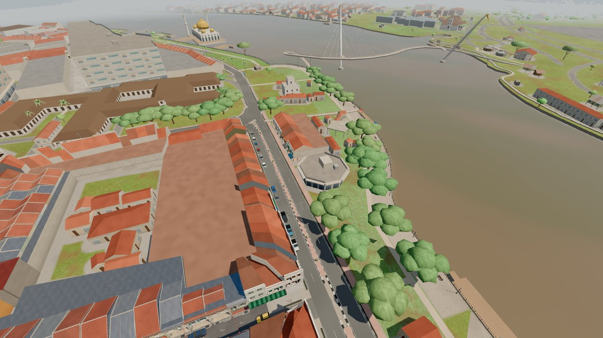 | 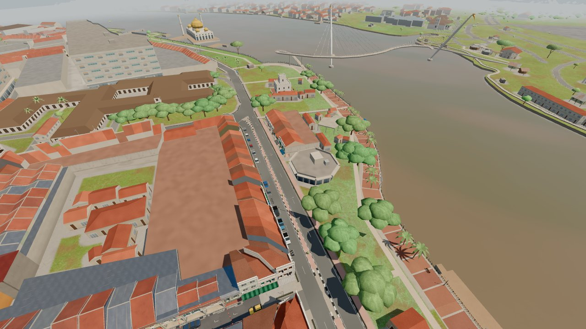 |

## Numbers (this place alone)
| Measure | Before | After |
|---|---|---|
| Chunk 0_-1 triangles / meshes (read in the running game) | 82,175 / 27 | 91,579 / 27 (+11.4 %) |
| Chunk 1_-1 | 24,409 / 19 | 30,287 / 19 (+24 %) |
| Chunk 1_0 | 96,894 / 27 | 102,485 / 27 (+5.8 %) |
| The three chunks together | 203,478 | 224,351 (+10.3 %) |
| New draw calls, materials, shader programs, downloads | | 0, 0, 0, 0 |
| Desktop fps in the eight views (Medium, 1280x720) | 60 | 60 |

Everything is merged into meshes the chunk already had: paving into the paving road layer, railing into the structure
mesh, props into the three district dressing meshes. On the Low preset the railing has no rings. Chunk 1_-1 is over
the +12 % guide for one place (it is a small chunk: +5,878 triangles); the three chunks together are under it.
The phone benchmark pair and the start-up reading cover both places together: `docs/night/m5a/NOTES.md`.

## How it works
- `src/world/district/promenade.ts` (pure): the paved walk as runs of nodes along each bank line (landward direction
  averaged over 9 m of bank so the walk never doubles back at a jog; narrowed where it would reach water or a
  carriageway), the Square Tower ring and its offset.
- `src/world/district/PromenadeMesh.ts`: paving and the ring-panel railing, called from `RoadBuilder` (`buildRoads`,
  `buildShore`).
- `src/world/district/props.ts`, `Dressing.ts`: festoon, palm, bin and kapcai props; palms take the place of every
  second rain tree on the walk; all block a walker except the festoons.
- Tests: `tests/unit/m5-waterfront.test.ts` (4), `tests/e2e/m5-waterfront.spec.ts` (the walk is walkable end to end).

## Not done, honestly
- No tensile canopies, no food kiosks, no observation tower, no musical fountain: forms not verified in this session.
- The real paving is a swirl mosaic of setts; ours is flat bays with ring medallions.
- No festoon across a chunk joint (two gaps of one span); bay and railing phases restart there too.
- Main Bazaar's facades are unchanged: still no lot verified from a photograph.
