# M5 place 5: Jalan Padungan, the Cat Column, the Great Cat and the Chinatown gate

Jalan Padungan is Kuching's Chinatown: two one-way carriageways with islands between them, lined by shophouses, with
a cat statue at each end. Until now neither statue existed, tour view 07 looked at a rain tree on an empty island, and
the Chinatown gate at the east end was drawn, and blocked, as a solid house standing across both carriageways.
Switch: `?m5=0` gives the N1-M4 state.

## What a player now sees
- **The Cat Column** (tour view 07, the Jalan Abell junction): a grey column with green leaves and red hibiscus, a
  gold crown ring and a blue crenellated block on top, four white cats sitting round its foot on a wide grey plinth.
- **The Great Cat of Kuching** (east end): a 2.5 m white cat sitting upright with one forepaw raised, on a white
  plinth inside a thin red frame, in a round planted bed with a black and white kerb.
- **The Chinatown gate** behind it: four salmon piers on dark red bases, a painted beam with "SELAMAT DATANG" on a
  cream panel, dark name panels, and five grey-blue tiled roofs with upturned corners. Both carriageways now pass
  under it; only the piers block.
- **The street between them** (about a kilometre of frontage, 197 lots): strong paint (crimson, yellow, cream, teal,
  red, white), painted fascia boards with gold trim under the beam on about half the lots, a few awnings, more
  air-conditioner units, kapcai in front of some shops.

## Which statue is which (a finding)
`landmarks.json` calls node 2404396149 "Cat Statue (Padungan)" and the brief expected the large white cat there. The
cached OpenStreetMap extract has three cat statues on this road. The supermarket Everrise is mapped 30 m from node
2404396149, and it is the building behind the column in the photograph `Cat Monument Kuching.jpg`: so the statue of
tour view 07 is the **Cat Column**. The white cat is node 4332185093 "Great Cat of Kuching", 570 m to the south-east,
20 m from the mapped "Kuching Chinatown Paifang" (way 1388131128): the pair in the gate photograph. Both were built.
The third (node 3592612107, "Cat Statue", 250 m north-west of the column) has no photograph and was not built.

## References
| Photo (Wikimedia Commons) | Author, licence | Used for | Shipped |
|---|---|---|---|
| `Cat Monument Kuching.jpg` | Medelam, CC BY-SA 4.0 | the column: plinth, four cats, shaft, flowers, crown ring, blue crenellated block | `public/reference/padungan-cat-column.jpg` |
| `Chinatown welcome gate at Jalan Padungan, Kuching, Sarawak, Malaysia.jpg` | Stefan Krasowski, CC BY 2.0 | the gate (piers, beam, the words SELAMAT DATANG, roofs) and the Great Cat (pose, plinth, bed, kerb, red frame) | `public/reference/padungan-gate-great-cat.jpg` |
| `Jalan Padungan 1928 shophouse architecture, Kuching, Sarawak, Malaysia.jpg` | Esther Siaw, CC BY 4.0 | crimson stucco, a green and gold fascia board, air-conditioner units, yellow and cream neighbours | `public/reference/padungan-1928-shophouse.jpg` |
| `Kuching, Sarawak, Malaysia 04.jpg` | StormChase, CC BY-SA 3.0 | red, yellow and white two and three storey blocks, black and white kerbs | `public/reference/padungan-shophouse-block.jpg` |

All four are recorded in `public/reference/manifest.json`. No new photograph was downloaded (all were already in
`docs/night/refs/img/`). No Google imagery.

## Frames (measured before modelling)
- **Cat Column:** node 2404396149 at (1104.1, 243.7), on the triangular island between ways 69063575, 68023796 and
  69063574. The plinth stands clear of every carriageway edge (unit-tested).
- **Gate:** way 1388131128, a strip 23.4 m long and 5.2 m wide. The north carriageway (way 69063574) crosses its
  axis 3.5 m from the north end, the south carriageway (way 68023796) 17.0 m from it. The four piers stand 0.5 m
  clear of each carriageway's mapped edge: at -0.7, 7.6, 12.9 and 21.2 m along the axis (bays of 8.3, 5.2 and
  8.3 m, as the photograph's wide outer bays and narrow middle bay). The gate is therefore 1.5 m north of the middle
  of its mapped outline.
- **Great Cat:** node 4332185093 at (1579.1, 551.1), on the mapped grass island, 21 m east of the gate. It faces
  away from the gate, as photographed.
- **Rows:** every frontage edge of a mapped shophouse block within 12 m of a way named Jalan Padungan, from the
  column to the gate: 22 blocks, 197 lots, 992 m (the table in `src/world/district/padungan.ts` is recomputed from the
  chunk data by a unit test). Frontages stand 3 to 8 m from the mapped centre line of a 6 m carriageway.

## Elements: verified or not
| Element | Status | Basis |
|---|---|---|
| Positions of both statues, the gate's outline, the carriageways, islands and blocks; the shop names on the boards | Verified | OpenStreetMap |
| Which statue stands at tour view 07 | Verified | Everrise is mapped beside the node and stands behind the column in the photograph |
| Cat Column: plinth, four white cats, grey shaft, leaves and hibiscus, gold crown ring, blue crenellated block | Verified form | column photograph |
| Cat Column: height (8.2 m), every other dimension, which way each cat looks, the cats' poses (all sit; the real ones differ), the relief and the lettering | Approximate | one photograph taken from below |
| Great Cat: white, sitting upright, one forepaw raised, low plinth, planted bed, black and white kerb, thin red frame | Verified form | gate photograph |
| Great Cat: size (2.5 m), the way it faces, the bed's radius, the shrubs | Approximate | one photograph |
| Gate: four piers on red bases, painted beam, the words SELAMAT DATANG, dark name panels, tiled roofs with upturned corners over three bays and two low wings | Verified form | gate photograph |
| Gate: pier positions, every height (clear 5.4 m, top 11.9 m), the west face (built like the east face, without the words), roof geometry | Approximate | derived from the mapped carriageways; one photograph of one face |
| Gate: the Chinese inscriptions; the column's lettering | **Not reproduced** | plain panels |
| Rows: two storeys, strong colours, fascia boards, air-conditioner units | Verified form | the two shophouse photographs |
| Rows: every single lot (paint, board, awning, air-conditioner), the kapcai | **Approximate** | by rule; no photograph shows a whole row, and the 1928 house of the photograph is not located |
| Three-storey blocks, the red Chinese-roof corner building, the grass median with its lamps | **Not built** | the data gives two storeys and no median |

Status per lot: all 197 lots **Approximate**. Cat Column, Great Cat and gate: **Verified form**.

## Before and after (fixed cameras)
Cameras: `tools/dev/m5-padungan-views.json` (OP fly poses), captured with
`node tools/dev/street-shots.ts <dir> --url=http://localhost:5175/[?m5=0] --views=tools/dev/m5-padungan-views.json --quality=medium --size=1280x720 --jpeg --stats`.

| View | Before | After |
|---|---|---|
| 01 Cat Column (tour view 07) | 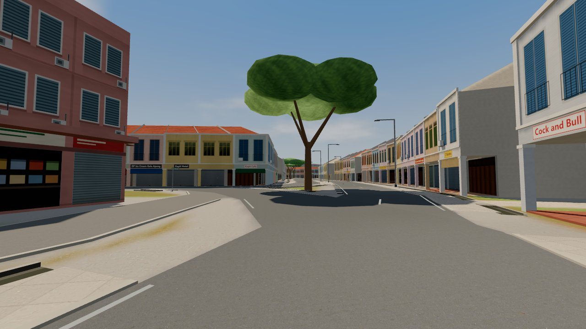 | 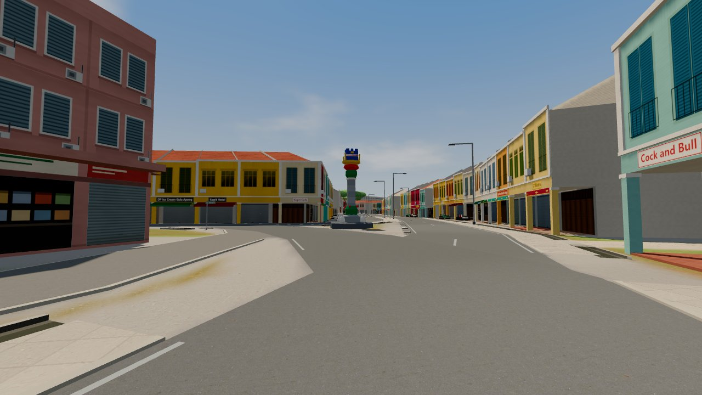 |
| 02 Cat Column, close | 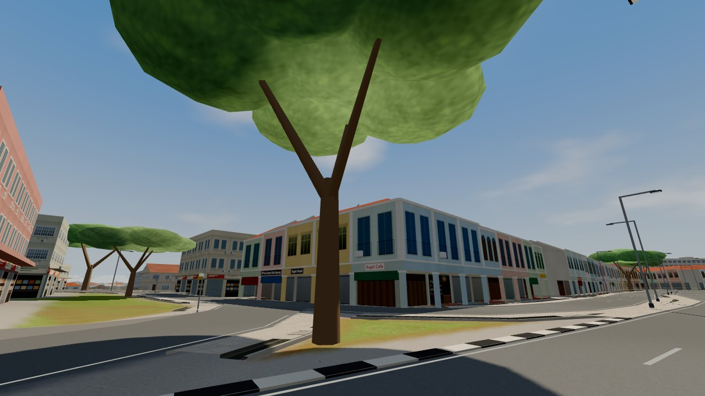 | 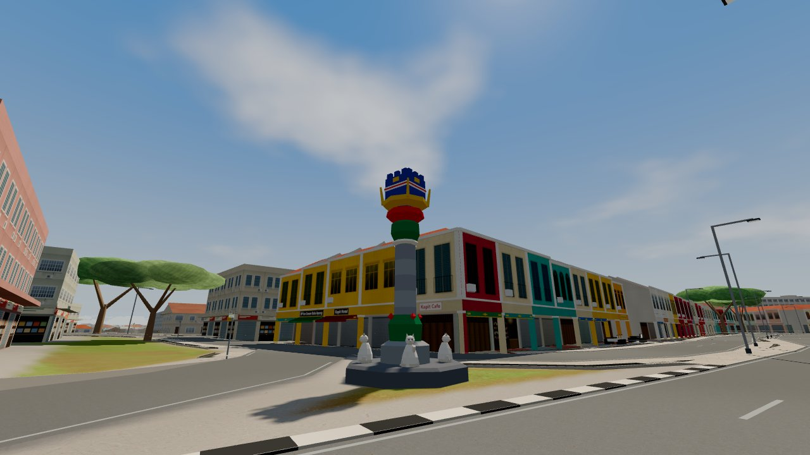 |
| 03 the rows, west end | 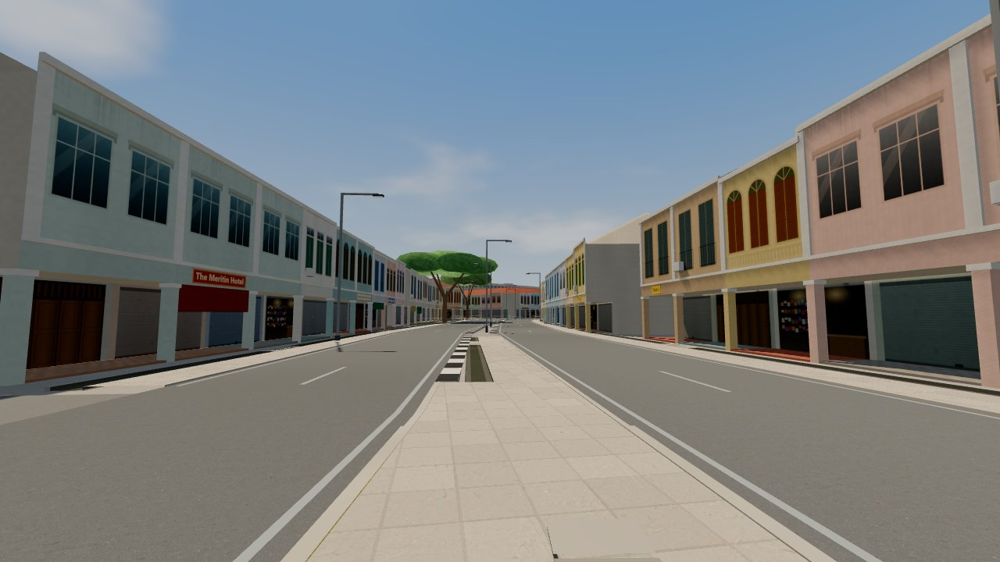 | 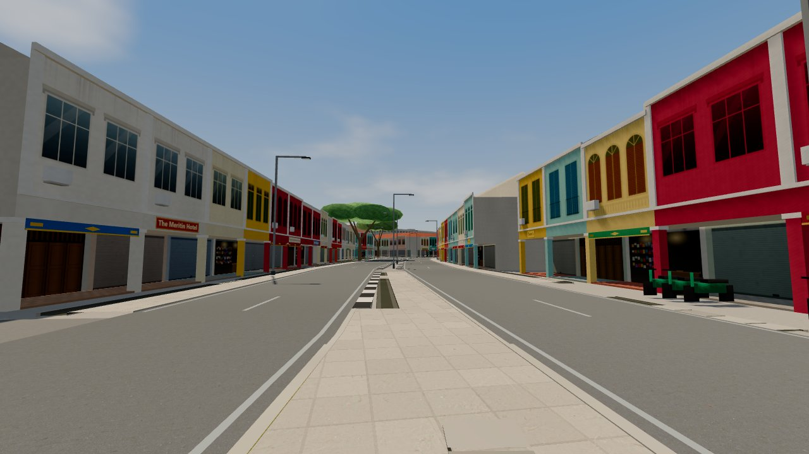 |
| 04 the rows, middle | 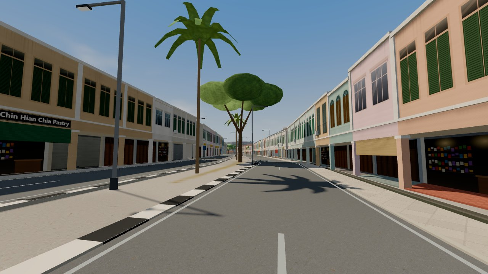 | 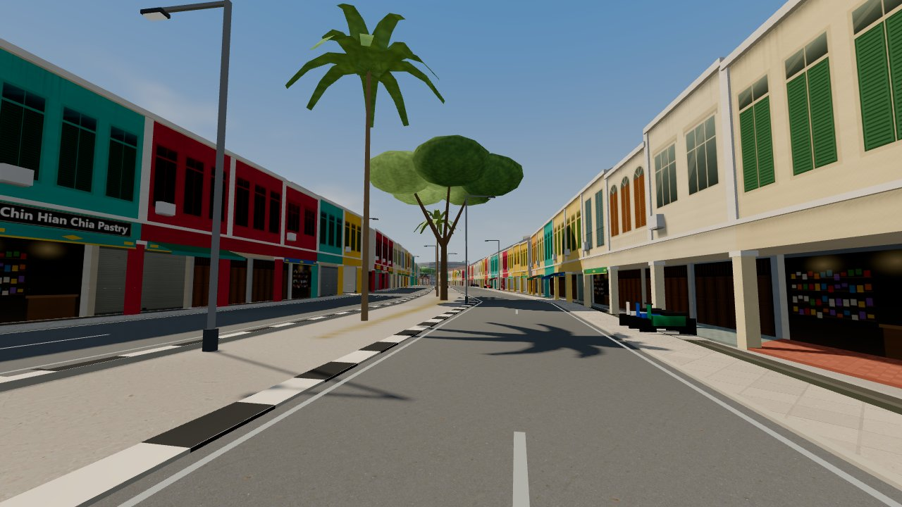 |
| 05 Great Cat and gate (the photograph's standpoint) | 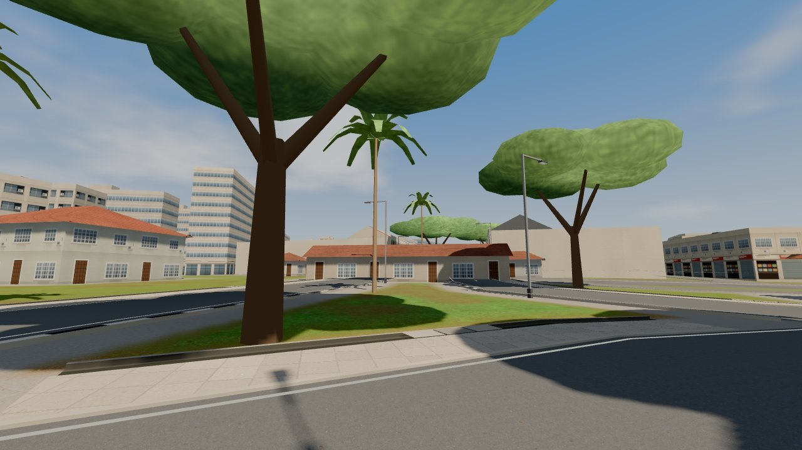 | 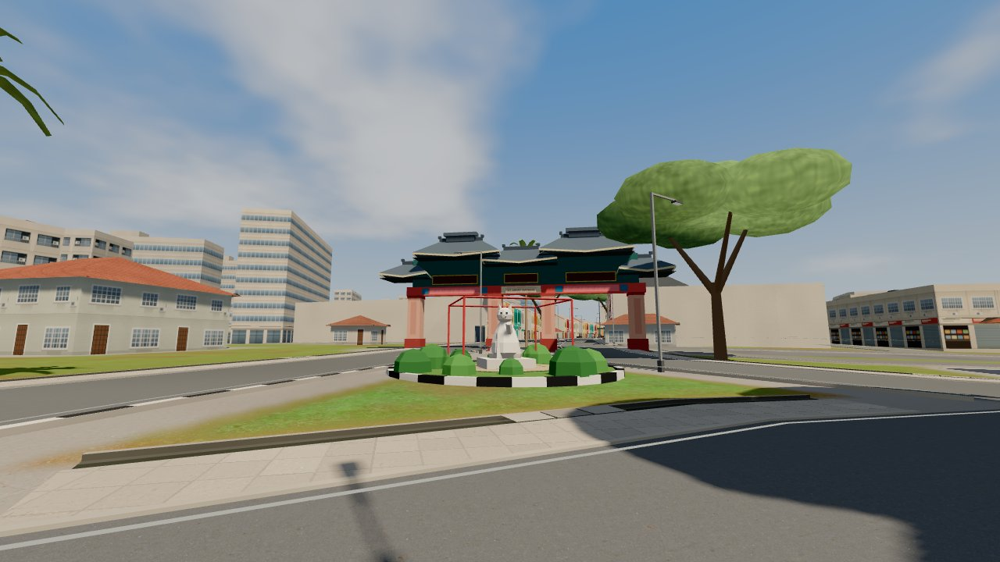 |
| 06 gate from the west | 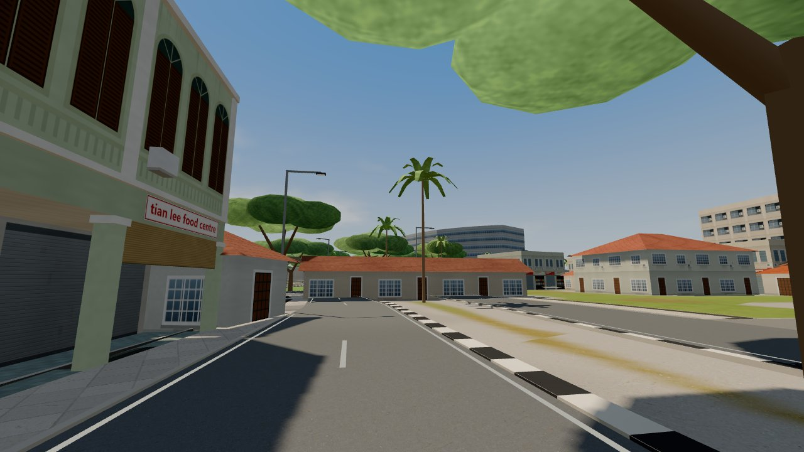 | 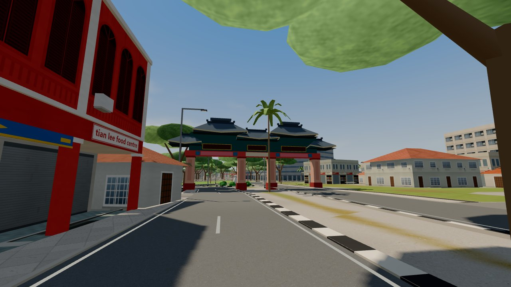 |
| 07 east end from above | 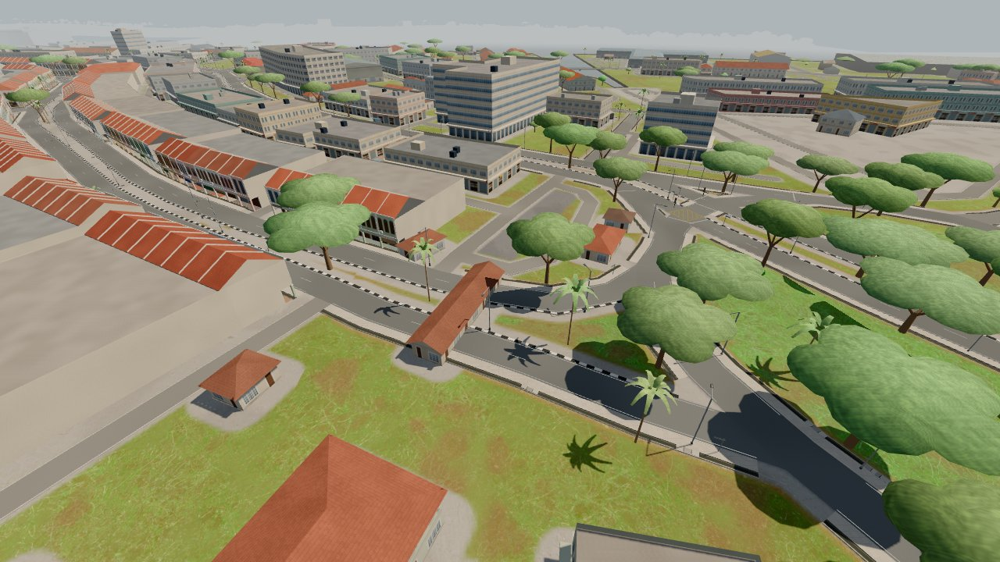 | 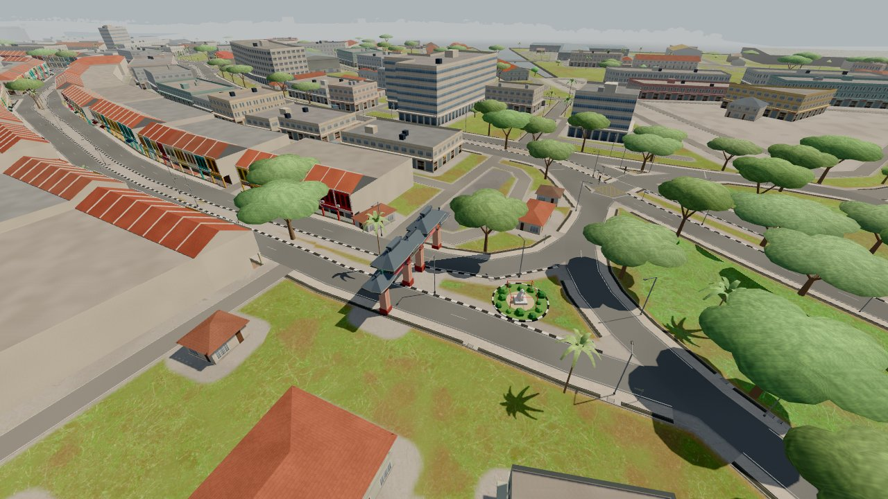 |

## Numbers (this place alone; read in the running game, Medium, `tools/dev/chunk-tris.mts`)
| Chunk | Before (triangles / meshes) | After | Change |
|---|---|---|---|
| 4_0 (Cat Column, west rows) | 22,310 / 20 | 24,432 / 21 | +9.5 %, one mesh (the column) |
| 4_1 | 19,773 / 20 | 20,839 / 20 | +5.4 % |
| 5_1 | 32,450 / 20 | 34,374 / 20 | +5.9 % |
| 5_2 | 21,079 / 20 | 21,235 / 20 | +0.7 % |
| 6_2 (gate, Great Cat) | 39,075 / 21 | 39,933 / 22 | +2.2 %, one mesh (gate and cat) |

Every chunk is under the +12 % guide. Two draw calls were added in all (one per statue site). All seven cameras hold
60 fps on the desktop at Medium. No download, no chunk JSON change.

## Collision and play
- The gate was a wall across Jalan Padungan for walkers and cars. Now only its four piers block (e2e: a walker goes
  under the north bay along the carriageway).
- The column's plinth, the Great Cat's plinth and each group of kapcai block. No inferred tree stands within 9 m of
  the column or 14 m of the Great Cat.
- The kapcai stand at least 1.4 m outside every carriageway edge (unit-tested); a frontage closer than that gets none.

## Not done
- No parked cars: the carriageways are mapped 6 m wide, and a kerbside row would leave a driven car 0.2 m.
- The 1928 shophouse's own front (pediment, date, bird finial): its lot is not located.
- The third cat statue, the grass median and its yellow lamps, three-storey blocks, Kuching South City Hall.
- No driving test passes the gate (the e2e walks under it); the phone bench does not run here.
