# M5 place 4: Plaza Merdeka, the Old Courthouse and the Square Tower

Three buildings round the west end of the old town. Two of them have licensed photographs, and the earlier models
did not match them: the Square Tower had a tower in the middle that does not exist, and the Old Courthouse's clock
tower was a plain box. Plaza Merdeka has no photograph; it had no entrance at all. Switch: `?m5=0` gives the N1-M4 state.

## What a player now sees
- **Square Tower:** a white two-storey block with a string course and a crenellated parapet, a taller crenellated
  **turret at one corner** with cross-shaped slits, three red-brown shuttered windows per face under white hoods with a
  shield, three small round-headed windows below, a door in the middle of the front.
- **Old Courthouse:** round white columns along every verandah wall, darker shingle roofs, and the **clock tower**: a
  white upper storey on six round columns over an open porch with steps, a lattice window with a small balcony, a
  clock with hands in a shaped parapet, a louvred cupola with a pyramid roof and a flagpole.
- **Plaza Merdeka:** an entrance on the face the mapped drop-off lane and footway lead to: a two-storey glazed
  portal in a white frame, a canopy on two columns, a paved forecourt with bollards and planters, and the mapped name
  over the door. Tour view 06 now shows a way in.

## References
| Photo (Wikimedia Commons) | Author, licence | Used for | Shipped |
|---|---|---|---|
| `Square Tower, Kuching.jpg` | Horatio Wong, CC BY-SA 4.0 | the front: corner turret, crenels, three shuttered windows with shields, the door | `public/reference/square-tower-front.jpg` |
| `Square Tower 03.jpg` | Yeo Jiun Tzen, CC BY-SA 4.0 | a side: three shuttered windows, three small round-headed windows below, string course | `public/reference/square-tower-side.jpg` |
| `KuchingOldCourtHouse.JPG` | Mattun0211, CC0 | the clock tower, the verandah columns, the shingle roofs | `public/reference/old-courthouse-clock-tower.jpg` |
| `Old Court House Complex, Kuching 01.jpg` | Yeo Jiun Tzen, CC BY-SA 4.0 | single-storey ranges under hipped roofs round a courtyard | `public/reference/old-courthouse-courtyard.jpg` |

All four are recorded in `public/reference/manifest.json`. No new photograph was downloaded (all were already in
`docs/night/refs/img/`). No Google imagery. **Plaza Merdeka has no licensed photograph** (docs/night/refs/PLACES.md,
section 4).

## Frames (measured before modelling)
- **Square Tower:** OSM way 817868530, a near-square outline. The model is fitted to it as before. The front is taken
  as the face turned furthest from the river (south-east): in the front photograph the DUN stands to the right behind
  the tower and the bridge to the left. The turret stands at the left end of that front, as photographed.
- **Old Courthouse:** OSM relation 10459393 (outer outline and courtyards). The clock tower is not mapped separately:
  it stands in front of the middle of the longest outer wall (the east range, facing Jalan Tun Abang Haji Openg), the
  same rule as before.
- **Plaza Merdeka:** OSM way 232212851 (19 vertices). The entrance is on the 15.7 m face of the stepped south-west
  corner, (-79.7, 14.4) to (-65.4, 20.8). A mapped drop-off lane off Jalan Pearl (way 1243941336) passes 8.5 m in front
  of it, and a mapped footway (way 1415532719) runs from that lane to the east end of this face: the map itself points
  at this face.

## Elements: verified or not
| Element | Status | Basis |
|---|---|---|
| Outlines and positions of all three buildings; the mall's name; the drop-off lane and footway | Verified | OpenStreetMap |
| Square Tower: white, two storeys, crenellated parapet, string course, **corner turret, no central tower** | Verified form | both photographs |
| Square Tower: three shuttered windows with hoods and shields, three small windows below (two faces), door on the front | Verified form | both photographs |
| Square Tower: the other two faces; which mapped face is the front; every dimension (turret 3.0 m square, 3.3 m above the parapet) | Approximate | built like the photographed side; background of the front photograph |
| Old Courthouse: white ranges, dark shingle hip roofs, round verandah columns | Verified form | both photographs |
| Clock tower: upper storey on six columns, porch with steps, lattice window, balcony, clock, louvred cupola | Verified form | clock-tower photograph |
| Clock tower position; column spacing (3.3 m); a verandah on every wall of the outline; roof geometry (truncated hips); every dimension | Approximate | not mapped, not measurable from the photographs |
| Plaza Merdeka entrance: portal, canopy, forecourt, bollards, planters | **Approximate** | no photograph; a generic mall entrance on the face the mapped lane and footway lead to |
| Plaza Merdeka's own form (the hotel tower above the mall, facade materials, height) | **Not built** | unchanged generic mall block |
| General Post Office, Round Tower, The Pavilion (Textile Museum), Brooke Memorial | **Not built** | still generic buildings; the GPO has a usable photograph (`gpo_colonnade`) |

There are no lots in this place: each building is one mapped outline. Status per building: Square Tower **Verified
form**; Old Courthouse **Verified form** (clock tower position Approximate); Plaza Merdeka **Approximate**.

## Before and after (fixed cameras)
Cameras: `tools/dev/m5-plaza-views.json` (OP fly poses), captured with
`node tools/dev/street-shots.ts <dir> --url=http://localhost:5175/[?m5=0] --views=tools/dev/m5-plaza-views.json --quality=medium --size=1280x720 --jpeg --stats`.

| View | Before | After |
|---|---|---|
| 01 Plaza Merdeka corner (tour view 06) | 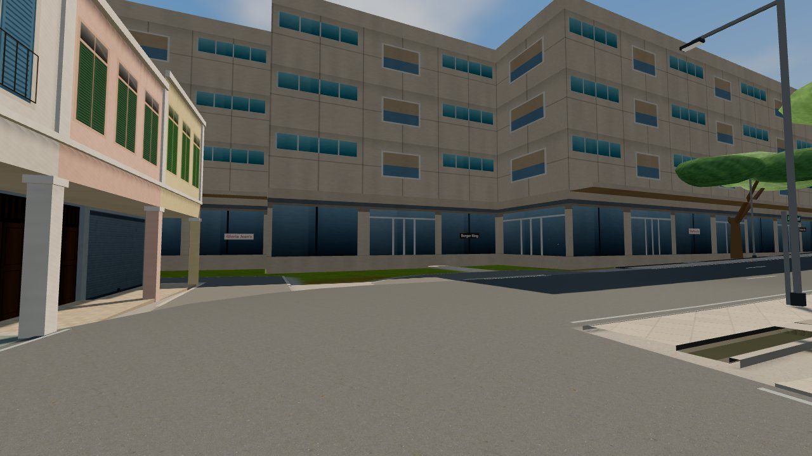 | 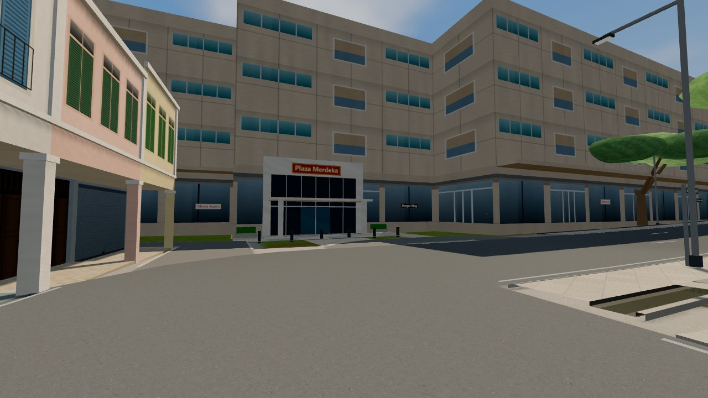 |
| 02 the entrance | 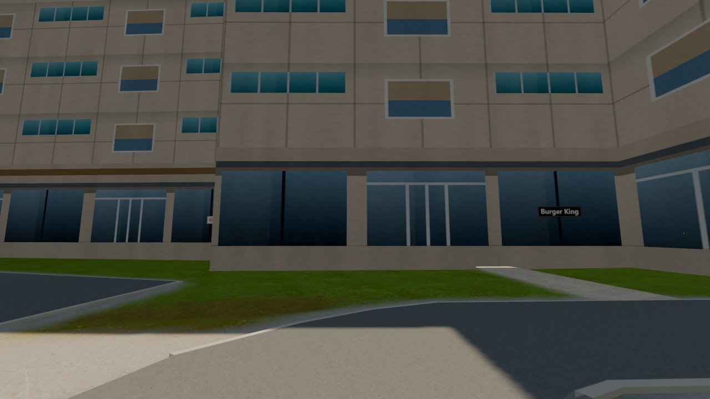 | 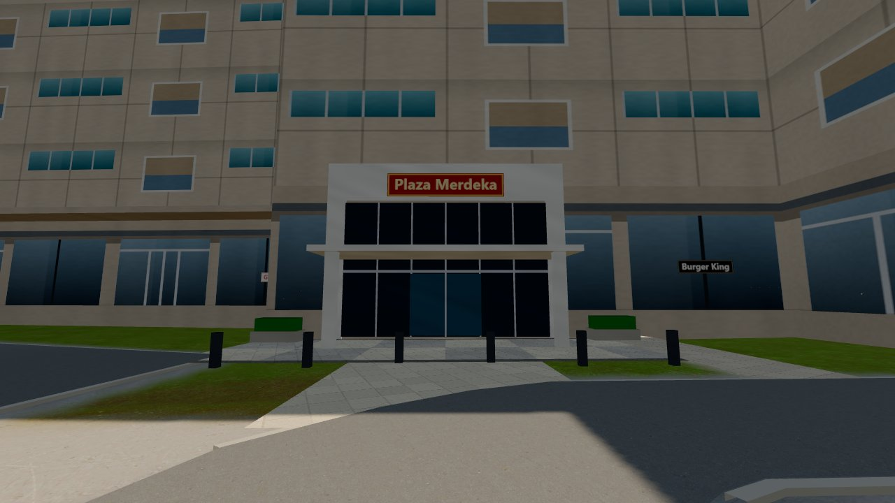 |
| 03 Square Tower from the south | 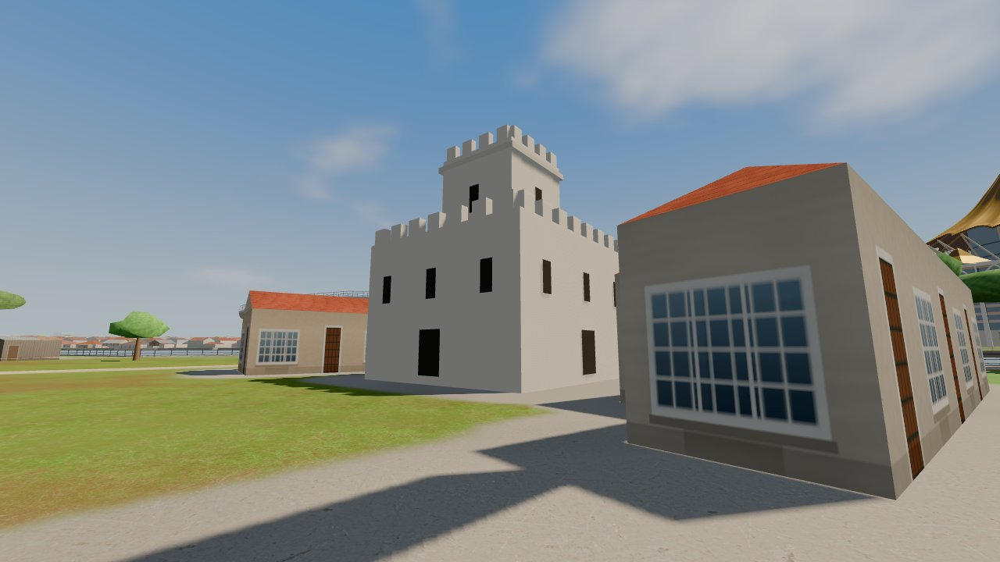 | 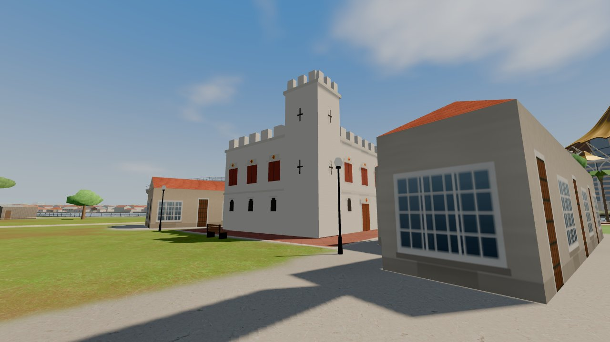 |
| 04 Square Tower from the east |  | 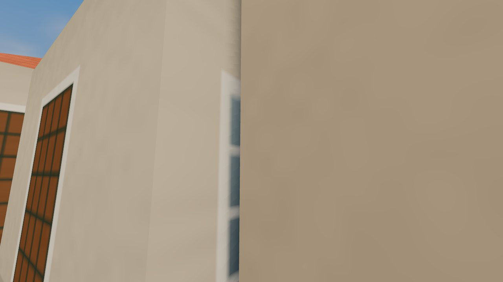 |
| 05 Square Tower from the river walk | 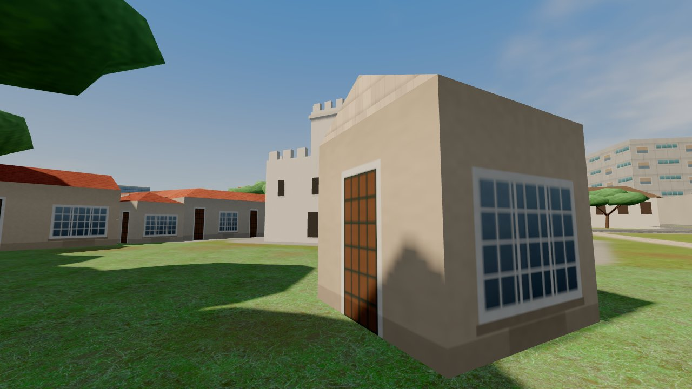 | 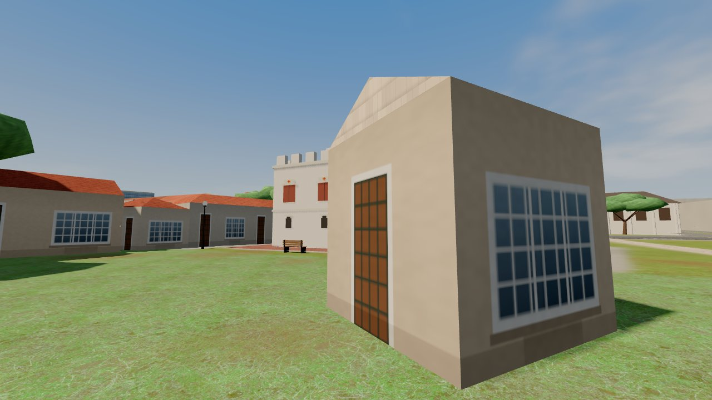 |
| 06 Old Courthouse from above | 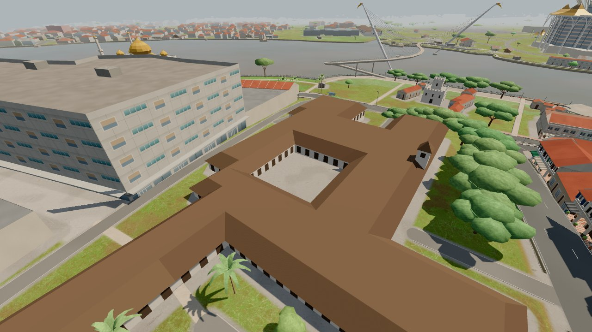 | 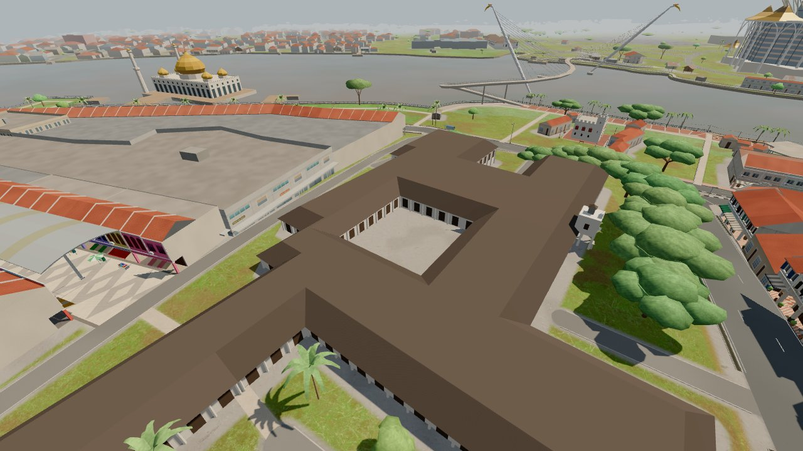 |
| 07 the clock tower | 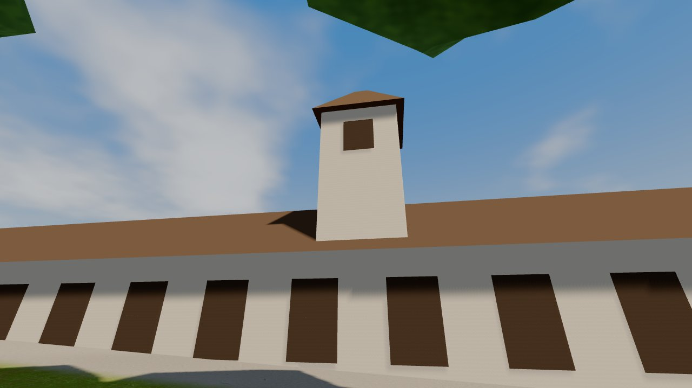 | 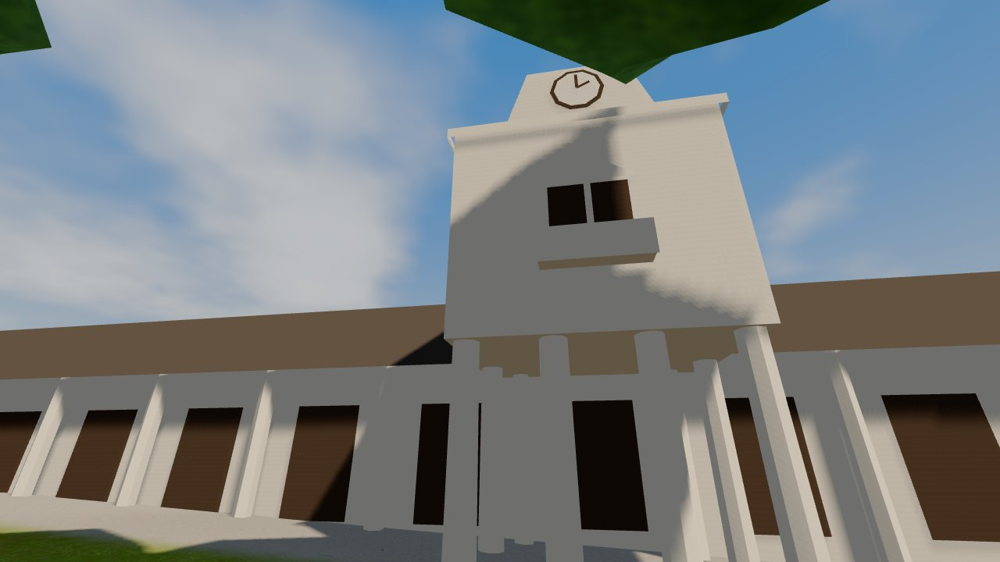 |
| 08 the east range | 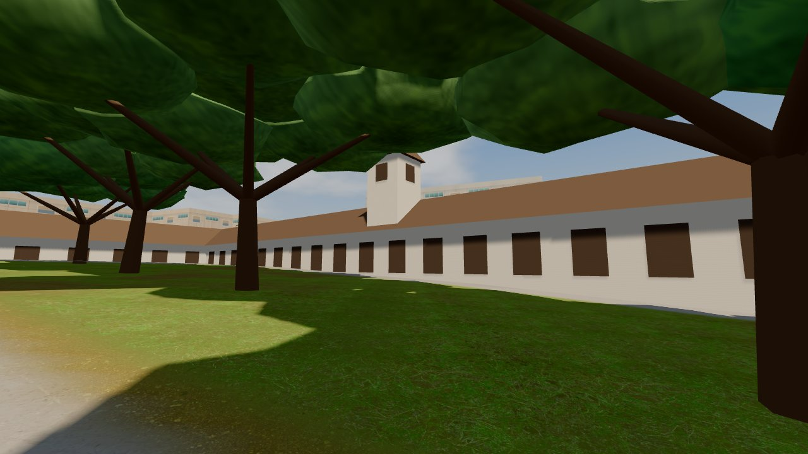 | 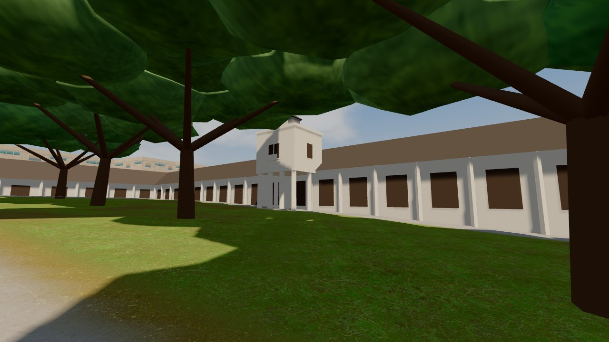 |

## Numbers (this place alone)
| Measure | Before | After |
|---|---|---|
| Chunk 0_-1 triangles / meshes (courthouse and tower; read in the running game, Medium) | 91,579 / 27 | 94,366 / 27 (+3.0 %) |
| Square Tower model | 530 | 744 |
| Old Courthouse model | 508 | 3,081 |
| Chunk -1_-1 (the mall entrance, after place 3) | 46,420 / 21 | 46,646 / 21 (+0.5 %) |
| New draw calls, materials, shader programs, textures, downloads | | 0, 0, 0, 0, 0 |
| Desktop fps in the eight views (Medium, 1280x720) | 60 | 60 |

Within the per-place guide (+12 % triangles). The two landmark models keep their one mesh each; the entrance goes
into the structure mesh and the paving road layer of the chunk that holds the mall; its name is one more board in
that chunk's sign mesh. The phone benchmark pair and the start-up reading cover places 3 and 4 together:
`docs/night/m5b/NOTES.md`.

## How it works
- `src/world/landmarks/squareTower.ts`: the verified form (`TOWER_FORM`); the earlier model is kept for `?m5=0`.
- `src/world/landmarks/oldCourthouse.ts`: `verifiedCourthouse` (verandah columns, the clock tower, `CLOCK_TOWER`);
  the earlier tower is kept for `?m5=0`.
- `src/world/district/plazaMerdeka.ts` (pure: the entrance face, props, obstacles, the sign) and `PlazaMesh.ts`,
  called from `RoadBuilder`, `CollisionWorld` and `places/PlaceIndex.ts`.
- Tests: `tests/unit/m5-plaza.test.ts` (3), `tests/e2e/m5-plaza.spec.ts` (a walker reaches the door, the canopy
  columns are solid, the tower's highest part stands at a corner, the courthouse model carries the new parts).

## Not done, honestly
- Collision for the two landmarks is still their mapped outline: the clock tower's porch cannot be walked under, and
  the turret's 0.2 m projection does not block.
- The Square Tower's hoods are flat panels (the real ones are curved), its shields are three flat patches, and there
  are no downpipes or the "1879" date.
- The courthouse roofs are still truncated hips with a flat top; the real ridges are not modelled. There is no lawn,
  hedge or paved forecourt inside the courtyards, and the columns stand against the wall rather than in front of an
  open verandah.
- The clock always shows the same time.
- Plaza Merdeka is still a generic block behind its new entrance; its glass doors do not open.
- The General Post Office (round-arched arcade, Corinthian portico), the Round Tower, The Pavilion and the Brooke
  Memorial are not built.
